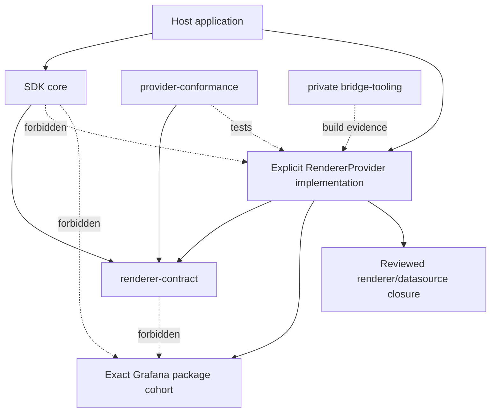

# Bounded Grafana Renderer Provider Architecture

## 1. Document metadata

| Field | Value |
| --- | --- |
| Owner | Dashboard Render SDK G maintainers |
| Phase | Phase 1 — Production Architecture and Distribution Strategy |
| Workstream | Productize the bounded Grafana rendering bridge |
| Status | Architecture design |
| Created | 2026-10-11 |
| Last Updated | 2026-10-11 |

This document is a production-boundary design, not an implementation plan, a
package-publication authorization, or a legal conclusion. It uses these labels:

- **VERIFIED PHASE 0 EVIDENCE** — behavior demonstrated by the completed
  controlled POC or established by its pinned source investigation.
- **PHASE 1 DECISION** — an architecture decision made by this workstream.
- **DELEGATED DECISION** — a decision intentionally assigned to another
  Phase 1 workstream.
- **OPEN QUESTION** — a question that cannot be closed by the available
  evidence.

The phase terminology follows the canonical
[project roadmap](../../project/roadmap.md). Phase 0 is completed historical
evidence. This work belongs to Phase 1 — Production Architecture and
Distribution Strategy.

## 2. Executive summary

**VERIFIED PHASE 0 EVIDENCE.** The controlled Grafana OSS 13.2.3 POC proved
that an independent React 19.2.8 host can retrieve a dashboard by UID, convert
a constrained V1/schema-42 DTO into Scenes, execute a real TestData query, and
render real Text, Stat, and Time series panels without an iframe,
`GrafanaApp.init`, or the Grafana application shell. It also proved UID changes,
refresh, time-range updates, responsive resize, cleanup, and two compatible
dashboard instances sharing one runtime identity. The complete evidence is in
the [POC results](../research/poc-results.md).

**PHASE 1 DECISION.** Production architecture will separate a small SDK-facing
core from renderer implementations through a project-owned, license-neutral
`RendererProvider` contract. The concrete Grafana provider will own every
Grafana-specific detail: server/API compatibility, package-cohort alignment,
runtime adapters, dashboard conversion, panel and datasource loading,
transformations, registries, styles, assets, and provenance. The core will not
import Grafana packages, Grafana application source, Scenes, or the concrete
provider.

```text
host React application
  -> SDK core
     -> project-owned renderer contract
        -> explicitly installed RendererProvider
           -> versioned Grafana bridge implementation
              -> Grafana server and native renderer closure
```

**PHASE 1 DECISION.** The baseline uses explicit provider installation. There
is no implicit global provider, arbitrary URL loader, dashboard-selected code
module, or SystemJS fallback. A host may explicitly supply one provider or an
explicit resolver over several installed providers. Provider selection and
feature preflight fail closed before scene activation.

**PHASE 1 DECISION.** The runtime contract is decomposed into cohesive
dashboard, panel, datasource, transformation, presentation, provenance, and
lifecycle capabilities. The core treats provider render graphs, panel modules,
datasource instances, and query data as opaque. Grafana types never enter the
initial public SDK API.

**DELEGATED DECISION.** This document does not select the bridge license,
Grafana support range, React support range, Runtime singleton isolation policy,
style-containment mechanism, transformation parity scope, server-hosted-module
feasibility, final package names, or publication model. Those choices remain
with their named Phase 1 workstreams.

**Final status: READY WITH DEPENDENCIES.** License-neutral internal contract and
conformance work may begin in private Phase 1 workspaces. A distributable
Grafana bridge, public package names, production API freeze, and publication
remain blocked by the licensing, legal, product, and delegated technical
decisions recorded below.

## 3. Phase 0 evidence baseline

The architecture is grounded in the exact successful baseline, not a claim of
general Grafana compatibility.

| Evidence dimension | Proven baseline | Production implication |
| --- | --- | --- |
| Grafana server/source | OSS 13.2.3; source commit `6193dc03311b631b9727b560d24369e683dc396e` | A provider declares and validates its own exact compatibility identity. |
| Grafana package cohort | Data/UI/Runtime/Schema/i18n/e2e-selectors 13.2.3 | The provider owns one aligned package cohort; the core does not depend on it. |
| Scenes | `@grafana/scenes@8.13.5` | Scenes remains provider-internal. |
| React | React/ReactDOM 19.2.8; Scenes declares React 18 peers | React is a host/core peer; supported combinations remain a separate decision. |
| Dashboard API | `dashboard.grafana.app`, stable V1 DTO subresource | Grafana API discovery and DTO handling belong to the provider dashboard capability. |
| Dashboard schema | Constrained current-schema V1/schema 42 | Capabilities and preflight must reject unsupported schemas/features explicitly. |
| Panels | Real Text, Stat, and Time series | Panel support is enumerated, lazy, and provider-specific. |
| Datasource | Real TestData `predictable_pulse` query | Datasource support is enumerated independently from panels. |
| Transformations | Controlled `renameByRegex` path | Transformation support is explicit and closed, not implied by package presence. |
| Runtime | One process-wide compatible identity; two dashboard instances | Leases and conflict detection are required; incompatible identities remain unresolved. |
| Presentation | Light DOM, minimum-scoped styles, Emotion, uPlot, shared portal | Presentation ownership needs a provider contract while containment remains delegated. |
| Distribution | Local ignored source checkout and ignored generated bundles | The POC is not a production distribution model. |

The detailed technical sources are:

- [Grafana source map](../research/grafana-source-map.md);
- [Scenes investigation](../research/grafana-scenes-investigation.md);
- [Data investigation](../research/grafana-data-investigation.md);
- [UI investigation](../research/grafana-ui-investigation.md);
- [Runtime investigation](../research/grafana-runtime-investigation.md);
- [dashboard API investigation](../research/dashboard-json-api-investigation.md);
- [panel rendering dependency analysis](../research/panel-rendering-dependencies.md);
- [POC design](../research/grafana-rendering-poc.md); and
- [POC results](../research/poc-results.md).

**VERIFIED PHASE 0 EVIDENCE.** The successful bundle included exactly 55
reviewed Grafana `public/app` files, two exact compiled internal-package
adapters, and a substantial static editor/Monaco/Codicon closure. The
[licensing/distribution strategy](licensing-distribution-strategy.md) and
[AGPL project-license evaluation](agpl-project-license-evaluation.md) establish
that this workstream may proceed only with license-neutral internal
architecture; they do not authorize public bridge distribution.

## 4. Phase 1 constraints

The production boundary must preserve these fixed project constraints:

- native React/DOM rendering;
- no iframe;
- no Grafana application shell, route tree, navigation, or chrome;
- no `GrafanaApp.init`;
- frontend-only architecture with no SDK-owned backend;
- dashboard selection by the user-facing Grafana UID;
- host-owned authentication, navigation, product chrome, and product-level
  telemetry;
- real Grafana rendering behavior where an approved provider supplies it;
- explicit, tested compatibility rather than implied compatibility; and
- clear failure for materially unsupported behavior.

This workstream adds these constraints:

- core contracts are project-owned and contain no Grafana internal types;
- the core has no dependency on a concrete provider or its distribution
  mechanism;
- providers are installed explicitly and are treated as trusted executable
  code;
- provider capability and compatibility checks precede rendering;
- panel, datasource, transformation, style, and asset support is closed by
  declared capability;
- provider caches may be shared only within a compatible runtime identity;
- exact provenance accompanies every concrete provider artifact; and
- package separation is a technical boundary, not an assumed license firewall.

## 5. Architecture principles

### 5.1 Stable core, replaceable renderer

**PHASE 1 DECISION.** The core owns the host-facing rendering workflow, while a
provider owns renderer-specific mechanics. Replacing an npm-bundled Grafana
provider with a locally generated, user-supplied, or server-hosted provider must
not require redesigning the core component API.

### 5.2 Capability before execution

Support is never inferred from a module being importable. The provider first
declares a machine-readable manifest, then validates the runtime environment,
server identity, dashboard schema, and feature inventory. Unsupported material
features fail before scene activation.

### 5.3 Opaque renderer internals

The core does not inspect Scenes objects, `PanelPlugin`, `PanelData`,
`DataFrame`, `DataSourceApi`, `GrafanaTheme2`, Runtime services, or Grafana
registries. These stay inside the provider. The contract exposes project-owned
identifiers, lifecycle handles, status, failures, and an opaque React rendering
surface.

### 5.4 Explicit ownership and cleanup

Every process-wide registration, runtime lease, dashboard session, request,
observer, portal, and style installation has a named owner and release rule.
Providers must be idempotent for a compatible identity and reject conflicting
identity rather than silently replacing shared state.

### 5.5 Fail closed at trust boundaries

Dashboard JSON cannot nominate JavaScript URLs, package names, or arbitrary
plugins. Only an explicitly installed provider may map an admitted ID to
executable code.

### 5.6 Evidence and provenance are part of compatibility

Provider identity includes source, package cohort, capabilities, build, and
asset provenance. Compatibility is not only an npm version comparison.

## 6. Proposed package boundaries

Names below are architectural working names, not approved npm names.

| Conceptual package | Purpose and ownership | Public/private state | Allowed dependencies | Forbidden dependencies | Grafana-derived code | Version/test responsibility |
| --- | --- | --- | --- | --- | --- | --- |
| `renderer-contract` | Project-owned provider interfaces, manifest model, capability vocabulary, errors, transport and observability types | Intended public contract after Phase 1 approval; private while designed | Type-only platform/React contracts if required | Any Grafana package, Scenes, provider implementation, application source | Never | Own contract and manifest schema versions; contract unit tests |
| `core` | React component/client, host configuration, provider selection, lifecycle orchestration, generation cancellation, host error boundary | Intended public SDK package in Phase 2; private during Phase 1 | `renderer-contract`, React/ReactDOM peers | Grafana packages/source, concrete providers, provider build tooling | Never | SDK semantic version; core behavior and host integration tests |
| `grafana-provider` | Concrete versioned Grafana bridge: APIs, Runtime adapters, Scenes conversion, panels, datasources, queries, registries, theme/styles/assets | Internal and non-distributable until legal/product approval; publication shape unresolved | `renderer-contract`, exact reviewed Grafana cohort, reviewed renderer closure | Core internals, host app, Grafana shell/routes/chrome, arbitrary remote loaders | May contain or load reviewed Grafana-derived code only under separately approved distribution/build policy | Provider semantic version plus exact manifest/provenance; full provider conformance matrix |
| `provider-conformance` | Reusable black-box contract tests and reference fixtures for provider authors | Private initially; possible public dev tooling later | `renderer-contract`, test framework adapters | Concrete provider implementation assumptions | Never | Conformance-suite version aligned to contract version |
| `bridge-tooling` | Private build-time source identity checks, allowlists, provenance, SBOM inputs, artifact inspection | Repository-internal; distribution requires separate review | Build tools and explicit source inputs | Runtime use by core; hidden source acquisition | Must not copy or emit upstream code unless an approved build/distribution workflow permits it | Reproducible-build and provenance tests |

**PHASE 1 DECISION.** Compatibility code is not a fifth public runtime package.
Grafana-specific compatibility lives inside the concrete provider so exact
package types and singleton services do not become cross-package public API.
Project-owned compatibility vocabulary belongs in `renderer-contract`.

**PHASE 1 DECISION.** `bridge-tooling` is outside the browser dependency graph.
It may produce manifests and evidence, but the core and contract packages must
not depend on it.

### Alternatives considered

1. **Recommended: separate contract, core, provider, and conformance
   boundaries.** This gives the strongest dependency direction, provider
   replaceability, and independent contract testing.
2. **Contract embedded in core.** Fewer packages, but provider authors would
   depend on the whole React SDK and contract versioning would be coupled to
   unrelated core releases. Rejected.
3. **One core-plus-Grafana package.** Simplest local build, but it couples every
   core consumer to the Grafana closure, distribution decision, bundle, and
   exact upgrade cadence. Rejected by the Phase 1 distribution strategy.

Final npm package names and publication grouping remain delegated.

## 7. Dependency direction



Rules:

- `core` depends on `renderer-contract`, never on `grafana-provider`.
- a concrete provider depends on `renderer-contract`, never on core internals;
- the host composes core and provider at the application boundary;
- conformance receives a provider through the contract rather than importing
  provider internals;
- only the concrete provider/browser artifact may depend on Grafana packages
  or reviewed renderer source;
- React and ReactDOM are host peers, never bundled into a provider; and
- circular re-export convenience packages are forbidden.

## 8. RendererProvider model

### 8.1 Cohesive subcontracts

**PHASE 1 DECISION.** `RendererProvider` is a small entry point, not a bag of
every Grafana operation. It exposes immutable identity/manifest data,
compatibility inspection, and runtime acquisition. A runtime lease exposes
cohesive services used to create provider-owned dashboard sessions.

Non-binding interface sketch:

```ts
interface RendererProvider {
  readonly manifest: CompatibilityManifest;
  inspectCompatibility(input: CompatibilityInput): Promise<CompatibilityReport>;
  acquireRuntime(context: RendererRuntimeContext): Promise<RendererRuntimeLease>;
}

interface RendererRuntimeLease {
  readonly identity: RuntimeIdentity;
  readonly dashboards: DashboardPipeline;
  readonly panels: PanelProvider;
  readonly datasources: DatasourceProvider;
  readonly transformations: TransformationProvider;
  readonly presentation: PresentationProvider;
  createDashboardSession(input: DashboardSessionInput): Promise<DashboardSession>;
  release(): void | Promise<void>;
}

interface DashboardSession {
  readonly identity: DashboardSessionIdentity;
  readonly Surface: RendererSurfaceComponent;
  refresh(): void;
  update(input: DashboardSessionUpdate): Promise<void>;
  release(): void | Promise<void>;
}
```

These are responsibility sketches only. Exact TypeScript names, React type
placement, asynchronous disposal convention, and package exports belong to a
later contract implementation plan.

### 8.2 Ownership

The provider owns:

- Grafana server/version probing and Grafana API behavior;
- Runtime/Scenes/package initialization and compatibility fingerprinting;
- conversion into its private render graph;
- panel, datasource, query, transformation, and registry behavior;
- provider React contexts, styles, assets, portals, and renderer errors;
- renderer caches and compatible shared singleton state; and
- provider-specific cleanup and provenance.

The provider does not own:

- host authentication, credentials, login, routing, or navigation;
- selection of untrusted provider code;
- product-level telemetry or error presentation;
- core component generation control; or
- a backend/proxy service.

## 9. Capability model

### 9.1 Shape

Capabilities are immutable manifest data supplemented by dashboard-specific
preflight results. Each material capability has an explicit state:

- `supported` — covered by the provider's compatibility tests;
- `conditional` — supported only under declared constraints;
- `unsupported` — recognized and rejected; or
- `unknown` — not recognized and therefore rejected for material behavior.

The manifest must cover:

- dashboard API families and versions;
- dashboard schema families and versions;
- layout kinds;
- panel plugin IDs;
- datasource plugin IDs;
- transformation IDs;
- variables, annotations, library panels, repeated panels, alert-related
  features, links/interactions, and live/streaming behavior;
- light/dark/system theme modes;
- same-runtime multi-dashboard support and incompatible-runtime behavior;
- module-delivery modes such as bundled, generated, host-supplied, or
  server-hosted;
- required browser capabilities such as DOM, Canvas, ResizeObserver, portal,
  and dynamic import support; and
- optional provider feature flags.

### 9.2 Preflight

Capability checks occur in layers:

1. core validates host input and contract-version compatibility;
2. provider validates browser, React, package-cohort, and runtime prerequisites;
3. provider probes the Grafana server identity/API surface;
4. provider loads and classifies the dashboard DTO;
5. provider inventories material dashboard features without executing panel or
   datasource modules;
6. provider compares the inventory with its manifest; and
7. only a successful report may create and activate a dashboard session.

Preflight returns all independently detectable unsupported features in one
report where safe, rather than failing on the first panel. It must not silently
drop an unsupported transformation, panel, datasource, variable, layout, or
interaction that can change rendering or query behavior.

## 10. Compatibility manifest

### 10.1 Required content

The provider owns and ships a machine-readable, immutable manifest containing:

- manifest schema version;
- renderer contract version/range;
- provider ID, provider version, build ID, and distribution mode;
- supported Grafana server edition/version constraints;
- Grafana source tag and public commit where applicable;
- exact or constrained `@grafana/*` package cohort;
- `@grafana/scenes` version/range;
- React and ReactDOM peer requirements;
- dashboard API group/family/versions;
- dashboard schema families/versions;
- supported layouts and dashboard features;
- supported panel IDs and per-panel constraints;
- supported datasource IDs and per-datasource constraints;
- supported transformation IDs and constraints;
- required style modes, assets, public-path capabilities, and browser APIs;
- multi-instance/runtime identity capabilities;
- known unsupported features and known incompatibilities;
- source/provenance record identity; and
- optional, namespaced feature flags.

Illustrative fragment:

```ts
interface CompatibilityManifest {
  readonly schemaVersion: string;
  readonly contract: { readonly range: string };
  readonly provider: { readonly id: string; readonly version: string; readonly buildId: string };
  readonly grafana: { readonly serverRange: string; readonly sourceCommit?: string };
  readonly packageCohort: Readonly<Record<string, string>>;
  readonly react: { readonly range: string; readonly reactDomRange: string };
  readonly dashboards: DashboardCapabilities;
  readonly panels: Readonly<Record<string, CapabilityDescriptor>>;
  readonly datasources: Readonly<Record<string, CapabilityDescriptor>>;
  readonly transformations: Readonly<Record<string, CapabilityDescriptor>>;
  readonly provenance: ProvenanceReference;
}
```

### 10.2 Ownership and validation timing

**PHASE 1 DECISION.** The provider build owns manifest production. The
contract package owns manifest vocabulary and schema validation. The core
validates contract/manifest structure before provider initialization. The
provider validates environment and server claims at runtime, then validates
the dashboard feature inventory before creating a session.

The manifest is evidence, not self-attestation sufficient for release. CI must
run the conformance suite against every claimed matrix cell.

## 11. Provider selection and version validation

### 11.1 Selection order

The initial production API supports:

1. an explicit provider instance supplied by the host; or
2. an explicit host-supplied resolver over a known set of installed providers.

A resolver may lazy-import a provider selected from its own trusted mapping.
The core will not scan packages, choose the newest provider, consult a global
mutable registry, or derive a module URL from dashboard/server data.

Implicit global registration is not part of the initial contract. A future
host-level registry may be a normal project-owned object, but it must still be
created and populated explicitly by the host.

### 11.2 Validation sequence

```text
host chooses provider/resolver
  -> core validates contract + manifest schema
  -> provider validates browser and React prerequisites
  -> provider probes server/API identity through host transport
  -> manifest/server/package cohort validation
  -> dashboard retrieval and schema classification
  -> dashboard feature preflight
  -> runtime lease and dashboard session creation
```

Typed early failures include:

- unsupported renderer contract version;
- unsupported Grafana server version/edition;
- provider/package-cohort integrity mismatch;
- unsupported React/ReactDOM combination;
- unsupported dashboard API or schema version;
- unsupported panel, datasource, transformation, layout, or feature; and
- conflicting process-wide runtime identity.

**DELEGATED DECISION.** Exact Grafana and React ranges, how the server version
is authoritatively discovered, and whether compatible patch ranges are allowed
belong to the Grafana version and React/Scenes policy workstreams.

## 12. Public SDK boundary

### 12.1 Conceptual host API

The host supplies a provider (or resolver), host-owned request transport,
Grafana base path/origin policy, dashboard UID, namespace when applicable,
locale/timezone/theme preferences, and callbacks.

```tsx
<GrafanaSdkProvider
  renderer={rendererProvider}
  transport={hostTransport}
  endpoint={grafanaEndpoint}
>
  <GrafanaDashboard uid="team-overview" />
</GrafanaSdkProvider>
```

An imperative client may use the same underlying core:

```ts
const client = createGrafanaClient({
  renderer: rendererProvider,
  transport: hostTransport,
  endpoint: grafanaEndpoint,
});
```

These sketches are non-binding. The provider context must not be selected only
for aesthetic API reasons; it exists to share one compatible runtime lease and
host policy across dashboard instances.

### 12.2 Responsibility split

| Responsibility | Host | Core SDK | Renderer provider | Concrete Grafana bridge |
| --- | --- | --- | --- | --- |
| Choose/trust provider | Owns | Validates supplied contract | Declares identity | Supplies implementation |
| Authentication/login | Owns | Never stores credentials | Uses transport only | Never embeds credentials |
| Request transport policy | Supplies | Normalizes lifecycle/cancellation boundary | Calls project-owned transport | Adapts it to Grafana Runtime/API needs |
| UID/instance lifecycle | Supplies UID | Owns generation, React lifecycle, host callbacks | Owns session lifecycle | Maps to Scenes/provider objects |
| Grafana compatibility | Observes reported result | Surfaces typed result | Declares and validates | Implements exact version behavior |
| Dashboard API/schema | None | Opaque | Owns | Implements Grafana API/conversion |
| Panels/datasources/data | None | Opaque | Owns capability/load lifecycle | Implements native modules/query path |
| Styling/assets | Supplies host container/policy inputs | Preserves host boundary | Owns declared installation/cleanup | Implements Grafana-specific details |
| Product errors/telemetry | Owns presentation and sink | Emits sanitized project events | Emits provider events | Adapts Grafana failures without leaking secrets |

The initial public API does not expose Grafana DTOs, Scenes models,
`PanelPlugin`, `PanelData`, `DataFrame`, datasource/query contracts,
`GrafanaTheme2`, registries, or Runtime setters. Advanced Grafana-native escape
hatches, if ever offered, require separate versioned APIs.

## 13. Dashboard pipeline ownership

```mermaid
flowchart LR
  UID[Host UID] --> Core[Core generation + cancellation]
  Core --> Runtime[Provider runtime lease]
  Runtime --> API[Provider dashboard API discovery/retrieval]
  API --> DTO[Provider-private DTO]
  DTO --> Classify[Schema + feature classification]
  Classify --> Validate[Manifest capability preflight]
  Validate --> Convert[Provider-private conversion]
  Convert --> Graph[Opaque render graph]
  Graph --> Panels[Panel resolution]
  Graph --> Queries[Datasource/query runtime]
  Panels --> Surface[Provider React surface]
  Queries --> Surface
  Surface --> DOM[Native DOM/canvas]
```



| Pipeline step | Owner | Contract output |
| --- | --- | --- |
| Validate UID and start generation | Core | Project-owned instance/generation identity and abort signal |
| Acquire compatible runtime | Provider | `RendererRuntimeLease` or typed conflict |
| API discovery and DTO retrieval | Provider | Opaque loaded-dashboard handle plus sanitized identity |
| Schema/feature classification | Provider | Project-owned compatibility report |
| Compatibility validation | Provider against manifest; core enforces result | Success or typed unsupported report |
| DTO-to-render-graph conversion | Provider | Opaque provider graph/session input |
| Panel/datasource/transformation resolution | Provider subcontracts | Opaque resolved handles or local typed failures |
| Query execution and data processing | Provider | Provider-private data lifecycle |
| Native rendering | Provider surface inside core boundary | React element/surface, status, lifecycle hooks |
| UID change/unmount | Core initiates; provider completes | Abort, session release, runtime lease release |

The provider may combine load/classify/convert internally, but observable stage
boundaries and typed errors remain required. The core must not implement
Grafana V1/V2 semantics itself.

## 14. Panel provider contract

The panel provider is a closed resolver owned by the concrete renderer
provider.

```ts
interface PanelProvider {
  supports(pluginId: string): CapabilityDescriptor;
  load(request: PanelLoadRequest): Promise<OpaquePanelHandle>;
  inspectCache(pluginId: string): 'absent' | 'loading' | 'ready' | 'failed';
}

interface PanelLoadRequest {
  readonly pluginId: string;
  readonly expectedVersion?: string;
  readonly signal: AbortSignal;
}
```

Required behavior:

- resolution is by normalized plugin ID within the provider's manifest;
- the provider—not core or dashboard JSON—maps the ID to a source/module;
- loading may be lazy and deduplicated by provider/runtime identity;
- successful compatible loads may be cached; failed loads define retry policy
  without poisoning unrelated panels;
- metadata and version are attached/validated by the provider;
- the returned panel handle is opaque outside the provider;
- unsupported IDs fail as `panel.unsupported` before URL formation/import;
- module-load failures are panel-local unless they expose provider integrity or
  runtime corruption;
- panel activation/deactivation belongs to the dashboard session; and
- load events include provider/source/provenance identity without source bodies
  or sensitive dashboard data.

**VERIFIED PHASE 0 EVIDENCE.** The closed Text/Stat/Time series catalogue,
promise caching, metadata attachment, and unknown-ID rejection demonstrated
this model. Production code must rewrite the POC catalogue behind the provider
contract; it must not expose Grafana `PanelPlugin` to core.

## 15. Datasource provider contract

Datasource resolution is independent from panel resolution even when the same
runtime lease owns both.

```ts
interface DatasourceProvider {
  supports(type: string): CapabilityDescriptor;
  resolve(request: DatasourceResolveRequest): Promise<OpaqueDatasourceHandle>;
  execute(request: ProviderQueryRequest): QueryExecution;
  requestResource?(request: DatasourceResourceRequest): Promise<TransportResponse>;
}

interface DatasourceResolveRequest {
  readonly uid: string;
  readonly type: string;
  readonly signal: AbortSignal;
}
```

Required behavior:

- UID/type/settings are obtained through provider-owned Grafana APIs and
  validated against the manifest;
- module identity is selected by the trusted provider mapping;
- instances may be cached only within the compatible runtime identity;
- cache keys include sufficient datasource/server/organization identity to
  prevent cross-context reuse;
- dashboard target payloads remain opaque provider-owned JSON;
- query execution preserves time range, dashboard/panel identity, refresh,
  cancellation, and stale-generation protection;
- resource calls use the same host transport and trust policy;
- responses/data frames stay provider-private;
- unknown UID/type, module load, HTTP, malformed response, cancellation, and
  query-processing failures are distinct; and
- provenance identifies the datasource frontend implementation.

The core neither knows TestData behavior nor provides fabricated panel data.
General datasource compatibility is not claimed. Each supported datasource
requires an explicit manifest entry and conformance profile.

## 16. Transformation contract

The provider declares transformations separately from panel capability:

```ts
interface TransformationProvider {
  supports(id: string): CapabilityDescriptor;
  initialize(ids: readonly string[]): Promise<void>;
  validate(config: JsonObject): TransformationValidationResult;
}
```

**PHASE 1 DECISION.** The provider owns registry initialization, operator
resolution, Grafana version coupling, and execution. Core sees only IDs and
preflight results, not Grafana `DataTransformerConfig` or operators.

Unknown transformations and unsupported option forms fail preflight. A
provider must not inherit Grafana's observed silent-skip behavior for an
unknown transformation when that would materially change output.

**DELEGATED DECISION.** The supported transformation catalog, published versus
application-owned operator strategy, registry lifecycle, and parity policy
belong to `[Phase 1] Define transformation compatibility strategy`. The
contract intentionally supports a closed subset such as Phase 0's
`renameByRegex` without claiming complete Grafana parity.

## 17. Runtime ownership boundary

The provider contract exposes runtime ownership facts without pretending that
Grafana Runtime singletons are instance-local.

Required runtime properties:

- immutable runtime identity and compatibility fingerprint;
- idempotent acquisition for the same compatible identity;
- typed rejection of a conflicting identity;
- reference-counted runtime leases;
- independent dashboard-session leases under one runtime;
- explicit session deactivation and release;
- declared cache/registry/portal/style scope;
- cleanup guarantees and inspection hooks suitable for conformance tests; and
- a documented statement of what remains intentionally page-lifetime state.

The minimum fingerprint conceptually includes provider/build identity, Grafana
server/base identity, namespace/organization policy, non-secret authentication
context identity, package cohort, panel/datasource/transform capability set,
locale/timezone/theme policy, and runtime-isolation mode. Which fields are
normative is delegated.

**VERIFIED PHASE 0 EVIDENCE.** Two compatible dashboards shared one runtime
identity while retaining independent scenes, requests, observers, portals, and
cleanup. Different Grafana origins/identities were not tested.

**DELEGATED DECISION.** Setter ownership, cross-root singleton policy, multiple
origins/organizations, reset behavior, hot reload, theme scope, and realm
isolation belong to `[Phase 1] Define runtime singleton ownership and isolation
model`. Until that decision, providers must reject incompatible identities in
one JavaScript realm.

## 18. Styling, theme, and assets boundary

The provider supplies a `PresentationProvider` whose responsibilities are:

- validate supported theme modes and create provider-native theme values;
- install required component and third-party styles through a declared mode;
- declare whether style state is runtime-, document-, or instance-scoped;
- own Emotion/cache assumptions and ensure one compatible package identity;
- resolve fonts, icons, CSS, workers, and other static assets through an
  explicit asset policy;
- acquire/release shared portal roots with collision-free ownership;
- expose a provider React boundary used by its rendering surface;
- report global style effects and asset failures; and
- release instance-owned resources while documenting intentional shared style
  caches.

The core supplies only host container bounds and approved presentation inputs.
It does not import Grafana `GlobalStyles`, set `window.__grafana_public_path__`,
or manipulate Grafana portal IDs.

**DELEGATED DECISION.** Light DOM versus Shadow DOM, global-reset policy,
Emotion insertion/cache strategy, per-instance themes, exact font/icon serving,
and cleanup acceptance belong to `[Phase 1] Define Grafana styling and
host-containment strategy`.

The provider API must support a later scoped, shadow-root, or host-approved
global implementation without changing the dashboard/core API.

## 19. Transport and authentication boundary

The host supplies a project-owned request capability. It is not a Grafana
`BackendSrv` and contains no credential fields.

```ts
interface RequestTransport {
  request(request: TransportRequest): Promise<TransportResponse>;
}

interface TransportRequest {
  readonly method: string;
  readonly url: string;
  readonly headers?: Readonly<Record<string, string>>;
  readonly body?: BodyInit;
  readonly signal: AbortSignal;
}
```

Contract requirements:

- the host chooses origin/base-path, cookie/credential mode, CORS policy, and
  any authorization-aware fetch behavior;
- neither core nor provider accepts a service-account secret, admin password,
  cookie, or bearer token as configuration;
- provider URLs are normalized against the approved endpoint and cannot escape
  it through traversal or dashboard input;
- caller abort signals propagate to network and query work;
- core generation cancellation prevents stale publication after UID changes;
- the provider adapts this transport to Grafana `BackendSrv` internally;
- response bodies are available only to the requesting pipeline and are not
  included in observability events; and
- instrumentation records only method, endpoint class, status, duration,
  request identity, and result category after sanitization.

An SDK backend, login flow, token store, or production proxy is outside scope.

## 20. Multi-instance model

The initial model supports multiple dashboard sessions only when one provider
accepts one compatible runtime identity.

Required guarantees:

- each dashboard has its own UID generation, abort controller, render graph,
  scene/session lifecycle, query subscriptions, observers, and error boundary;
- compatible instances may share provider module, datasource, registry, style,
  portal, and runtime caches only where the provider declares that scope;
- unmounting one instance cannot deactivate, cancel, or remove resources owned
  by another;
- final release returns instance-owned resources to baseline;
- a shared cache failure is isolated or escalated according to error severity;
  and
- a conflicting runtime identity fails before replacing shared services.

No support is claimed for multiple Grafana origins, credential contexts,
organizations, package cohorts, or incompatible themes in one realm. Those are
explicit capability fields and delegated runtime-policy decisions.

## 21. Typed error model

All public failures extend a project-owned `GrafanaSdkError` shape with:

- stable `code`;
- `scope`: `host`, `dashboard`, `panel`, `datasource`, `query`, `provider`, or
  `runtime`;
- `severity`: `recoverable`, `local`, or `fatal`;
- retryability when known;
- sanitized contextual IDs such as provider, dashboard UID, panel ID, or
  datasource UID;
- a user-safe message; and
- an optional original cause available in memory but excluded from serialized
  evidence by default.

| Code family | Example codes | Default handling boundary |
| --- | --- | --- |
| Provider selection | `provider.unavailable`, `provider.contract-incompatible`, `provider.integrity-failed` | Host/core; no runtime created |
| Compatibility | `grafana.version-unsupported`, `react.version-unsupported`, `dashboard.api-unsupported`, `dashboard.schema-unsupported` | Host/core; fail before rendering |
| Dashboard retrieval | `dashboard.uid-invalid`, `dashboard.unauthorized`, `dashboard.forbidden`, `dashboard.not-found`, `dashboard.response-malformed`, `dashboard.cancelled` | Dashboard instance; host chooses UX |
| Feature preflight | `dashboard.feature-unsupported`, `panel.unsupported`, `datasource.unsupported`, `transformation.unsupported` | Dashboard or affected local scope; no silent omission |
| Module/runtime | `panel.load-failed`, `datasource.load-failed`, `runtime.conflict`, `runtime.initialization-failed` | Panel/datasource local where safe; runtime failures fatal |
| Query/resource | `query.failed`, `query.cancelled`, `query.response-malformed`, `resource.failed` | Panel-local by default; authorization may be promoted by host policy |
| Presentation | `style.initialization-failed`, `asset.load-failed`, `portal.initialization-failed` | Local if fallback is declared; otherwise provider fatal |
| Lifecycle | `lifecycle.activation-failed`, `lifecycle.cleanup-failed`, `lifecycle.stale-generation` | Activation may be local/fatal; stale generation is suppressed and observed |

Panel-local failures must not destroy the host or unrelated panels. Fatal
provider errors stop new sessions under the affected runtime. Error codes are
contract-versioned; raw Grafana error objects never become the public API.

## 22. Observability contract

Production observability is optional and host-controlled:

```ts
interface RendererObservabilitySink {
  record(event: RendererEvent): void;
}
```

Event families include:

- provider selection, compatibility validation, initialization, and release;
- runtime lease and dashboard-session acquire/release;
- dashboard discovery/load/classification/preflight/conversion;
- panel and datasource cache/load outcomes;
- query start/state/result/cancel/failure;
- style/asset/portal initialization;
- lifecycle cleanup and resource-balance summaries; and
- typed failures.

Events contain stable categories, sanitized identities, monotonic durations,
and capability/provenance references. They never contain cookies,
authorization headers, passwords, tokens, request/response bodies, query text,
dashboard JSON, datasource secrets, panel content, or raw thrown messages.

No analytics endpoint, automatic upload, user tracking, or mandatory telemetry
is part of the SDK. Phase 0's invasive observer/network instrumentation remains
test infrastructure, not production telemetry.

## 23. Provenance and SBOM model

Every concrete provider exposes a provenance reference linked from its
compatibility manifest. The referenced record includes, where applicable:

- provider ID/version/build ID and artifact checksum;
- renderer contract and manifest schema versions;
- target Grafana server version/edition;
- Grafana source tag and public commit;
- reviewed source identities and whether each is imported, adapted, generated,
  or dynamically loaded;
- adaptation/patch identities and checksums;
- exact `@grafana/*`, Scenes, React, and material third-party package cohort;
- emitted CSS, font, icon, worker, editor, and other static assets;
- build-tool and reproducible-build identity;
- SBOM location/checksum when generated;
- upstream and third-party license/notice reference locations; and
- distribution mechanism.

**PHASE 1 DECISION.** Provenance is informational runtime metadata and required
release evidence. It does not encode license-specific execution behavior and
does not assert legal compliance.

Build tooling should generate the source/asset inventory and fail on closure
drift. Human-maintained summaries cannot substitute for bundle/source graph
inspection. SBOM format and publication process are deferred.

## 24. Provider conformance test suite

The conformance suite is provider-independent and accepts a provider factory,
test server/fixture adapter, and expected capability profile.

Mandatory categories:

1. **Manifest and identity** — schema validity, contract version, immutable
   identity, provenance reference, and claims matching the tested artifact.
2. **Initialization** — first acquisition, compatible repeat acquisition,
   ordering, partial-failure cleanup, and conflicting identity rejection.
3. **Compatibility rejection** — server, package cohort, React, API, schema,
   panel, datasource, transformation, browser capability, and feature mismatch.
4. **Dashboard pipeline** — real UID retrieval, schema classification,
   preflight, conversion, activation, native output, and cancellation.
5. **Panel resolver** — supported loads, lazy/cache behavior, unknown-ID
   rejection, local failure isolation, metadata, and provenance.
6. **Datasource/query** — real supported datasource resolution, real query,
   refresh, cancellation, malformed/error paths, and no fabricated success.
7. **Transformations** — admitted execution and explicit unknown/unsupported
   rejection.
8. **Presentation** — theme/provider presence, required assets, portal/style
   ownership, resize, and documented host-side effects.
9. **Lifecycle** — UID change, stale-work suppression, unmount/remount,
   request/subscription/observer/portal cleanup, and idempotent release.
10. **Multi-instance** — two compatible sessions, cache safety, independent
    lifecycle, and resource return after both release.
11. **Security boundary** — no arbitrary dashboard-derived module URL,
    untrusted plugin execution, credential evidence, iframe, shell, route
    takeover, or unexpected navigation.
12. **Artifact inspection** — one React/ReactDOM identity, allowed source
    closure, bundle/provenance agreement, and no forbidden imports.

Conformance profiles may conditionally skip capabilities a manifest declares
unsupported, but must test that the provider rejects them correctly. A provider
cannot claim a capability solely because its tests skip it.

The suite versions independently from providers and publishes which contract
and manifest schema versions it verifies. Phase 0 tests inform the cases but
are not copied as production tests by default.

## 25. Versioning model

Version axes remain separate:

| Axis | Owner | Purpose |
| --- | --- | --- |
| Core SDK semantic version | Core package | Host API and behavior changes |
| Renderer contract version | Contract package | Provider/core interface compatibility |
| Manifest schema version | Contract package | Machine-readable metadata evolution |
| Provider semantic version | Provider distributor | Provider implementation changes |
| Provider build ID/checksum | Provider build | Exact artifact identity |
| Grafana server/source version | Provider manifest | Target compatibility |
| Grafana package cohort | Provider manifest | Browser package identity |
| Scenes version | Provider manifest | Render graph/runtime identity |
| React/ReactDOM range | Core/provider peer policy | Host runtime compatibility |
| Conformance-suite version | Testing package | Tested contract behavior |

A provider release may support one or more Grafana versions only when the
manifest and conformance matrix prove them. Its npm version must not be parsed
as the sole Grafana compatibility signal. A bridge name may contain a major
Grafana family for discoverability, but manifest validation remains normative.

**DELEGATED DECISION.** Exact supported Grafana ranges, patch/minor upgrade
rules, deprecation windows, and compatibility-matrix publication belong to
`[Phase 1] Define Grafana version compatibility and support policy`.

## 26. Lazy-loading and bundle architecture

The contract permits these provider implementation shapes without preferring
one distribution model:

- per-panel chunks;
- per-datasource chunks;
- shared renderer/runtime chunks;
- locally generated provider artifacts;
- host-supplied providers;
- separately distributed provider packages; and
- future server-hosted module loaders.

Rules:

- importing core must not import any concrete renderer;
- installing a provider must not eagerly load every panel/datasource module;
- manifest data must be inspectable without loading renderer chunks;
- module maps are provider-owned and statically/auditably bounded;
- lazy loads are cancellable where the platform permits and deduplicated by
  compatible identity;
- chunk failures are typed and scoped;
- caches are provider-owned and observable; and
- source/asset provenance maps to emitted chunks.

**DELEGATED DECISION.** Removing Monaco/editor/TestData scenario closure,
choosing chunk budgets, and deciding view-only build transformations belong to
`[Phase 1] Reduce Grafana bridge bundle and editor dependency closure`.

## 27. Server-hosted provider extensibility

The provider contract is delivery-neutral. A future provider may retrieve
version-matched modules from the configured Grafana server if a separate
experiment proves a stable and safe loader protocol.

Such a provider must still:

- be explicitly installed by the host;
- expose a manifest before dashboard execution;
- constrain module identities to its audited mapping;
- validate server/module/build identity and integrity where available;
- use the host transport/origin policy;
- satisfy shared React/Grafana dependency requirements without a second React
  runtime;
- own asset/public-path resolution and CSP/CORS failures;
- reject dashboard-provided module URLs; and
- pass the same conformance profile.

**OPEN QUESTION / EXPERIMENT REQUIRED.** Phase 0 did not prove stable
browser-addressable built-in panel URLs, standalone shared-dependency wiring,
or shell-free execution of server chunks. The concrete experiment defined in
the [licensing/distribution strategy](licensing-distribution-strategy.md#113-required-experiment)
must run before server-hosted loading is represented as viable. No contract
method assumes npm, local source, or server-hosted delivery.

## 28. License neutrality

The runtime interfaces contain no license-specific branch or behavior. A
provider can be:

- separately distributed after legal approval;
- AGPL-licensed after legal/product approval;
- locally generated from a user's checkout;
- supplied by a host or third party;
- dynamically backed by server-hosted modules after a successful experiment;
  or
- implemented independently against the same project-owned contract.

The manifest may expose SPDX identifiers, license/notice reference locations,
source availability references, and provenance as information. Core does not
interpret those fields as legal authorization.

**PHASE 1 DECISION.** Package boundaries exist for dependency direction,
version isolation, loading, testability, provenance, and runtime ownership.
They are not described as legal firewalls.

**DELEGATED DECISION.** Bridge license, core license, combined-work analysis,
notice/source obligations, artifact distribution, and publication require the
qualified legal review listed in the two Phase 1 licensing documents. This
design does not reopen or answer those questions.

## 29. Security and trust boundary

A renderer provider is trusted executable browser code with access to the DOM,
provider runtime state, dashboard content, datasource settings returned to the
browser, and a constrained host transport. It is not a data-only plugin.

Security requirements:

- hosts explicitly install/select providers from trusted code paths;
- no provider is discovered from dashboard JSON, a panel option, query target,
  URL parameter, or unauthenticated server metadata;
- dashboard/plugin IDs are data inputs to a closed resolver, never import URLs;
- provider/manifest/provenance identity is inspectable before execution;
- integrity or build-identity checks are required for remotely loaded modules
  where the mechanism supports them;
- unsupported/untrusted panels and datasources do not execute automatically;
- transport URLs remain within host-approved endpoint policy;
- providers receive no raw credential configuration and emit no sensitive
  evidence;
- styles/assets/portals are declared capabilities because they can affect the
  host document;
- datasource resource/query code is subject to the same provider trust and
  provenance rules as panel code;
- provider failures cannot trigger host navigation or load Grafana chrome; and
- content-security, sanitization, and HTML/Markdown behavior remain part of
  each provider's security review.

This architecture does not sandbox provider JavaScript. If untrusted provider
execution becomes a requirement, it needs a separate security architecture;
an iframe is prohibited by the current product constraints.

## 30. POC to production migration map

POC code is evidence and will not be promoted wholesale.

| Phase 0 component | Classification | Production responsibility |
| --- | --- | --- |
| `poc-compat` | **SPLIT** | Project-owned lifecycle/errors/transport vocabulary move conceptually to contract/core; all Grafana services/conversion/registries move inside the provider and are rewritten. |
| `poc-grafana-bridge` | **REWRITE** | Keep the bounded-provider concept and provenance discipline; rebuild behind the provider contract under the selected build/distribution policy. |
| Experimental `GrafanaDashboard` | **REWRITE** | Core owns a stable project-level component/session lifecycle without POC catalog/runtime props or Grafana types. |
| Runtime foundation | **SPLIT** | Core owns lease orchestration; provider owns Grafana singleton installation and fingerprinting; exact policy awaits runtime workstream. |
| `BackendSrv` adapter | **REWRITE** | Public boundary becomes `RequestTransport`; Grafana `BackendSrv` adaptation is provider-private. |
| Dashboard client | **REWRITE** | Provider dashboard capability owns discovery/retrieval/classification; core sees project-owned status/errors only. |
| Scenes converter | **REWRITE** | Provider-private, versioned converter selected by manifest capability; current fixture converter remains test evidence only. |
| Closed panel catalogue | **KEEP CONCEPT** | Provider-owned closed panel resolver with lazy loads, cache, typed unknown/load failures, and provenance. |
| Datasource runtime | **REWRITE** | Provider-owned datasource capability with explicit UID/type support, instance cache, query/resource behavior, and cancellation. |
| Registries | **REWRITE** | Provider owns exact capability-driven initialization; no POC gate-named functions or silent missing entries. |
| Instrumentation | **SPLIT** | Small sanitized event sink becomes contract; invasive browser/resource patches remain conformance/test tooling and are discarded from production runtime. |
| Source allowlists and bundle guards | **KEEP CONCEPT** | Move to private bridge tooling and CI-generated provenance/closure checks; never become host runtime configuration. |
| Fixture-specific preflight | **REWRITE** | Replace with provider schema/feature inventory checked against manifest; keep strict fail-closed behavior. |
| Gate-specific style modes | **DEFER** | Preserve evidence; production implementation waits for style-containment decision. |

## 31. Decisions made

This workstream decides:

1. The production boundary is core -> project-owned renderer contract ->
   explicitly supplied provider.
2. Core and contract do not depend on Grafana packages, Scenes, application
   source, or a concrete provider.
3. Grafana-specific compatibility stays inside the concrete provider rather
   than a shared public compatibility package.
4. Provider identity, capability manifest, provenance, and conformance are
   first-class architecture elements.
5. Provider selection is explicit; no implicit global provider is required.
6. Dashboard API/schema/conversion, panels, datasources, queries,
   transformations, registries, presentation, and assets are provider-owned.
7. Host transport/authentication remains host-owned through a project-owned
   credential-free request contract.
8. Core owns React/UID generation lifecycle and stale-work cancellation;
   provider owns renderer session lifecycle and cleanup.
9. Unknown material features fail closed before rendering where detectable.
10. Panel and datasource loaders are independent, closed, lazy, cached within
    compatible identity, and opaque to core.
11. Errors and observability use project-owned sanitized contracts.
12. Provider delivery and license remain implementation metadata, not runtime
    interface behavior.
13. Conformance testing is independent from the core SDK and concrete provider.
14. Phase 0 code is rewritten/split selectively; it is not the production
    implementation.

## 32. Decisions delegated to other Phase 1 workstreams

| Delegated decision | Owning Phase 1 workstream |
| --- | --- |
| Core/bridge software licenses, legal obligations, public distribution | Licensing/legal review following the existing licensing workstreams |
| Exact supported Grafana versions and patch/minor policy | Define Grafana version compatibility and support policy |
| Exact React/ReactDOM/Scenes ranges and peer policy | Define React and Scenes compatibility policy |
| Runtime singleton ownership, fingerprints, multiple origins, reset/realm policy | Define runtime singleton ownership and isolation model |
| Light/Shadow DOM, global styles, Emotion, portals, fonts/icons/assets | Define Grafana styling and host-containment strategy |
| Supported transformation catalog and registry/operator strategy | Define transformation compatibility strategy |
| Monaco/editor removal, chunk budgets, view-only builds | Reduce Grafana bridge bundle and editor dependency closure |
| Server-hosted built-in module feasibility | Server-hosted panel/datasource module experiment |
| Final npm names, package publication, release workflow | Phase 1 final architecture approval and Phase 2 packaging work |
| Final public component/client syntax | Phase 2 SDK public-API design after Phase 1 approval |
| Provider SBOM file format and attestation mechanism | Supply-chain/provenance follow-up |

## 33. Open questions

- Can one provider artifact safely support a tested Grafana patch range, or
  must each server patch have an exact provider build?
- Which non-secret host identity is sufficient to prevent cache reuse across
  organizations and authentication contexts?
- Can a provider offer different themes per instance without conflicting
  Runtime/style globals?
- Which React type belongs in `renderer-contract` for the opaque rendering
  surface while keeping non-rendering manifest inspection lightweight?
- Should dashboard retrieval be callable separately for host preflight, or
  remain an internal stage of session creation with observable events?
- What retry semantics are safe for failed dynamic panel/datasource imports?
- Which capability fields are normative for compatibility versus descriptive
  provenance?
- How should third-party providers prove that manifest claims match their
  artifact and conformance results?
- Can server-hosted modules share the host's React/Grafana cohort without
  Grafana shell or SystemJS assumptions?
- Which accessibility checks become mandatory provider conformance gates?
- What cleanup evidence is sufficient for intentional page-lifetime Grafana
  registries and Emotion sheets?

## 34. Recommended next implementation/design step

**TECHNICAL RECOMMENDATION — HIGH confidence.** Begin a private,
license-neutral contract-validation slice, not production SDK implementation:

1. resolve the runtime singleton ownership/isolation workstream far enough to
   make runtime identity and lease semantics normative;
2. draft the project-owned manifest, capability, error, transport,
   observability, provider, runtime-lease, and session types in a private
   contract workspace with no Grafana dependencies;
3. implement manifest validation and a fake provider used only by the
   conformance harness;
4. adapt the existing POC provider behind that contract as a private test
   fixture without moving or publishing Grafana-derived code; and
5. prove core/contract builds contain zero Grafana modules and the provider can
   pass initial lifecycle, unsupported-capability, and cancellation conformance
   tests.

This work may proceed as Phase 1 internal architecture validation. It must stop
before public package naming, package license fields, distributable bridge
artifacts, production API promises, or publication.

The recommended next issue/workstream is:

`[Phase 1] Define runtime singleton ownership and isolation model`

That decision affects the provider's most consequential lifecycle contract and
should precede freezing `RendererRuntimeLease` semantics. In parallel, purely
declarative manifest/error/transport vocabulary and conformance test design may
continue without a concrete Grafana bridge distribution.

## 35. Final status

**READY WITH DEPENDENCIES**

The provider/core responsibility split, acyclic dependency direction,
capability/manifest model, panel and datasource boundaries, project-owned error
and observability contracts, provenance model, conformance concept, and POC
migration disposition are sufficiently defined for review.

License-neutral contract implementation may begin only as private Phase 1
internal architecture work. It may define project-owned types, manifest
validation, fake-provider conformance tests, and adapters around the existing
local POC evidence. It may not publish a bridge, redistribute Grafana
application code/assets, choose package licenses, freeze production package
names, or claim production compatibility.

The bridge-productization GitHub issue is ready to close after human review if:

- maintainers accept this provider boundary and record delegated questions in
  their owning Phase 1 issues;
- the runtime singleton/isolation issue is identified as the next blocking
  contract decision; and
- public bridge distribution remains explicitly blocked pending qualified
  legal review and the final Phase 1 production-architecture decision.
