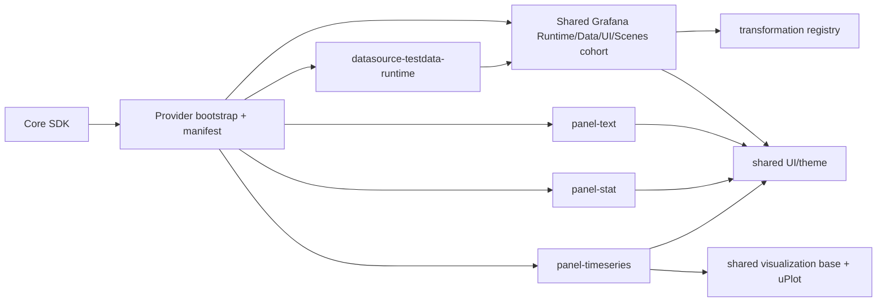

# Grafana Bridge Bundle and Dependency Strategy

## 1. Document metadata

| Field | Value |
| --- | --- |
| Owner | Dashboard Render SDK G maintainers |
| Phase | Phase 1 — Production Architecture and Distribution Strategy |
| Workstream | Reduce Grafana bridge bundle and editor dependency closure |
| Status | Architecture research |
| Created | 2026-10-12 |
| Last Updated | 2026-10-12 |
| Evidence baseline | Grafana OSS 13.2.3, source commit `6193dc03311b631b9727b560d24369e683dc396e`; React/ReactDOM 19.2.8; `@grafana/scenes` 8.13.5 |

This document uses the phase semantics defined by the
[project roadmap](../../project/roadmap.md). It is a technical architecture
decision, not an implementation plan, package manifest, distribution approval,
or legal conclusion.

Evidence labels used below are:

- **VERIFIED FACT** — directly observed in checked-in source, generated Phase 0
  bundle evidence, or a completed Phase 0 browser gate.
- **INFERENCE** — a technical conclusion supported by the evidence but not yet
  proved in the proposed production artifact.
- **TECHNICAL RECOMMENDATION** — the architecture this workstream recommends.
- **OPEN DECISION** — work deliberately delegated to an experiment or another
  Phase 1 workstream.

## 2. Executive summary

**VERIFIED FACT.** Phase 0 proved that real Grafana 13.2.3 Text, Stat, and Time
series renderers and the real TestData query path can run without an iframe,
`GrafanaApp.init`, or the Grafana application shell. The final evidence build
contained 3,818 modules, 148 JavaScript chunks, and exactly 55 reviewed Grafana
`public/app` source files. It emitted approximately 8.94 MB raw / 2.46 MB gzip
of JavaScript. That output is feasibility evidence, not a production bundle.

The largest closure was not the four small Grafana application-source output
chunks. It was the shared package graph: a roughly 2.45 MB raw / 742 kB gzip
Grafana UI/Emotion/uPlot chunk, a 1.48 MB raw / 284 kB gzip Grafana data chunk,
and an editor graph containing a 1.85 MB raw / 468 kB gzip Monaco API chunk plus
an 889 kB raw / 220 kB gzip React-Monaco chunk and many language chunks. The
view-only browser gates did not request Monaco or Codicon resources. They were
emitted because the selected Text and TestData upstream entry points statically
register editor components and because broad package entry points expose large
dynamic graphs.

**TECHNICAL RECOMMENDATION.** Build a view-only, version-specific Grafana
renderer provider as a combination of:

1. a small manifest/bootstrap artifact that imports no renderer;
2. host-owned external React/ReactDOM/JSX runtimes;
3. one provider-owned, deduplicated Grafana/Scenes runtime cohort;
4. provider-owned renderer-only artifacts that use the real Grafana renderers
   but do not import upstream plugin or datasource editor entry points; and
5. closed, lazy per-panel and per-datasource loaders with content-hashed chunks,
   exact provenance, and typed failures.

This combines Model C's renderer-only construction with Model B's lazy delivery.
It preserves the Phase 0 fidelity result while removing editor/configuration
closure from the view-only profile. It does not assume that ordinary tree
shaking can make full Grafana plugin modules view-only.

**Final status: READY WITH EXPERIMENTS.** The boundary and policy are ready for
Phase 1 use. Experiments A–E in section 30 must prove the actual closure and
budgets before Phase 2 creates an experimental package. Distribution remains
subject to the separate licensing strategy; styling containment remains subject
to its own Phase 1 workstream.

## 3. Phase 0 bundle evidence

The authoritative narrative is the [Phase 0 POC results](../research/poc-results.md).
The generated local evidence files are
`apps/poc-host/dist/evidence/bundle-evidence.json` and
`apps/poc-host/dist/evidence/forbidden-import-report.json`. They are ignored
build artifacts; the durable mechanisms that produced and validated them are
the [bundle evidence plugin](../../../apps/poc-host/build/bundleEvidencePlugin.ts),
the [forbidden-import plugin](../../../apps/poc-host/build/forbiddenGrafanaImportPlugin.ts),
and the [bundle inspector](../../../scripts/inspect-poc-bundle.mjs).

### 3.1 Final evidence-build totals

| Measure | Observed value | Interpretation |
| --- | ---: | --- |
| Inspected imports | 9,154 | Import-boundary inspection, not a module count |
| Bundled modules | 3,818 | All six POC build entries and their closures |
| JavaScript chunks | 148 | Includes many dynamic editor/language chunks |
| JavaScript bytes | 8,937,250 raw / 2,455,983 gzip | Entire emitted POC graph, not initial transfer |
| Non-evidence assets | 164,115 raw / 57,863 gzip | CSS plus one Codicon font |
| Reviewed Grafana application files | 55 | Text 6, Stat 8, Time series 8, TestData 33 |
| Grafana internal-package modules | 0 | Deep adapters resolve to reviewed repository code |
| SystemJS modules | 0 | No arbitrary plugin loader was bundled |
| Workers / WASM | 0 / 0 | None in the final controlled closure |
| CSS module IDs | 75 | Predominantly Monaco plus uPlot/host/provider CSS |

The build used six preserved inputs (`index`, panel catalogue, Text, Stat, Time
series, and TestData) to make closure inspection possible. Therefore total
emitted bytes and the main entry's reachability graph are deliberately broader
than a production single-entry provider.

### 3.2 Largest measured chunks

| Role inferred from module evidence | Raw | Gzip | Runtime observation |
| --- | ---: | ---: | --- |
| Broad Grafana UI/Emotion/uPlot/shared graph | 2,449,537 B | 741,801 B | Required in part; also exposes CodeEditor/OpenLayers/React-Monaco dynamic imports |
| Monaco `editor.api` graph | 1,854,543 B | 468,475 B | Emitted, not requested by view-only gates |
| Broad Grafana data graph | 1,482,572 B | 283,503 B | Required in part; current barrel is too broad |
| React-Monaco editor graph | 888,605 B | 220,332 B | Emitted, not requested by view-only gates |
| Scenes graph | 397,238 B | 112,032 B | Required in part; also exposes 19 locale chunks |
| Shared CodeMirror graph | 308,455 B | 98,786 B | Editor-only for the controlled view path |
| TestData application chunk | 127,180 B | 31,647 B | Mixes query runtime with editors and optional scenarios |
| Runtime/hooks shared chunk | 112,772 B | 33,319 B | Required in part |
| Time series application chunk | 20,784 B | 8,210 B | Required renderer closure |
| Stat application chunk | 12,834 B | 3,582 B | Mixes renderer, registration, migration, and suggestion code |
| Text application chunk | 4,889 B | 2,077 B | Mixes renderer, editor registration, and migration code; dependencies land in shared chunks |

Chunk-local sizes are not incremental feature costs: shared imports can place a
feature's transitive dependencies in other chunks. The static closure rooted at
the final Text application chunk was about 4.44 MB raw / 1.19 MB gzip; Stat was
4.34 MB / 1.16 MB; TestData was 4.60 MB / 1.23 MB; and Time series was 4.49 MB /
1.21 MB. Those closures overlap heavily and must not be summed.

The main POC entry reached 14 chunks totaling about 4.40 MB raw / 1.18 MB gzip
through static imports. Following every dynamic edge reached 147 of 148 chunks
and nearly the entire 8.94 MB / 2.46 MB emitted graph. This distinction is why
the production policy measures both initial transfer and emitted lazy closure.

### 3.3 Runtime versus emitted evidence

**VERIFIED FACT.** Text view mode, Stat, Time series, and Predictable Pulse did
not request Monaco, React-Monaco, Codicon, workers, or Text v2 resources during
the controlled browser gates. Time series did request uPlot behavior and its
CSS. The reference Grafana page requested Inter/Roboto assets, but the POC
bundle did not emit those font files.

**INFERENCE.** Monaco and most TestData editor files are removable from the
view-only artifact without replacing the real renderers or query implementation.
Experiments A and B must establish this rather than treating absence of a
network request as proof of absence from the distributed artifact.

## 4. Current bundle composition

### 4.1 Package and project layers

| Layer | Current role | Evidence classification |
| --- | --- | --- |
| `poc-host` | Host UI, probe entries, build/evidence plugins, browser instrumentation | **TEST/POC-ONLY** |
| `poc-compat` | Runtime boot adaptation, transport, API, conversion, Scenes lifecycle, registries, provider wrappers | Mixed: required behavior plus **TEST/POC-ONLY** fixture constraints |
| `poc-grafana-bridge` | Closed loaders, source identities, renderer/source adapters, TestData loader | Production concepts are valid; implementation is **TEST/POC-ONLY** |
| React/ReactDOM 19.2.8 | Host rendering runtime | **REQUIRED AT VIEW RUNTIME**, host-owned in production |
| Grafana package cohort | Data/UI/Runtime/Schema/i18n/e2e-selectors 13.2.3 | Mixed runtime, initialization, and dormant exports |
| `@grafana/scenes` 8.13.5 | Scene graph, panel lifecycle, query runner | **REQUIRED AT VIEW RUNTIME** subset |
| Emotion, RxJS, uPlot | Styling, streams, plotting | **REQUIRED AT VIEW RUNTIME** where selected feature needs them |
| Vite/Rolldown evidence entries | Preserve independently inspectable source roots | **TEST/POC-ONLY** |

`@grafana/scenes-react` is not present in the successful Phase 0 dependency
cohort. It is not part of the current composition.

### 4.2 Exact reviewed Grafana application-source inventory

All paths below are relative to pinned Grafana source commit
`6193dc03311b631b9727b560d24369e683dc396e`.

#### Text — 6 files

| Exact path | Current classification |
| --- | --- |
| `public/app/core/config.ts` | **REQUIRED ONLY AT INITIALIZATION** through the upstream Text module; provider boot adaptation should replace this direct dependency where possible |
| `public/app/plugins/panel/text/panelcfg.gen.ts` | **UNKNOWN** mixed runtime option descriptors and configuration metadata; Experiment A decides the minimum |
| `public/app/plugins/panel/text/v1/TextPanel.tsx` | **REQUIRED AT VIEW RUNTIME** |
| `public/app/plugins/panel/text/v1/TextPanelEditor.tsx` | **EDITOR-ONLY** |
| `public/app/plugins/panel/text/v1/module.tsx` | **REQUIRED ONLY AT INITIALIZATION** in the POC; avoid in renderer-only output |
| `public/app/plugins/panel/text/v1/textPanelMigrationHandler.ts` | **CONFIGURATION-ONLY** for current-schema view; a versioned conversion/migration profile may use it separately |

#### Stat — 8 files

| Exact path | Current classification |
| --- | --- |
| `public/app/features/panel/suggestions/utils.ts` | **CONFIGURATION-ONLY** |
| `public/app/plugins/panel/stat/StatMigrations.ts` | **CONFIGURATION-ONLY** for admitted current-schema input |
| `public/app/plugins/panel/stat/StatPanel.tsx` | **REQUIRED AT VIEW RUNTIME** |
| `public/app/plugins/panel/stat/common.ts` | **REQUIRED AT VIEW RUNTIME** for renderer behavior |
| `public/app/plugins/panel/stat/module.tsx` | **REQUIRED ONLY AT INITIALIZATION** in the POC; avoid in renderer-only output |
| `public/app/plugins/panel/stat/panelcfg.gen.ts` | **UNKNOWN** mixed field-option processing and editor descriptors; retain only measured renderer requirements |
| `public/app/plugins/panel/stat/presets.ts` | **CONFIGURATION-ONLY** |
| `public/app/plugins/panel/stat/suggestions.ts` | **CONFIGURATION-ONLY** |

#### Time series — 8 files

| Exact path | Current classification |
| --- | --- |
| `public/app/core/components/GraphNG/GraphNG.tsx` | **REQUIRED AT VIEW RUNTIME** |
| `public/app/core/components/GraphNG/utils.ts` | **REQUIRED AT VIEW RUNTIME** |
| `public/app/core/components/TimeSeries/TimeSeries.tsx` | **REQUIRED AT VIEW RUNTIME** |
| `public/app/core/components/TimeSeries/utils.ts` | **REQUIRED AT VIEW RUNTIME** |
| `public/app/plugins/panel/timeseries/TimeSeriesPanel.tsx` | **REQUIRED AT VIEW RUNTIME** |
| `public/app/plugins/panel/timeseries/TimeSeriesTooltip.tsx` | **REQUIRED AT VIEW RUNTIME** for the admitted tooltip capability |
| `public/app/plugins/panel/timeseries/plugins/OutsideRangePlugin.tsx` | **REQUIRED AT VIEW RUNTIME** for the admitted renderer behavior |
| `public/app/plugins/panel/timeseries/utils.ts` | **REQUIRED AT VIEW RUNTIME** |

The Time series P2 experiment already used the renderer component rather than
the full upstream plugin module. Provider-owned adapters supplied excluded app
services and a constrained field-option registration. It is the strongest
Phase 0 evidence for the renderer-only strategy.

#### TestData — 33 files

| Exact paths | Current classification |
| --- | --- |
| `public/app/plugins/datasource/grafana-testdata-datasource/datasource.ts` | **REQUIRED AT VIEW RUNTIME** for the real datasource implementation |
| `.../constants.ts`, `.../dataquery.ts`, `.../variables.ts` | **REQUIRED AT VIEW RUNTIME** for datasource/query contracts used by the module |
| `.../module.tsx` | **REQUIRED ONLY AT INITIALIZATION** in the POC; replace with a runtime-only datasource constructor entry |
| `.../ConfigEditor.tsx`, `.../QueryEditor.tsx`, `.../MetaDataInspector.tsx`, `.../TestInfoTab.tsx` | **EDITOR-ONLY** or **CONFIGURATION-ONLY** |
| `.../components/CSVContentEditor.tsx`, `CSVFileEditor.tsx`, `CSVWaveEditor.tsx`, `ErrorEditor.tsx`, `ErrorWithSourceEditor.tsx`, `ExemplarLabelsEditor.tsx`, `ExemplarsEditor.tsx`, `FlakyQueryEditor.tsx`, `GrafanaLiveEditor.tsx`, `NodeGraphEditor.tsx`, `PredictablePulseEditor.tsx`, `RandomWalkEditor.tsx`, `RawFrameEditor.tsx`, `SimulationQueryEditor.tsx`, `SimulationSchemaForm.tsx`, `StreamingClientEditor.tsx`, `USAQueryEditor.tsx` | **EDITOR-ONLY** |
| `.../LogIpsum.ts`, `.../metricTree.ts`, `.../nodeGraphUtils.ts`, `.../runStreams.ts` | **DORMANT TRANSITIVE DEPENDENCY** for Predictable Pulse; runtime for other unsupported TestData scenarios |
| `.../testData/flameGraphResponse.ts`, `serviceMapResponse.ts`, `serviceMapResponseMedium.ts` | **DORMANT TRANSITIVE DEPENDENCY** for Predictable Pulse |

The abbreviated `.../` prefix in this table always means
`public/app/plugins/datasource/grafana-testdata-datasource/`. The list contains
all 33 exact reviewed TestData files; it is not a sample.

### 4.3 Published-package and asset composition

| Closure | Classification | Notes |
| --- | --- | --- |
| `@grafana/runtime` services and boot config | **REQUIRED ONLY AT INITIALIZATION** plus query-time service calls | Provider-owned singleton cohort |
| `@grafana/data` frames, display, plugin types, transforms | **REQUIRED AT VIEW RUNTIME** subset | Current broad package entry emitted far more than the explicitly used subset |
| `@grafana/ui` panel chrome, theme, controls, uPlot helpers | **REQUIRED AT VIEW RUNTIME** subset | Broad entry exposes unrelated dynamic editor/table/map paths |
| `@grafana/schema` | Mostly **REQUIRED ONLY AT INITIALIZATION** | Keep only if converter/runtime validation actually executes it |
| `@grafana/i18n` | **REQUIRED ONLY AT INITIALIZATION** and render-time translations | Active locale only should be eagerly available |
| `@grafana/e2e-selectors` | **REQUIRED AT VIEW RUNTIME** only where renderer imports selectors | Provider-owned, not a core dependency |
| Scenes scene objects and renderers | **REQUIRED AT VIEW RUNTIME** subset | Locale map and unused scene types are dormant |
| RxJS | **REQUIRED AT VIEW RUNTIME** | One provider-owned physical identity |
| Emotion | **REQUIRED AT VIEW RUNTIME** | One provider-owned styling identity; exact containment is delegated |
| uPlot and `uPlot.min.css` | **REQUIRED AT VIEW RUNTIME** for Time series only | Must remain lazy until a uPlot panel is admitted |
| Monaco, React-Monaco, CodeMirror | **EDITOR-ONLY** | Emitted but not requested in Phase 0 view flows |
| Codicon TTF and Monaco CSS | **EDITOR-ONLY** for the controlled view profile | Emitted because of editor closure |
| Host CSS and constrained panel CSS | **TEST/POC-ONLY** implementation; presentation concept required | Rewrite under styling policy |
| Inter/Roboto font files | **UNKNOWN** production asset decision | Referenced by Grafana styles but not emitted by the POC bundle |
| Workers/WASM | Not present | Future features must reclassify them if introduced |

## 5. Dependency-closure classification

The production provider must generate this classification from its actual
module graph. The current classification establishes the expected boundary.

| Class | Admitted examples | Excluded or conditional examples |
| --- | --- | --- |
| **REQUIRED AT VIEW RUNTIME** | Selected Scenes objects; panel chrome; Text/Stat/Time series renderer components; display processing; active transformations; RxJS; Emotion; uPlot only for Time series; datasource query class | Editors, dashboards settings, option suggestion UI |
| **REQUIRED ONLY AT INITIALIZATION** | Boot/config adapter, theme/i18n setup, runtime service setters, closed loader registration, required registries | Full package-version JSON imports when the generated manifest already supplies versions |
| **EDITOR-ONLY** | Text editor; TestData query/config editors; Monaco; React-Monaco; CodeMirror; Codicon | Never admitted by view-only profile |
| **CONFIGURATION-ONLY** | Stat suggestions/presets; option editor factories; migration handlers for unsupported old schemas | Separate conversion or authoring artifact, never an accidental renderer dependency |
| **TEST/POC-ONLY** | Probe entries, diagnostic DOM, evidence hooks, fixture contracts, TestData as the only supported datasource, current source transformer | No production runtime dependency merely because it helped prove Phase 0 |
| **DORMANT TRANSITIVE DEPENDENCY** | Monaco languages, unused Scenes locales, optional TestData scenarios, OpenLayers/Table paths exposed by broad UI entry | May be emitted today; must not enter initial transfer and should be absent from the view-only distribution where practical |
| **UNKNOWN** | Exact generated `panelcfg` split, minimum schema import, minimum UI subpaths, datasource scenario helper boundary | Requires A–E experiments and graph evidence |

**INFERENCE.** “Not requested by the browser” and “not distributed” are
different. The Phase 2 view-only artifact must eliminate editor-only source,
chunks, CSS, and fonts from its emitted manifest, not merely defer their network
request.

## 6. Entry-point leak analysis

| Entry/leak | Why it enters Phase 0 | Classification | Production response |
| --- | --- | --- | --- |
| Text v1 `module.tsx` | Constructs `PanelPlugin` and statically imports Text editor, migration handler, generated configuration, and app config | **LIKELY AVOIDABLE** | Import the real `TextPanel` renderer through a provider-owned view entry and reconstruct only runtime metadata/options |
| Stat `module.tsx` | Registers panel, migrations, field config, suggestions, and presets together | **LIKELY AVOIDABLE** | Use real `StatPanel` plus measured runtime display/field config; keep migrations/suggestions out of view chunk |
| TimeSeries full plugin module | Full app entry would pull annotations/exemplars/filter/assistant/editor dependencies | **AVOIDABLE**; Phase 0 P2 already avoided it | Preserve the renderer-only source-built shape and replace only explicitly reviewed app services |
| TestData `module.tsx` | Registers `DataSourceClass`, ConfigEditor, QueryEditor, metadata tab, and query editors as one plugin | **LIKELY AVOIDABLE** | Expose the real datasource constructor from a runtime-only entry; omit editor registrations |
| TestData `datasource.ts` optional scenarios | One datasource class contains branches and imports for many scenarios | **UNKNOWN** | Experiment B measures whether Predictable Pulse can be isolated without changing query semantics |
| Panel catalogue | Closed loaders are dynamic, but preserved probe entries and shared package imports broaden output | **AVOIDABLE** in production shape | Keep catalogue metadata import-free and import only selected view entries |
| Datasource registration | Loading full plugin to discover `DataSourceClass` brings editor fields | **LIKELY AVOIDABLE** | Register a provider-owned constructor descriptor directly |
| `panelcfg.gen.ts` | Generated descriptors mix runtime defaults/processors with editor factories | **STRUCTURAL** in upstream generation, **LIKELY AVOIDABLE** in provider artifact | Generate or adapt a runtime-only projection with provenance |
| Migrations | Upstream plugin entry always wires them even for schema 42 | **AVOIDABLE** for initial current-schema profile | Reject unsupported schemas; later place migrations in a separate converter chunk |
| Suggestions/presets | Top-level plugin registration references them | **AVOIDABLE** for viewing | Exclude from view profile |
| Broad `@grafana/ui` entry | Barrel includes a large component graph and dynamic CodeEditor/map paths | **LIKELY AVOIDABLE** | Prefer documented public subpaths when exported; otherwise provider build-time projection needs explicit stability/provenance review |
| Broad `@grafana/data` entry | Main package graph includes many transforms/helpers | **LIKELY AVOIDABLE** | Import supported public subpaths where possible; keep any reviewed deep import behind provider adapters |
| Scenes main entry | Export graph and locale loader map become reachable | **UNKNOWN** | Measure narrow public imports or a generated provider projection; never deep-import unsupported internals casually |
| Runtime/global registries | Setters and registries are top-level singletons and cannot be duplicated safely | **STRUCTURAL** | Keep one shared provider runtime cohort; do not duplicate it per panel chunk |
| Multiple POC build entries | Evidence build preserves six roots and forces conservative sharing | **AVOIDABLE** | Production provider uses a bootstrap plus deliberate feature entries; evidence build remains separate |

Tree shaking cannot remove a component whose value is passed into a plugin
registration object, nor can it prove that a registered editor will never be
read later. The fix is a narrower semantic entry point, not a more aggressive
minifier flag.

## 7. Renderer-only strategy

**TECHNICAL RECOMMENDATION.** Generate or source-build provider-owned view
entries from the exact supported Grafana source identity. Each entry returns an
opaque provider panel handle or `PanelPlugin` configured only for rendering.
It is not a new renderer implementation.

### 7.1 Required entry contracts

| Conceptual entry | Must expose | Must avoid |
| --- | --- | --- |
| `text/view` | Real `TextPanel`, Text mode/options needed by the supported DTO, sanitizer/Markdown/runtime helpers, panel metadata | `TextPanelEditor`, Monaco/CodeMirror, migration UI, Text v2, dashboard editor |
| `stat/view` | Real `StatPanel`, reduction/display/threshold/value-mapping processors, required field-config descriptors, metadata | Suggestions, presets, migration handlers, option editors, dashboard editor |
| `timeseries/view` | Real `TimeSeriesPanel`, GraphNG/TimeSeries/uPlot helpers, tooltip/legend/axis and admitted field-option behavior | Full app module, annotations/exemplars/assistant/filter code unless a declared capability requires it, option editors |
| `datasource/testdata/runtime` | Real `DataSourceClass`, constructor settings, Predictable Pulse query/runtime helpers, template substitution needed by admitted queries | ConfigEditor, QueryEditor, scenario editors, inspector tabs, unsupported scenario fixtures |

The entry owns exact metadata attachment, runtime option registration, and
source identity. It must not expose Grafana-specific types through the public
SDK contract. Any adapted/generated line remains mapped to its upstream source
and is subject to the selected distribution strategy.

### 7.2 Fidelity rule

A renderer-only artifact passes only when the same controlled dashboard still
passes the applicable Gate A/B/C visual and lifecycle tests using real Grafana
renderer components and real query data. Replacing a panel with project-owned
lookalike markup is not bundle optimization.

### 7.3 Migration rule

The initial view profile accepts only the schema/version declared by its
compatibility manifest. It does not bundle all historical migrations “just in
case.” If broader migration support is approved later, conversion-time modules
are separate lazy capabilities selected before renderer activation.

## 8. Panel lazy loading

The provider owns a closed map conceptually equivalent to:

```text
text       -> import(provider-generated text/view chunk)
stat       -> import(provider-generated stat/view chunk)
timeseries -> import(provider-generated timeseries/view chunk)
```

Dashboard JSON supplies only the normalized plugin ID. It never supplies a URL,
package name, or import specifier.

### 8.1 Loading sequence

1. Core validates the provider contract and compatibility manifest without
   loading renderer code.
2. Provider retrieves/classifies the dashboard and inventories required panel
   IDs.
3. Provider rejects unsupported IDs before scene activation.
4. Provider may preload only the admitted panel chunks named by that inventory.
5. Scene activation requests handles from the same closed loader table.
6. Load success, failure, provenance, and cache behavior are observable without
   recording source bodies or dashboard data.

### 8.2 Cache and failure behavior

- Cache the in-flight promise by provider build identity plus plugin ID so
  concurrent instances deduplicate a load.
- Cache the resolved immutable plugin identity for the lifetime of its
  compatible provider runtime.
- Evict a rejected promise. A bounded explicit retry may attempt the same
  trusted chunk; failure never falls back to SystemJS or a dashboard URL.
- Consumer cancellation prevents stale publication and scene activation. ESM
  fetch/evaluation is not assumed to be abortable.
- Unknown IDs produce a typed `panel.unsupported` result. Integrity or source
  mismatch is provider-fatal; ordinary panel load failure remains panel-local
  when the provider can render a host-safe error boundary.
- Preload hints are advisory deployment data. They must not turn every supported
  panel into an eager dependency.

## 9. Datasource lazy loading

Datasource delivery uses a parallel closed map keyed by a normalized datasource
type, not by datasource UID:

```text
grafana-testdata-datasource -> import(datasource/testdata/runtime)
```

The UID selects server-side instance settings. The provider mapping selects
trusted code.

The runtime-only entry returns a constructor/factory and declared capabilities:
query, resource calls if supported, health if supported, streaming if supported,
and template-variable dependencies. Editor and configuration components are a
different profile.

Datasource instances are cached by provider runtime identity plus server
identity, organization/namespace where material, datasource UID, and settings
revision. They are never shared across incompatible runtime identities. A stale
dashboard generation may release its consumer while a shared compatible
instance remains cached; query subscriptions and abort controllers remain
session-owned.

TestData proves the shape only for one datasource and one real Predictable Pulse
path. It does not prove arbitrary datasource packaging. Every new datasource
requires its own runtime/editor split, source audit, query/resource capability
declaration, and browser conformance test.

## 10. Monaco/editor analysis

### 10.1 Observed entry paths

**VERIFIED FACT.** The following paths make editor code reachable in the final
Phase 0 build:

1. Text `v1/module.tsx` statically imports `TextPanelEditor.tsx` and registers
   it on the plugin.
2. Text editor behavior reaches published Grafana CodeEditor/React-Monaco
   components.
3. TestData `module.tsx` statically imports `ConfigEditor.tsx`,
   `QueryEditor.tsx`, and related metadata/config tabs.
4. `QueryEditor.tsx` statically imports scenario-specific editor components,
   including `PredictablePulseEditor.tsx` and many unrelated editors.
5. Published `@grafana/ui` paths expose `CodeEditor` and
   `ReactMonacoEditor` dynamic chunks; React-Monaco exposes dozens of language
   chunks.
6. The Monaco CSS graph emits the Codicon TTF and two editor CSS assets.

The final report contains 854 module IDs whose normalized identity contains
`monaco`, spread across 86 chunks. Chunk membership overlaps shared dependencies,
so their chunk sizes must not be summed as an isolated Monaco contribution.

### 10.2 Conclusion

Monaco, CodeMirror, React-Monaco, Codicon, Text editor code, and TestData editor
code are not view-runtime requirements for the controlled dashboard. They are
structural consequences of importing upstream registration entry points.

**TECHNICAL RECOMMENDATION.** A production view-only provider must fail its
artifact inspection if any of these editor identities or assets are emitted,
not only if a browser happens not to request them. Do not solve this with a
runtime flag in the same module graph; bundlers still must retain statically
registered code. Use different entry points/artifacts.

Experiments A and B must prove removal while retaining real Text rendering and
real TestData query behavior. If either real implementation imports editor code
internally even after its registration module is removed, the source-built
adapter must document that specific unavoidable edge; no such edge was observed
at runtime in Phase 0.

## 11. Asset/font/icon analysis

| Asset or style | Phase 0 evidence | View-only ownership |
| --- | --- | --- |
| `uplot/dist/uPlot.min.css` | Bundled and required by Time series | Provider visualization chunk or provider style layer; lazy with uPlot capability |
| Provider panel CSS | Small POC stylesheet | Rewrite under provider presentation boundary; scope decision delegated |
| Emotion-generated rules | Required by Grafana UI and panels | Provider runtime; one compatible Emotion identity and deterministic insertion policy |
| Full Grafana `GlobalStyles` | Not silently imported by the POC; known to contain broad resets | Not approved here; styling-containment workstream decides minimum subset |
| Codicon TTF (72,504 raw / 40,396 gzip) | Emitted through editor closure, not requested in view gates | Excluded from view-only profile; authoring profile owns it if needed |
| Monaco editor CSS (39,288 raw / 6,953 gzip) | Emitted, not requested | Excluded from view-only profile |
| React-Monaco CSS (42,432 raw / 7,557 gzip) | Emitted, not requested | Excluded from view-only profile |
| Grafana UI CSS asset (6,738 raw / 1,773 gzip) | Emitted shared dependency CSS | Attribute to actual component owner; retain only if view tests require it |
| Inter / Roboto Mono | Referenced by Grafana theme/global styles; not emitted in POC | Styling workstream chooses provider-hosted local assets or documented host fallback |
| Grafana SVG/icons | Component-dependent; no standalone image asset emitted in final evidence | Prefer component-inline/provider-owned assets; inventory each addition |
| Workers/WASM | None emitted | Absent by default; any future addition needs capability, CSP, and provenance review |

Assets required by a locally distributed provider must be deployable from the
same application origin or an explicitly configured local asset base. The core
SDK does not own Grafana fonts, icon roots, or public paths. CDN/server ownership
is an optional deployment adapter, never the only supported mode.

This workstream defines bundle ownership only. Selector scoping, light DOM
versus Shadow DOM, portal targets, global resets, font fallback, and Emotion
insertion belong to the styling-containment decision.

## 12. Tree-shaking limits

Tree shaking is useful only after entry points express the desired semantic
boundary.

| Limitation | Consequence |
| --- | --- |
| Static plugin registration | Editor/config components referenced by setters are live values and cannot be discarded |
| Top-level registry mutation | Bundlers conservatively retain imports with observable initialization |
| Generated configuration | Runtime processors and editor factories may share one generated object/module |
| Broad package barrels | Re-export graphs and side-effect imports make unrelated code reachable |
| CommonJS/interoperability boundaries | Export usage is less precise and side effects are harder to prove |
| Dynamic import maps inside packages | Unrequested chunks may still be emitted because the import expressions are reachable |
| CSS imports | CSS is a side effect and remains when its importing module remains live |
| Runtime reflection/plugin objects | Bundlers cannot know which plugin properties Grafana will read later |
| Multiple evidence entries | Shared graph is optimized for all preserved roots, not one production path |
| `sideEffects` metadata | Helps only when packages accurately annotate effects and imports are already narrow; it cannot nullify explicit registration |

Deep imports can reduce closure but introduce export/stability risk. Prefer
documented package subpaths. A reviewed provider adapter may use an unpublished
subpath only when its exact version, provenance, conformance tests, and upgrade
cost are explicit. This is not a general invitation to bypass package exports.

## 13. Chunking strategy

The logical production graph is:



Logical boundaries are:

| Chunk group | Loading policy |
| --- | --- |
| `provider-bootstrap` | Eager only after host explicitly selects provider; contains manifest parsing, compatibility checks, closed loader tables, and typed errors |
| `grafana-runtime-cohort` | Load once after compatibility succeeds and before the first provider session activates |
| `scenes` | Shared provider chunk; may merge with cohort if measurement shows a lower total without harming cacheability |
| `shared-ui-theme` | Shared by panels; load with first renderer, not by core import |
| `transformation-registry` | Load only transformations admitted by dashboard preflight; initial selected set may be shared |
| `panel-text` | Independent renderer-only lazy chunk |
| `panel-stat` | Independent renderer-only lazy chunk |
| `panel-timeseries` | Independent renderer-only lazy chunk |
| `shared-visualization-base` | uPlot and shared graph helpers; only panels that require it reference it |
| `datasource-testdata` | Independent query/runtime-only lazy chunk |
| `editor-*` / `authoring-*` | Absent from view-only artifact; optional future authoring distribution only |

These are logical chunk IDs, not filenames. The build may merge very small
helpers, but it must preserve feature-level load isolation, provenance, and
budget reporting.

## 14. Shared chunks

| Dependency | Policy | Reason |
| --- | --- | --- |
| React, ReactDOM, JSX runtimes | **HOST-OWNED EXTERNAL** | One physical host runtime; governed by React/Scenes compatibility policy |
| `@grafana/runtime` | **SHARED PROVIDER CHUNK** | Process-wide singleton setters and boot evaluation cannot be duplicated |
| `@grafana/data` | **SHARED PROVIDER CHUNK** | Frame/plugin/display identities and registries must agree |
| `@grafana/ui` | **SHARED PROVIDER CHUNK**, narrowed | Theme/context/component identity and Emotion usage must agree |
| `@grafana/scenes` | **SHARED PROVIDER CHUNK** | Scene class identity and lifecycle are runtime-wide |
| `@grafana/schema`, i18n, selectors | **SHARED PROVIDER CHUNK** where required | Exact aligned cohort and shared initialization |
| RxJS | **SHARED PROVIDER CHUNK** | Observable identity and runtime services should not diverge |
| Emotion | **SHARED PROVIDER CHUNK** | Avoid duplicate style engines/order inconsistencies |
| uPlot | **LAZY SHARED VISUALIZATION CHUNK** | Share across uPlot panels without charging Text/Stat initial load |
| Small pure helpers | **MAY DUPLICATE** after measurement | A few duplicated bytes can be preferable to an eager large shared edge |

Duplication is acceptable only for pure, non-singleton helpers and must stay
below a declared duplication threshold. Never duplicate React, Grafana Runtime,
Scenes, registries, RxJS, Emotion, or uPlot constructors across a compatible
provider runtime.

## 15. Externalization

### 15.1 Host-owned externals

The production provider should declare, not bundle:

- `react`;
- `react-dom` and `react-dom/client`;
- `react/jsx-runtime`; and
- `react/jsx-dev-runtime` for development artifacts only.

The provider manifest declares the tested React/ReactDOM range, and provider
initialization verifies physical identity through the established runtime
guard. Missing or incompatible peers fail before renderer loading.

### 15.2 Provider-owned dependencies

Grafana Data/UI/Runtime/Schema/i18n/e2e-selectors, Scenes, RxJS, Emotion, uPlot,
and reviewed renderer/source adapters remain provider-owned. Externalizing them
to arbitrary hosts would turn exact cohort compatibility into an undocumented
consumer obligation and would weaken one-runtime guarantees.

A future host-supplied provider may own those dependencies as part of its own
artifact. That is provider substitution, not core peer externalization.

## 16. Dynamic-import policy

Approved boundaries are compile-time closed loader tables, versioned provider
chunks, and an optional future server-hosted provider whose manifest and loader
are explicitly installed by the host.

Forbidden boundaries include:

- `import()` of a dashboard value or constructed arbitrary URL;
- unbounded SystemJS lookup;
- Grafana's general application plugin loader;
- implicit loading of Grafana routes, chrome, or application shell;
- fallback to “nearest” renderer versions after a compatibility failure; and
- hidden editor imports from view entries.

Every dynamic edge has a logical feature ID, expected provider build identity,
source/provenance record, error category, and budget. The deployment layer may
map the logical ID to a content-hashed file or approved remote URL.

## 17. View-only profile

The initial production-oriented provider profile is `view-only`.

It preserves:

- dashboard API retrieval and compatibility preflight;
- constrained DTO conversion and Scenes lifecycle;
- renderer components and panel chrome;
- datasource query/resource runtime for explicitly supported datasources;
- declared transformations, field/display processing, theme, styles, assets,
  portals, i18n, refresh, time range, resize, and cleanup; and
- provider diagnostics, provenance, and typed errors.

It excludes:

- panel, datasource, and dashboard editors;
- option editors and suggestion/preset UI;
- configuration/admin pages;
- migration UI and unsupported historical migration sets;
- Monaco, React-Monaco, CodeMirror, Codicon, editor CSS, and language chunks;
- arbitrary plugin discovery and Grafana application navigation; and
- authoring APIs in the core SDK.

The build profile is a distinct artifact graph, not a runtime boolean applied
to a monolithic bundle.

## 18. Optional authoring profile

**TECHNICAL RECOMMENDATION.** If authoring becomes a product goal, publish or
generate it as a separate provider profile/artifact with a separate manifest,
budgets, provenance, compatibility matrix, CSP/assets, and legal review. Do not
add dormant editor chunks to the view-only artifact.

This document does not design editing behavior or promise an authoring product.
It only reserves a clean boundary. An authoring provider may depend on the same
runtime cohort when compatible, but must not make the view-only provider import
its entry point.

## 19. Bundle budgets

These are **INITIAL PHASE 2 TARGETS**, not guarantees or current measurements.
They apply to minified production output with React/ReactDOM externalized and
source maps excluded. Transfer budgets count each unique chunk once.

| Budget surface | Raw target | Gzip target | Gate behavior |
| --- | ---: | ---: | --- |
| Core SDK, excluding React | ≤ 150 KiB | ≤ 50 KiB | Hard target; core must contain no Grafana modules |
| Provider bootstrap + manifest parser | ≤ 100 KiB | ≤ 30 KiB | Hard target; no renderer, Grafana cohort, or editor modules |
| Shared Grafana/Scenes/UI runtime needed by first dashboard | ≤ 3,000 KiB | ≤ 900 KiB | Experiment target; report component breakdown |
| First Text dashboard, all unique initial JS | ≤ 3,500 KiB | ≤ 1,000 KiB | Includes bootstrap/shared runtime/Text; excludes host React |
| Incremental Text chunk | ≤ 250 KiB | ≤ 75 KiB | Renderer-only closure after shared chunks |
| Incremental Stat chunk | ≤ 350 KiB | ≤ 100 KiB | Renderer-only closure after shared chunks |
| Incremental Time series + unique helpers | ≤ 800 KiB | ≤ 250 KiB | uPlot may be a separate shared lazy chunk |
| Incremental datasource runtime | ≤ 500 KiB | ≤ 150 KiB | TestData runtime experiment target |
| Shared visualization/uPlot chunk | ≤ 700 KiB | ≤ 200 KiB | Must not load for Text-only dashboard |
| Entire initial Text/Stat/Time series/TestData view profile emitted JS | ≤ 5,500 KiB | ≤ 1,500 KiB | Excludes evidence, source maps, and editor/authoring artifacts |
| View-profile assets requested for first dashboard | — | ≤ 100 KiB | CSS/font/icon total; panel-specific assets load lazily |
| Editor code/assets in view profile | 0 B | 0 B | Hard exclusion: Monaco/CodeMirror/React-Monaco/Codicon/editor CSS |

The first production experiment may miss a size target without invalidating the
architecture, but it may not silently raise the budget. A miss requires a graph
report and an explicit accept/revise decision. The editor exclusion, core
Grafana exclusion, and single-React rules are invariants rather than stretch
targets.

## 20. Bundle metrics

Every provider build and pull request affecting its graph should record:

- minified raw, gzip, and informational Brotli bytes;
- module and chunk counts;
- unique initial-load JavaScript for Text-only and representative dashboards;
- lazy JavaScript per panel, datasource, transformation, and visualization base;
- emitted versus actually requested chunks in browser scenarios;
- CSS, font, icon, image, worker, and WASM bytes by logical owner;
- duplicated module identities and duplicated byte estimates;
- physical React/ReactDOM, Grafana cohort, Scenes, RxJS, Emotion, and uPlot
  identities;
- exact reviewed Grafana `public/app` source count and path delta;
- editor/Monaco/CodeMirror/Codicon module and asset counts;
- parse/evaluate time for bootstrap, shared runtime, and each feature on a
  controlled browser profile; and
- manifest-to-bundle/provenance agreement.

Raw, gzip, and Brotli answer different questions. Gzip is the initial CI budget
because it matches existing Phase 0 evidence; raw exposes parse pressure;
Brotli is reported for modern deployment comparison but is not the only gate.

## 21. Bundle regression policy

CI should compare each build with an approved baseline and enforce:

1. core and renderer-contract contain zero Grafana, Scenes, renderer, or
   provider modules;
2. provider bootstrap contains no panel, datasource, visualization, editor, or
   broad Grafana UI module;
3. React/ReactDOM/JSX runtimes are external and one physical runtime passes the
   conformance probe;
4. each initial/per-feature/asset budget passes or carries an explicitly
   approved budget-change record;
5. view profile contains zero Monaco, React-Monaco, CodeMirror, Codicon, editor
   CSS, or known editor entry points;
6. every new Grafana `public/app` path fails until source, provenance,
   distribution, and compatibility reviews approve it;
7. forbidden shell/router/chrome/SystemJS/application loader imports remain
   zero;
8. duplicated singleton packages remain zero and pure-helper duplication stays
   below a defined byte threshold;
9. emitted chunks and assets all map to a logical owner and provenance record;
10. a Text-only browser run requests no Stat, Time series, datasource, uPlot, or
    authoring chunk;
11. functional conformance reruns real Text/Stat/Time series and real query
    paths appropriate to the affected provider; and
12. generated evidence contains no credentials, source bodies, dashboard data,
    or authorization headers.

CI reports a graph diff, not only a pass/fail byte count. A new shared edge can
make several feature chunks look smaller while increasing initial transfer.

## 22. Manifest impact

### 22.1 Compatibility manifest

The compatibility manifest may contain stable logical bundle facts:

- provider ID/version/build ID and profile (`view-only`);
- supported feature IDs and their logical loader IDs;
- required shared capability groups such as `uplot` or selected transforms;
- asset categories a capability may require;
- provenance/SBOM reference and exact Grafana source/package cohort;
- integrity/provenance policy identifier;
- whether a feature is eager, lazy, or unavailable; and
- tested size class or optional summary metadata.

It should not contain hashed filenames, CDN origins, cache headers, or every
module path. Compatibility remains stable across equivalent deployments.

### 22.2 Deployment manifest

A separate deployment manifest maps logical loader IDs to:

- content-hashed URLs or local files;
- exact raw/compressed size metadata;
- integrity hashes where applicable;
- dependent chunk and asset IDs;
- preload hints; and
- cache/public-path information.

The provider build owns both manifests and checks their build IDs agree. The
core understands compatibility vocabulary but not deployment filenames.

## 23. Server-hosted module compatibility

The bundle architecture is delivery-neutral. A provider resolver may map the
same logical chunk IDs to locally bundled files, a separately installed bridge,
or a future server-hosted provider.

**OPEN DECISION.** Server-hosted loading is not yet proven. Its separate
experiment must establish stable/discoverable assets, module format, public
paths, CORS/cookie/CSP behavior, integrity/version discovery, React and Grafana
cohort sharing, and operation without the Grafana shell or general plugin
loader. Until then:

- no Phase 2 bundle depends on server-hosted assets;
- the locally deployable provider remains the reference implementation;
- no compatibility manifest advertises server delivery without conformance
  evidence; and
- a server-hosted provider must obey the same closed loader and provenance
  contracts.

## 24. Offline deployments

The recommended architecture supports air-gapped and on-premises use:

- provider JavaScript, CSS, fonts, icons, and other required assets can be
  installed and served locally;
- runtime execution requires no npm registry or public CDN access;
- content-hashed lazy chunks resolve from a host-configured local base;
- compatibility and deployment manifests can be generated and verified during
  a controlled build/release process; and
- optional remote/server providers do not remove the local provider path.

Offline deployments still communicate with their configured Grafana server for
dashboard and datasource APIs. “Offline” here means no public artifact service
is required at runtime.

## 25. Cache strategy

- Use content hashes for immutable JavaScript/CSS/font/icon assets and long
  cache lifetimes.
- Keep a short-lived, revalidated deployment manifest that points to immutable
  assets; never mutate bytes behind a hashed URL.
- Include provider build and exact Grafana compatibility identity in cache keys
  or manifest scope.
- Cache the shared runtime cohort across dashboards using the same installed
  provider build.
- Cache panel and datasource chunks independently so dashboards pay only for
  features they use.
- Deduplicate concurrent imports with promise caches; evict failed promises.
- Allow host-controlled preload based on a validated dashboard inventory, not
  on untrusted arbitrary URLs.
- Do not cache credential-bearing API responses in the asset cache.
- A provider upgrade may reuse unchanged content-hashed feature chunks, but
  manifest compatibility validation still occurs for the new build.

## 26. Provenance impact

Every emitted provider chunk must be traceable to:

- provider ID, version, profile, and build ID;
- exact Grafana tag and source commit;
- reviewed Grafana `public/app` source identities and whether each was imported,
  adapted, or generated;
- exact `@grafana/*`, Scenes, React peer, and material third-party package
  cohort;
- source-transform/generator identity and reproducibility inputs;
- CSS/font/icon/worker/other asset identities;
- license/notice/SBOM references selected by the licensing workstream; and
- the logical feature IDs that own the chunk.

Bundle splitting must not hide source provenance in an anonymous shared chunk.
The provenance report should record the per-chunk module set plus a whole-build
union. Source maps are diagnostic artifacts with controlled publication; they
are not a substitute for the provenance inventory and must not leak local paths
or unrelated source.

This section defines traceability, not license obligations. The
[licensing and distribution strategy](licensing-distribution-strategy.md)
controls distribution review.

## 27. Security impact

Lazy loading expands the executable-code boundary, so the provider must:

- use closed, code-defined loader tables;
- validate compatibility manifest and provider build identity before loading;
- never derive executable paths from dashboard JSON, panel options, query
  payloads, or datasource settings;
- use integrity checks for separately hosted chunks where the platform and
  deployment model support them;
- document CSP requirements without requiring `unsafe-eval` or arbitrary
  SystemJS;
- constrain public paths to the installed provider deployment;
- treat a manifest/chunk integrity mismatch as provider-fatal;
- sanitize load evidence and avoid source bodies, credentials, or API payloads;
  and
- maintain the forbidden shell/router/chrome/application-loader guards.

The provider is trusted executable code, not a sandbox for third-party plugins.
Supporting arbitrary untrusted plugins would require a different security
architecture and is outside this strategy.

## 28. Build-tool requirements

The production build system must support:

- multiple deliberate library/feature entries and preserved dynamic boundaries;
- reliable React/ReactDOM/JSX externalization;
- deterministic shared-chunk policy and duplicate-module inspection;
- TypeScript/TSX transformation of exact pinned source inputs without importing
  Grafana's application build system;
- exact source aliases/replacements with allowlists and provenance;
- CSS extraction and per-feature asset ownership;
- content hashes, integrity metadata, and reproducible manifests;
- raw/gzip/Brotli, module graph, initial/lazy closure, and duplication reports;
- forbidden-import/editor/source-identity guards;
- license/provenance/SBOM plugin integration;
- browser-consumer tests in at least the supported Vite path and one independent
  consumer-bundler shape; and
- safe source-map generation and publication control.

Vite/Rollup/Rolldown is a credible continuation because Phase 0 already proves
source transforms, aliases, dynamic chunks, and evidence hooks. Webpack remains
relevant for consumer compatibility and server-hosted Grafana asset analysis.
esbuild/Oxc are useful transformers/minifiers but do not by themselves define
the required chunk, CSS, provenance, and manifest model. The final selection is
based on capability experiments, not loyalty to the POC tool.

Manual chunking is a policy aid, not a cure for a wrong import graph. If a
feature is statically imported by bootstrap, naming it `panel-text` does not
make it lazy.

## 29. POC migration

| POC mechanism | Production treatment | Rationale |
| --- | --- | --- |
| `apps/poc-host/vite.config.ts` | **SPLIT** | Separate consumer demo, provider build, and evidence/conformance configurations |
| Exact source aliases | **KEEP CONCEPT / REWRITE** | Provider build owns audited aliases; no host-visible source aliases |
| `pinnedGrafanaSourceTransformPlugin` | **REWRITE** | Retain clean pinned-source verification, import replacement, and identity mapping; make generation reproducible and profile-aware |
| `bundleEvidencePlugin` | **KEEP CONCEPT / REWRITE** | Expand to entry closures, Brotli, duplicate bytes, logical owners, manifest agreement, and provenance output |
| `forbiddenGrafanaImportPlugin` | **KEEP CONCEPT** | Preserve default-deny source/shell/SystemJS guards with provider-profile allowlists |
| Closed panel catalogue | **KEEP CONCEPT / REWRITE** | Move behind provider contract and generated manifest; preserve cache and typed errors |
| TestData datasource bridge | **SPLIT** | Runtime-only entry becomes experiment B; editor/config graph stays absent from view profile |
| Source allowlists | **KEEP CONCEPT** | Generate reviewed per-feature and whole-build provenance; human approval required for deltas |
| `inspect-poc-bundle.mjs` | **REWRITE** | Convert fixed POC lists into profile-aware CI policy and budget checks |
| POC probe entries | **DISCARD** from production | Keep equivalent cases in conformance/evidence builds, not consumer bundles |
| Browser instrumentation | **DEFER** to conformance tooling | Never ship diagnostic monkey patches as SDK telemetry |
| Fixture-specific converter/registries | **REWRITE** | Provider capability implementations, exact version/schema support, no fixture shortcuts |

No POC file is promoted unchanged merely because it passed Gate C.

## 30. Experiment plan

### Experiment A — Text renderer-only bundle without Monaco/editor closure

Build a single provider Text view entry from the pinned renderer component and
minimum runtime metadata.

**Pass:** real Gate A dashboard-by-UID path renders the same Text sentinel and
lifecycle behavior; emitted graph contains no `TextPanelEditor`, Monaco,
React-Monaco, CodeMirror, Codicon, editor CSS, Text v2, or dashboard editor;
incremental and initial budgets are reported and meet targets or have an
explicit reviewable miss.

**Fail:** fidelity requires a replacement renderer; an editor module is still
statically required; forbidden app/shell code enters; or lifecycle/conformance
regresses.

### Experiment B — TestData runtime/query-only bundle without editor UI

Build a datasource entry that exposes the exact TestData datasource class and
only the controlled Predictable Pulse runtime closure.

**Pass:** the real browser `/grafana/api/ds/query` path reaches `PanelData.Done`,
refresh/cancellation remain correct, and emitted graph contains no ConfigEditor,
QueryEditor, scenario editor, Monaco/CodeMirror/React-Monaco/Codicon/editor CSS,
or unsupported scenario fixture unless a measured runtime edge proves it
necessary.

**Fail:** success uses fabricated data/custom query behavior; the real class
cannot execute without the full editor module; or required optional-scenario
closure cannot be bounded and documented.

### Experiment C — Per-panel lazy split

Build Text, Stat, and Time series as separate closed feature entries behind a
manifest-only bootstrap.

**Pass:** a fresh Text-only page requests no Stat, Time series, TestData, uPlot,
or editor chunk; each additional panel triggers only its feature/shared lazy
dependencies; unknown IDs fail closed; Gate A/B/C remain green; chunk provenance
and size ownership are complete.

**Fail:** bootstrap eagerly reaches panel code; one panel pulls every catalogue
entry; feature chunks cannot be attributed; or manual chunk naming hides a
static dependency.

### Experiment D — Shared Grafana cohort deduplication

Exercise two panels and two compatible dashboard instances under one provider.

**Pass:** one physical identity exists for each Grafana cohort package, Scenes,
RxJS, Emotion, and uPlot; the shared cohort loads once; panel chunks stay lazy;
unmounting one instance does not invalidate another; resources return to the
expected shared-runtime baseline.

**Fail:** duplicate registries/classes appear, shared chunk policy makes every
feature eager, or lifecycle isolation regresses.

### Experiment E — Provider entry with React externalization

Consume a production-shaped provider from an independent React 19.2.8 host.

**Pass:** provider output contains no React/ReactDOM/JSX implementation modules;
one physical host React/ReactDOM identity is observed; missing/incompatible
peers fail before activation; Gate C render/resize/cleanup remains green.

**Fail:** the provider bundles or fetches a second React, relies on Grafana's
SystemJS sharing, or cannot operate with the host-owned peer contract.

### Priority

Run A and B first because they test the core editor-removal hypothesis. Run E
next to lock the external boundary, then C and D to tune chunking and sharing.
All five experiments are Phase 1 evidence; none requires publishing an artifact.

## 31. Decision matrix

Scores are 1 (worst) to 5 (best). The weighted total is the sum of
`score × weight`, divided by 100. “Legal flexibility” means the architecture can
accommodate different approved distribution modes; it is not a legal judgment.

| Criterion | Weight | A: monolithic provider | B: lazy panel/datasource | C: renderer-only generated | D: server-hosted modules |
| --- | ---: | ---: | ---: | ---: | ---: |
| Initial size | 15 | 1 | 4 | 5 | 5 |
| Total size | 10 | 2 | 3 | 5 | 4 |
| Implementation simplicity | 10 | 4 | 3 | 2 | 1 |
| Grafana fidelity | 15 | 5 | 5 | 5 | 4 |
| Upgrade cost | 10 | 2 | 3 | 2 | 4 |
| Provenance clarity | 10 | 3 | 4 | 5 | 2 |
| Offline support | 10 | 5 | 5 | 5 | 1 |
| Cacheability | 5 | 2 | 5 | 5 | 4 |
| Legal/distribution flexibility | 10 | 2 | 3 | 4 | 5 |
| Debugging | 5 | 4 | 4 | 3 | 1 |
| **Weighted total / 5** | **100** | **3.00** | **3.90** | **4.20** | **3.30** |

Arithmetic check:

- A: `(15+20+40+75+20+30+50+10+20+20) / 100 = 3.00`;
- B: `(60+30+30+75+30+40+50+25+30+20) / 100 = 3.90`;
- C: `(75+50+20+75+20+50+50+25+40+15) / 100 = 4.20`; and
- D: `(75+40+10+60+40+20+10+20+50+5) / 100 = 3.30`.

| Model | Classification | Decision |
| --- | --- | --- |
| A — monolithic provider | **VIABLE WITH SIGNIFICANT TRADE-OFFS** | Not the initial Phase 2 policy; retains editor/unused-feature cost and weak cache isolation |
| B — lazy per-panel/per-datasource chunks | **TECHNICALLY PREFERRED** delivery model | Adopt, but it does not remove editor closure if loaders still target full upstream modules |
| C — renderer-only generated bridge artifacts | **TECHNICALLY PREFERRED** construction model | Adopt with exact source provenance, conformance, and distribution approval |
| D — server-hosted modules | **EXPERIMENT REQUIRED** | Keep provider contract compatible; do not make Phase 2 depend on it |

The recommended architecture is C-built artifacts delivered through B-style
lazy loading. The matrix does not select between npm, local generation, or
another legally approved distribution shape.

## 32. Technical recommendation

### Technical recommendation

Adopt a version-specific, view-only Grafana renderer provider that generates or
source-builds renderer-only panel/datasource entries, shares one narrowed
Grafana/Scenes runtime cohort, externalizes host React, and exposes a closed lazy
loader table through the renderer-provider contract.

| Recommendation | Confidence | Basis |
| --- | --- | --- |
| Separate core/bootstrap/runtime/feature entries | **HIGH** | Phase 0 loaders and provider architecture already prove the lifecycle boundary; current graph shows why eager catalogue import is harmful |
| Exclude editors through semantic renderer-only entries | **MEDIUM** | Time series P2 proves the pattern; Text and TestData require experiments A/B |
| Externalize React/ReactDOM/JSX | **HIGH** | Existing React policy and one-runtime evidence require it; experiment E validates packaging mechanics |
| Share provider-owned Grafana/Scenes/RxJS/Emotion cohort | **HIGH** | Singleton/registry/class identity makes per-feature duplication unsafe |
| Meet the numeric budgets | **LOW** until experiments | Targets are evidence-informed but the production graph does not exist yet |
| Keep server-hosted delivery optional | **HIGH** | Provider abstraction supports it; feasibility remains unproved |

### Legal approval required

This strategy is license-neutral about how renderer-only artifacts are
distributed. Any artifact containing, adapting, generating, or remotely loading
Grafana application source follows the decisions and review gates in the
licensing workstream. Bundle optimization is not distribution permission.

### Build-tool requirements

Use a toolchain that satisfies section 28 and produces reproducible manifest,
provenance, and closure evidence. Vite/Rollup-family tooling is the leading
technical baseline, but selection waits for experiments A–E and a second
consumer-bundler test.

## 33. Phase 2 initial policy

Phase 2 — SDK Foundation and Experimental Package should begin with this bundle
policy only after the relevant Phase 1 approval gates:

1. core and renderer-contract have zero Grafana dependencies;
2. the provider bootstrap exposes compatibility data without importing Grafana
   or any feature implementation;
3. React/ReactDOM/JSX are host peers and externalized;
4. the Grafana/Scenes cohort is provider-owned, exact-versioned, and physically
   deduplicated;
5. the initial provider profile is view-only;
6. panels and datasources use closed lazy mappings and renderer/runtime-only
   entries;
7. editor/Monaco/Codicon closure is absent from emitted view artifacts;
8. feature chunks and assets are locally deployable and content hashed;
9. CI enforces budgets, forbidden imports, source deltas, provenance, and real
   browser conformance;
10. only capabilities proved and declared by the provider manifest are shipped;
    and
11. authoring, server-hosted delivery, arbitrary plugins/datasources, and broad
    migrations remain excluded unless separately approved.

## 34. Other Phase 1 impacts

| Workstream | Impact of this decision | State |
| --- | --- | --- |
| Bridge/provider architecture | Confirms manifest-only bootstrap, provider-owned loaders, and opaque feature handles | **UNBLOCKED** for license-neutral contract/build design |
| Grafana version policy | Every feature chunk/provenance record is tied to an exact supported Grafana source/cohort identity | **UNCHANGED**, now gains bundle evidence requirements |
| React/Scenes policy | React externalization becomes a hard packaging invariant; Scenes stays provider-owned/shared | **UNBLOCKED** for experiment E/conformance |
| Styling containment | Must decide minimum CSS/global rules, Emotion insertion, portal, fonts/icons, and asset base | **RECOMMENDED NEXT WORKSTREAM** |
| Transformation compatibility | Registry should be capability-driven and lazy; avoid importing every standard/application transform | **UNBLOCKED** for inventory/strategy, implementation deferred |
| Server-hosted modules | Must implement the same logical loader/manifest contract; no current dependency | **EXPERIMENT REQUIRED** |
| Licensing/distribution | Per-chunk provenance and editor/source removal improve reviewability but do not answer redistribution questions | **BLOCKED where legal approval is required** |
| Public SDK API | Must expose provider/capability/errors, never chunk URLs, Grafana module types, or editor toggles | **UNBLOCKED** for contract design |

Newly unblocked work includes defining provider build manifests, profile-aware
bundle evidence, closed logical loader contracts, and experiments A–E without
publishing artifacts. Final distribution of Grafana-derived renderer artifacts
remains blocked by the licensing decision. Production styling claims remain
blocked by the styling-containment workstream.

## 35. Decisions made

1. Production uses a small core, small provider bootstrap, shared provider
   cohort, and lazy feature chunks—not the POC's monolithic evidence graph.
2. The initial provider is a distinct view-only artifact/profile.
3. Renderer-only generated/source-built entries are the preferred construction
   model; lazy per-feature chunks are the preferred delivery model.
4. React/ReactDOM/JSX are host-owned externals; the Grafana/Scenes cohort is
   provider-owned and shared.
5. Loader tables are closed and provider-controlled. Dashboard content never
   supplies executable paths.
6. Editor/Monaco/CodeMirror/React-Monaco/Codicon closure is forbidden in the
   view-only artifact.
7. Ordinary tree shaking is not accepted as proof of editor removal.
8. Compatibility metadata and deployment/chunk metadata are separate manifests.
9. Locally deployable/offline operation is required; server-hosted delivery is
   optional and experimental.
10. Bundle budgets and exact source/asset deltas become CI review gates.
11. Bundle splitting preserves exact source/license provenance.
12. A future authoring profile, if pursued, is a separate artifact and review.

## 36. Delegated/open decisions

- Exact Text and TestData runtime-only closure: experiments A and B.
- Final shared-chunk boundaries and whether Scenes merges with the cohort:
  experiments C and D.
- Production React external mechanics across supported bundlers: experiment E.
- Exact numeric budget acceptance after the first production-shaped build:
  maintainers following A–E evidence.
- Distribution form and obligations for generated/adapted Grafana source:
  licensing/distribution workstream and qualified review.
- CSS/reset containment, Emotion insertion, portals, fonts/icons, and light DOM
  versus other containment: styling-containment workstream.
- Supported transformation set and registry chunk shape: transformation
  compatibility workstream.
- Server-hosted module discovery, CORS/CSP/integrity, and shared-runtime
  feasibility: server-hosted module experiment.
- Whether any authoring profile becomes a product requirement: future roadmap
  decision, not Phase 2 default.
- Final build tool and public package manifests: after experiments and before
  the Phase 2 experimental package.

## 37. Final status

**READY WITH EXPERIMENTS**

The bundle architecture is sufficiently defined to guide license-neutral
provider build work and to open experiments A–E. The preferred direction is a
renderer-only, view-only, closed lazy provider with host-owned React and a
provider-owned shared Grafana/Scenes cohort.

This status does not authorize publishing Grafana-derived bridge artifacts and
does not claim the target budgets are already met. Phase 2 packaging waits for
the experiments, the applicable legal/distribution decision, and the remaining
Phase 1 production-architecture gates.
