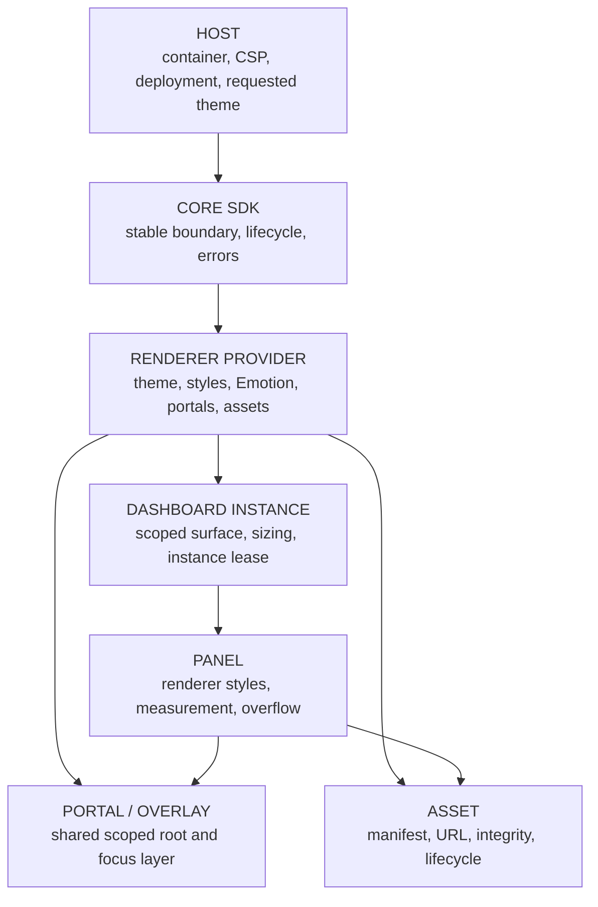

# Grafana Styling and Host-Containment Strategy

## 1. Document metadata

| Field | Value |
| --- | --- |
| Owner | Grafana React SDK maintainers |
| Phase | Phase 1 — Production Architecture and Distribution Strategy |
| Workstream | Define Grafana styling and host-containment strategy |
| Status | Architecture research and design |
| Created | 2026-10-12 |
| Last Updated | 2026-10-12 |
| Evidence baseline | Grafana OSS 13.2.3 at `6193dc03311b631b9727b560d24369e683dc396e`; React/ReactDOM 19.2.8; `@grafana/scenes` 8.13.5 |

This document follows the canonical phase semantics in the
[project roadmap](../../project/roadmap.md). It defines the production styling
boundary for the renderer-provider architecture. It does not implement that
boundary, change the Phase 0 POC, authorize distribution of Grafana-derived
assets, or claim universal CSS isolation.

Evidence labels are:

- **VERIFIED FACT** — directly observed in pinned source or the completed
  Phase 0 POC.
- **INFERENCE** — supported by evidence but not yet proved by a
  production-shaped artifact.
- **PHASE 1 DECISION** — the production architecture selected here.
- **EXPERIMENT REQUIRED** — a claim that needs focused implementation evidence.
- **DELEGATED DECISION** — intentionally assigned to another workstream.

## 2. Executive summary

Phase 0 proved that real Grafana Text, Stat, and Time series panels can render
in ordinary light DOM with explicit Grafana theme context, Emotion-generated
styles, uPlot CSS, a shared portal root, and no full Grafana application
stylesheet. The controlled host retained its own styles. A real CSS Grid
containment defect nevertheless required `min-width: 0`, and the diagnostic
Grafana `GlobalStyles` mode changed the host sentinel from 16 px to 14 px. This
is sufficient evidence for native composition, not universal collision safety.

**PHASE 1 DECISION.** Select **Model B: light DOM plus a scoped provider root
and provider-owned Emotion/style infrastructure** as the initial production
model. Specifically:

- core creates a stable, size-safe host boundary but imports no Grafana CSS;
- the renderer provider creates a scoped dashboard surface and a matching
  scoped portal surface;
- provider-authored resets and static CSS are explicitly scoped to those
  surfaces;
- the full Grafana `GlobalStyles` component is forbidden in the view-only
  profile;
- one provider runtime owns one coherent Grafana theme, Emotion cohort, portal
  root, asset base, and z-index policy per JavaScript/document realm;
- Grafana's `@emotion/css` component styles may still inject class-scoped style
  tags into the document head; this is an acknowledged light-DOM limitation,
  not claimed isolation;
- panel and visualization CSS load lazily with the owning feature; and
- assets are provider-declared and locally deployable through an explicit host
  deployment base, never implicitly fetched from an arbitrary dashboard value.

Shadow DOM is not the initial model. It blocks document-head Emotion rules at
the shadow boundary while Grafana UI's default portals escape to the document's
fixed `#grafana-portal-container`. Solving those two paths would require source
adaptation and broad conformance work. An iframe provides stronger isolation
but violates the product's fixed no-iframe constraint and native-composition
goal.

The initial Phase 2 profile is view-only, light-theme-only, ordinary light DOM,
one compatible provider/style identity per realm, shared portal root, no full
global reset, no authoring styles, and no promise of arbitrary-host immunity.

**Final status: READY WITH CONSTRAINTS.** The baseline is selected. Focused
collision, CSP, portal, asset, dark-theme, micro-frontend, and optional Shadow
DOM experiments remain required before expanding compatibility claims.

## 3. Phase 0 evidence

The primary evidence sources are the [Phase 0 POC results](../research/poc-results.md),
the [Grafana UI investigation](../research/grafana-ui-investigation.md), and the
[Scenes investigation](../research/grafana-scenes-investigation.md).

### 3.1 Proven behavior

| Evidence | Result | Production implication |
| --- | --- | --- |
| Real Text, Stat, and Time series panels in light DOM | **PASS** | Shadow DOM is not required for renderer viability |
| Published Grafana light theme in Runtime config and React ThemeContext | **PASS** | Provider must keep the two theme channels coherent |
| Emotion component styles | **PASS** | Grafana UI styles can operate outside the Grafana shell |
| Host sentinel across mount/remount | Color, font stack, and browser body margin remained stable in minimum-scoped mode | Scoped minimum styles are viable in the controlled host |
| Emotion style count | 90 after first Text render and unchanged after remount | Repeated compatible mounts did not create unbounded style growth |
| Full `GlobalStyles` diagnostic | Rendered, but changed host sentinel font size from 16 px to 14 px | Full Grafana global reset is unacceptable by default |
| No-global diagnostic | Renderer still rendered | Full global reset is not a hard renderer prerequisite for the controlled panels |
| Minimum-scoped diagnostic | Selected POC mode; Text/Stat/Time series passed | Starting point for production experiments |
| uPlot CSS | Required for Time series | Visualization CSS belongs to its lazy feature/shared-visualization chunk |
| Grid resize | Native `ResizeObserver` worked, but parent grid needed `min-width: 0` | Core/provider sizing contract must include intrinsic-size containment |
| Portal root | Shared, reference-counted, empty for Text, removed after final lease | Provider owns portal lifecycle at runtime scope, not per panel |
| Two dashboards | Independent scenes and observers shared one compatible portal/runtime | Same-identity multi-instance styling is feasible |
| Assets | No new view-time font/icon request in minimum mode; full-reference mode requested Inter/Roboto from `/grafana/public/fonts/` | Font/icon distribution remains unresolved and must not depend on Grafana server paths by accident |
| Host/application stylesheet | No full Grafana application stylesheet loaded | Production must not import the Grafana shell stylesheet |

### 3.2 POC implementation evidence

The current private POC:

- wraps panels with a single Grafana `ThemeContext.Provider` in
  [`PocGrafanaProviders.tsx`](../../../packages/poc-compat/src/theme/PocGrafanaProviders.tsx);
- requires the Runtime and React provider to share the same light theme object in
  [`createPocTheme.ts`](../../../packages/poc-compat/src/theme/createPocTheme.ts);
- installs a realm-global `window.__grafana_public_path__` before the package
  cohort loads in
  [`assetPolicy.ts`](../../../packages/poc-compat/src/theme/assetPolicy.ts);
- reference-counts a fixed document portal in
  [`portalManager.ts`](../../../packages/poc-compat/src/theme/portalManager.ts);
- exposes diagnostic `none`, `minimum-scoped`, and `full-reference` modes in
  [`styleModes.ts`](../../../packages/poc-compat/src/theme/styleModes.ts);
- imports uPlot CSS and two scoped rules in
  [`poc-panel.css`](../../../packages/poc-compat/src/theme/poc-panel.css); and
- applies host/grid containment in
  [`host.css`](../../../apps/poc-host/src/host.css).

These files are disposable POC evidence. Their responsibilities inform the
production provider, but the files and public names are not production APIs.

### 3.3 Pinned upstream behavior

**VERIFIED FACT.** Grafana UI 13.2.3:

- uses both `@emotion/css` for component styles and `@emotion/react` for
  `GlobalStyles`;
- aggregates 21 broad style modules in `GlobalStyles`, including rules for
  `html`, `:root`, `body`, headings, forms, fonts, Markdown, dashboards, and
  uPlot;
- resolves its default portal through the document-wide
  `#grafana-portal-container`, falling back to `document.body`;
- allows an explicit root on the low-level `Portal`, but many components call
  the default container directly;
- creates the portal root as a fixed, full-width layer using the theme's portal
  z-index;
- reads `window.__grafana_public_path__` for font and icon URLs; and
- caches the computed icon root at module scope after first access.

Pinned sources include [Portal.tsx](https://github.com/grafana/grafana/blob/v13.2.3/packages/grafana-ui/src/components/Portal/Portal.tsx),
[GlobalStyles.tsx](https://github.com/grafana/grafana/blob/v13.2.3/packages/grafana-ui/src/themes/GlobalStyles/GlobalStyles.tsx),
[elements.ts](https://github.com/grafana/grafana/blob/v13.2.3/packages/grafana-ui/src/themes/GlobalStyles/elements.ts),
[fonts.ts](https://github.com/grafana/grafana/blob/v13.2.3/packages/grafana-ui/src/themes/GlobalStyles/fonts.ts),
and [icon URL utilities](https://github.com/grafana/grafana/blob/v13.2.3/packages/grafana-ui/src/components/Icon/utils.ts).

## 4. Styling requirements

The production presentation boundary must:

1. preserve real Grafana renderer and UI behavior;
2. avoid the Grafana application shell and full application stylesheet;
3. constrain provider-authored selectors to explicit dashboard and portal
   surfaces;
4. keep Runtime `config.theme2` and React `ThemeContext` on the same theme
   identity;
5. support panel measurement, canvas, `ResizeObserver`, overflow, tooltips,
   focus, and keyboard behavior;
6. provide one deliberate portal, asset, and z-index policy;
7. preserve host navigation, body layout, typography, and product chrome;
8. support multiple compatible dashboard instances in one realm;
9. fail clearly for incompatible provider/theme/asset identities;
10. expose no Grafana theme or styling types through the stable core API;
11. work with local/offline asset deployment;
12. record source, CSS, font, icon, and asset provenance;
13. remain compatible with the view-only/lazy bundle strategy; and
14. make limitations explicit rather than claim universal isolation.

The initial boundary does not promise protection against a hostile host
stylesheet that targets provider internals or applies broad `!important` rules.
It does promise tested behavior against a documented host CSS contract and a
representative collision matrix.

## 5. Ownership model



| Owner | Responsibilities | Must not own |
| --- | --- | --- |
| **HOST** | Supply container, available size, host-aware request behavior, CSP nonce/policy when supported, approved provider deployment/asset base, requested supported theme, and optional z-index integration values | Grafana theme objects, internal class names, panel CSS, provider portal children |
| **CORE SDK** | Create stable boundary; enforce `min-width: 0`/size contract; orchestrate provider lifecycle; expose project-owned errors and status | Grafana packages, Emotion, Grafana styles/assets, portal implementation, renderer DOM assumptions |
| **RENDERER PROVIDER** | Own exact theme creation, Runtime/context coherence, scoped static CSS, Emotion cohort, global-style exclusion, portal manager, asset resolution, z-index band, feature CSS, manifest, cleanup policy, and conformance evidence | Host body reset, host router/chrome, arbitrary theme mutation, arbitrary asset URLs |
| **DASHBOARD INSTANCE** | Acquire a scoped surface and runtime/style/portal leases; apply instance ID, direction, size/overflow policy; release instance resources | Independent provider theme, independent `window.__grafana_public_path__`, document-global portal ID |
| **PANEL** | Use provider theme/context; render component-local styles; observe its content box; load declared visualization CSS/assets | Mutating document/global styles, choosing remote code or asset bases |
| **PORTAL / OVERLAY** | Shared compatible root, provider scope/theme markers, focus/layer behavior, child cleanup, ownership diagnostics | Per-dashboard global ID, host navigation layer, unmanaged body fallback |
| **ASSET** | Logical ID, owning feature, URL mapping, hash/integrity, MIME, provenance, preload/cache metadata | Credentials, dashboard-controlled paths, implicit public CDN requirement |

## 6. Light DOM analysis

### Benefits

- It is the environment Phase 0 proved with real panels.
- Grafana UI class styles inserted into `document.head` apply normally.
- The fixed document portal, floating UI, focus management, SVG, canvas, and
  uPlot behave as expected.
- React context crosses normal portals without an additional bridge.
- Browser accessibility trees and document-level keyboard/focus behavior match
  the environment Grafana UI targets.
- Hosts can inspect, test, and style the outer SDK boundary using ordinary DOM
  tools.

### Limitations

- Host selectors can reach Grafana DOM.
- Any unscoped provider selector can reach host DOM.
- Inherited font, line height, color, direction, and custom properties cross the
  boundary unless explicitly established.
- `@emotion/css` inserts styles into the document head, not a per-dashboard
  subtree.
- The portal leaves the dashboard subtree and needs a second scoped surface.
- Broad host resets, `!important`, global canvas/SVG rules, and CSS-in-JS
  insertion order can still alter rendering.

**PHASE 1 DECISION.** Light DOM is the default rendering environment. Support
claims are based on an explicit host CSS contract and conformance profiles, not
on an assertion that light DOM is isolated.

## 7. Scoped-root strategy

Each mounted dashboard receives a provider-owned surface conceptually like:

```html
<div
  data-grsdk-surface="dashboard"
  data-grsdk-provider="grafana-13.2.3"
  data-grsdk-theme="light"
  data-grsdk-instance="opaque-instance-id"
></div>
```

The shared portal root carries the same provider and theme markers with
`data-grsdk-surface="portal"`. Provider static selectors target both surfaces,
never `html`, `:root`, or `body`.

The scoped baseline establishes only proven integration properties:

- border-box sizing for descendants;
- provider font/color/line-height inheritance;
- scoped `color-scheme`;
- `min-width: 0` and `max-width: 100%` at dashboard/grid integration points;
- required Markdown, focus, panel chrome, and visualization rules;
- overflow rules owned by the dashboard layout contract; and
- provider-prefixed CSS custom properties.

It does not use `all: initial`, `all: revert`, or a copied browser reset. Those
approaches would remove useful accessibility/inheritance behavior and create a
new compatibility surface. CSS `contain` is not treated as selector isolation;
strict layout/paint containment can also change measurement, sticky/fixed
positioning, and overflow.

Provider-owned selectors use a stable provider prefix and avoid exposing
Grafana internal class names as a host customization API. Hosts may style the
outer core boundary through documented project-owned hooks only.

## 8. Emotion strategy

Grafana UI uses two distinct Emotion paths:

1. `@emotion/css` creates hashed component classes through its module-level
   cache and inserts style nodes into the document; and
2. `@emotion/react` provides `Global`, theme-aware global rules, and optional
   cache infrastructure.

A React `CacheProvider` does not automatically redirect styles produced by the
separate `@emotion/css` singleton. Therefore “add an Emotion cache” is not a
complete containment strategy.

**PHASE 1 DECISION.** The renderer provider owns one compatible Emotion cohort
and style registry per provider runtime identity:

- `@emotion/react` provider-controlled styles use a dedicated, provider-keyed
  cache/container where the production build supports it;
- the view-only profile does not mount Grafana `GlobalStyles`;
- Grafana component styles generated through `@emotion/css` remain
  class-scoped document-head styles in the initial model;
- those style nodes are loaded once, deduplicated, attributed to the provider,
  and tested for bounded growth;
- no dashboard instance creates its own Emotion package/cache identity; and
- host applications are not required to adopt Grafana's Emotion instance as
  their design-system cache.

**EXPERIMENT REQUIRED.** Test a host that also uses `@emotion/css` and
`@emotion/react`, including hydration markers and insertion order. A future
provider build may alias Grafana source imports to a provider-keyed
`@emotion/css/create-instance` adapter, but only if renderer fidelity, class
generation, portals, CSP nonce behavior, source provenance, and bundle cost all
pass. That source adaptation is not assumed by the initial policy.

Style nodes with a provider-runtime lifetime may remain until that runtime is
disposed; they are not added/removed for each dashboard. Bounded shared styles
are not classified as instance leaks. Unbounded growth across compatible
mount/remount cycles is a conformance failure.

## 9. Shadow DOM analysis

Shadow DOM offers stronger selector and inheritance isolation, but it conflicts
with the pinned renderer stack:

- document-head Emotion rules do not style elements inside a shadow tree;
- the default Grafana portal resolves a fixed element in `window.document`,
  outside the shadow root;
- many UI consumers use `getPortalContainer()` directly rather than accept a
  caller root;
- portal CSS and inherited values would have to exist in both document and
  shadow scopes;
- focus traps, outside-click logic, selectors, and `document` event handlers
  assume one document tree;
- third-party CSS such as uPlot would need adopted/scoped injection;
- asset/font rules and CSSOM ordering would require a separate path; and
- cross-shadow accessibility relationships and test tooling would expand the
  support matrix.

React context survives a portal, but CSS scoping does not. Creating the portal
inside a shadow root also does not fix components that resolve the fixed
document container themselves.

**PHASE 1 DECISION.** Shadow DOM is not supported by the initial provider and is
not a fallback for ordinary CSS defects. A future diagnostic experiment may
adapt both Emotion insertion and every portal path, then rerun Gate A/B/C,
accessibility, focus, resize, CSP, and multi-instance suites. Failure of that
experiment does not block the selected light-DOM model.

## 10. Global reset/style policy

The view-only provider must not mount Grafana's full `GlobalStyles` or import the
Grafana application stylesheet. Phase 0 demonstrated both that the controlled
renderers work without the full reset and that the reset changes host
typography.

Production uses a reviewed minimum stylesheet assembled from:

- project-owned scoped integration rules;
- exact required Grafana style fragments adapted to the provider scope with
  source provenance;
- third-party visualization CSS owned by a lazy feature; and
- component-local Emotion rules emitted by the real renderer stack.

Rules targeting `html`, `:root`, `body`, generic host headings/forms, common
utility class names, application pages, query editors, alerting, dashboard
editing, or legacy shell fixes are excluded. Required accessibility rules are
adapted deliberately rather than discarded with the reset.

CSS cascade layers may organize provider-authored static CSS, but they are not
assumed to control unlayered Emotion output. Likewise, selector prefixing must
be verified against keyframes, `@font-face`, `@page`, nested at-rules, portals,
and third-party selectors. A build transform is accepted only with source-to-
output provenance and browser conformance.

## 11. Theme ownership

The host requests a theme mode through project-owned configuration. The
renderer provider creates the exact Grafana theme object and installs the same
identity into:

- Grafana Runtime `config.theme2`;
- Grafana `ThemeContext` for React rendering;
- provider dashboard and portal surface markers;
- scoped static style generation;
- asset selection where theme-specific assets exist; and
- z-index/overlay styling.

The core never creates or exposes a `GrafanaTheme` type.

### Initial theme policy

- Light is the only initial Phase 2 supported mode because it is the mode proven
  by Gate A/B/C.
- Dark and system-following modes are manifest capabilities, not assumed
  parity.
- All dashboards sharing one provider runtime use the same active theme
  identity.
- Per-dashboard light/dark themes in one Runtime realm are unsupported.
- An unsupported or conflicting request fails before scene activation.

### Future switching

Dynamic switching must be one provider-level transaction: create the new
theme, update Runtime and React context coherently, update both dashboard and
portal scopes, refresh dependent styles/canvas renderers, and roll back or fail
without leaving mixed themes. It affects all compatible instances in that
realm. Until a focused two-instance/overlay/uPlot experiment passes, the
initial provider requires reinitialization in a fresh realm to change theme.

## 12. Portal/overlay model

Grafana UI's default portal contract is document-wide. The provider must create
or validate `#grafana-portal-container` before any renderer can fall back to
`document.body`.

**PHASE 1 DECISION.** Use one shared portal root per compatible provider runtime
and document realm:

- it carries provider surface, version, theme, direction, and layering markers;
- its base typography/custom properties match dashboard surfaces because it is
  not their DOM descendant;
- compatible dashboard instances acquire/release references;
- React owns portal children, and instance teardown must remove its overlays;
- the provider removes an owned empty root only after the final runtime/session
  reference; it never removes a host-owned compatible root;
- a pre-existing unmarked/incompatible root is a typed conflict, not silently
  reused;
- the body fallback is forbidden in conformance; and
- overlay failures are local where safe, while root identity/focus integrity
  failures stop provider activation.

The fixed upstream ID prevents independent incompatible Grafana providers from
owning separate default roots in one document. Shadow roots do not change that
fact. A host needing incompatible providers requires a separate JavaScript/
document realm; an iframe may be used by tests or an unrelated micro-frontend
isolation architecture, but not by this SDK to render a dashboard.

Portal conformance covers tooltip, dropdown/menu, select, modal/focus trap,
Time series tooltip, nested portal order, escape/outside click, and two
instances opening overlays concurrently.

## 13. Fonts/icons/assets

### Fonts

Grafana's full font styles define Inter and Roboto Mono using URLs under
`window.__grafana_public_path__`. The published UI package does not contain
those font files.

The provider must declare its font policy:

- `provider-bundled` — exact reviewed local font assets with hashes and
  provenance;
- `host-supplied` — a documented family/metrics contract; or
- `system-fallback` — reduced-fidelity mode explicitly reflected in the
  compatibility manifest.

Provider-bundled font faces should use provider-specific family names where
Grafana theme construction can consume them without changing layout behavior.
This avoids replacing a host's unrelated `Inter` face globally. Font metrics,
canvas measurements, axes, truncation, and normalized visual comparisons must
pass before that alias is approved.

### Icons

Grafana UI's icon utility reads and then caches an icon root derived from
`window.__grafana_public_path__`. Therefore the asset base must be established
before the first icon path is resolved and cannot vary per dashboard.

The provider owns a closed icon inventory for supported features. Inline SVG or
provider-bundled SVG is preferred where the real component supports it. Network
icons resolve only from the approved provider asset base. Missing icons must not
fall back to the target Grafana server or an arbitrary CDN silently.

### Other assets

Every image, font, CSS file, worker, WASM module, and future editor asset has a
logical ID, feature owner, content hash, MIME type, source provenance, and
deployment mapping. The view-only profile contains no Monaco/Codicon assets, as
required by the [bundle strategy](bundle-dependency-strategy.md).

Asset licensing and redistribution remain governed by the
[licensing/distribution strategy](licensing-distribution-strategy.md); this
document makes no legal conclusion.

## 14. Visualization CSS

Time series requires both uPlot's structural CSS and Grafana's theme-aware uPlot
rules. The production provider must:

- load structural uPlot CSS only when an admitted uPlot-based renderer is
  needed;
- include the exact theme-aware rules required for cursor, selection,
  crosshair, tooltip, and font behavior;
- scope selectors to provider dashboard/portal surfaces where technically
  valid;
- preserve uPlot element/class semantics rather than restyle a lookalike;
- attribute CSS bytes to the shared visualization or panel feature chunk;
- verify resize, canvas dimensions, pointer, keyboard, legend, tooltip, and
  teardown; and
- fail the feature if its required CSS cannot load.

Third-party CSS for future Table, map, editor, or other panels receives the same
per-feature treatment. It is not promoted into a global provider stylesheet for
convenience.

## 15. Static/public-path model

The host supplies an approved provider deployment base; the provider resolves
logical asset IDs through its deployment manifest. Browser code never derives
asset paths from dashboard content.

### Initial compatibility path

For pinned Grafana code that still reads `window.__grafana_public_path__`, the
provider installs one normalized asset base before importing Grafana UI and
records it in the runtime/style identity. A different base in the same realm is
rejected. This is compatibility adaptation, not a public core API promise.

### Preferred production path

Renderer-only generation rewrites or adapts asset resolution to provider-owned
logical URLs where technically possible, reducing dependence on the Grafana
application global. The output must remain traceable to pinned source and pass
the same UI conformance tests.

The provider does not assume assets live on the target Grafana server. A local
same-origin path is the default deployment. Cross-origin and server-hosted
assets are optional modes that must declare CORS, CSP, credentials, integrity,
and cache behavior separately.

## 16. Host collision analysis

### Host styles affecting Grafana

Risk sources include:

- inherited `font`, `line-height`, color, direction, and `color-scheme`;
- universal/element resets for `*`, headings, paragraphs, buttons, tables,
  SVG, canvas, labels, and form controls;
- global `box-sizing`, minimum-content sizing, flex/grid rules, and overflow;
- broad CSS custom-property names;
- host `!important` rules or selectors more specific than Emotion classes;
- animation/transition reduction policies; and
- CSS-in-JS insertion order or duplicate cache keys.

Mitigations are an explicit surface baseline, prefixed custom properties,
component Emotion classes, feature-specific static CSS, documented minimum host
contract, and adversarial conformance fixtures. The provider does not attempt an
ever-higher specificity war with the host.

### Grafana styles affecting the host

Risk sources include:

- full `GlobalStyles` rules for `html`, `body`, `:root`, headings, and forms;
- unscoped third-party CSS;
- document-head Emotion nodes;
- globally named `@font-face`, keyframes, and utility classes;
- body scroll locks applied by overlays/selects;
- a fixed full-width portal and z-index scale;
- module-cached public asset paths; and
- styles left after provider teardown.

Mitigations are exclusion of full `GlobalStyles`, scoped static CSS, prefixed
provider tokens, a marked shared portal, reviewed overlay behavior, bounded
runtime-lifetime Emotion styles, and asset-base conflict detection.

### Host contract

Supported hosts must:

- provide a nonzero measurable container and allow its grid/flex child to
  shrink;
- avoid deliberately targeting undocumented provider descendants;
- permit the declared style/asset/CSP requirements;
- reserve the agreed overlay layer; and
- use core-owned integration hooks rather than Grafana internal class names.

This contract does not prohibit common resets or another design system; those
combinations belong in the tested host matrix.

## 17. Multiple-instance behavior

Multiple dashboards may share styling infrastructure only when their provider
runtime identity, Grafana cohort, theme, Emotion identity, asset base, portal
policy, direction, and style-profile version are compatible.

Each dashboard owns:

- its scoped surface and instance marker;
- layout/resize observers and panel DOM;
- instance-specific overlay children and lifecycle evidence; and
- any panel-local lazy CSS/asset leases.

The provider runtime shares:

- theme object and ThemeContext;
- static stylesheet and Emotion cohort;
- provider custom properties/default direction;
- portal root and z-index band;
- asset manifest/base and loaded asset cache; and
- feature style/chunk caches.

Unmounting one dashboard must not remove styles, assets, or portal infrastructure
used by another. After the final instance, the owned portal must be empty and
removable; instance resources must return to zero. Shared immutable style nodes
may remain for the provider-runtime lifetime but must not grow across cycles.

Independent per-instance themes, asset bases, or portal roots are unsupported
in the initial realm model.

## 18. Micro-frontend implications

Micro-frontends in one window are not independent realms. Separate bundlers or
React roots do not isolate Grafana Runtime globals, the fixed portal ID,
`window.__grafana_public_path__`, cached icon roots, or document-head styles.

**PHASE 1 DECISION.** Same-document micro-frontends must use a host-level
provider broker/registry and acquire one compatible renderer provider identity.
They may mount independent dashboard instances but cannot initialize competing
Grafana providers.

If a second micro-frontend requests an incompatible Grafana cohort, theme,
asset base, style profile, portal policy, or provider build, acquisition fails
with a typed realm conflict before style or Runtime mutation. Loading it in a
ShadowRoot is insufficient. A separate browser window/document realm is the
only established hard isolation option; using an iframe for the SDK dashboard
itself remains outside the product architecture.

Conformance must cover two independently bundled consumers acquiring the same
provider and a controlled incompatible acquisition failure.

## 19. z-index/layering

Grafana's theme defines a z-index scale and its portal uses
`theme.zIndex.portal`. That scale cannot assume ownership of the host's entire
page.

The host/provider installation contract supplies or accepts one overlay band
for the provider realm. The provider derives its portal, tooltip, dropdown, and
modal layers from that band while preserving their internal order. The value is
provider-runtime-wide, not per dashboard.

Dashboard surfaces use `isolation: isolate` where conformance confirms it does
not change renderer behavior. This contains panel-local stacking contexts but
does not contain the body-level portal. The portal root carries the approved
base z-index and must not cover or intercept the page when empty.

A host with reserved chrome/modal layers must configure the provider band at
installation. Incompatible late changes fail rather than mutating active
overlays. Conformance includes host header/modal overlap, nested Grafana
overlays, focus order, pointer hit testing, and two concurrent dashboard
overlays.

## 20. responsive sizing/overflow

The core boundary and every host flex/grid integration point must allow shrink:

- `width: 100%` and `max-width: 100%`;
- `min-width: 0` on the dashboard boundary and relevant grid/flex children;
- a documented minimum usable height or an explicit host-provided height;
- no viewport-height assumption inside the SDK;
- `ResizeObserver` driven measurement for responsive panels; and
- an explicit dashboard overflow policy rather than accidental min-content
  overflow.

The provider must distinguish temporary zero-size/hidden containers from an
unsupported layout. It may defer expensive visualization creation until size is
nonzero, but must recover when the container becomes measurable.

`overflow: hidden` is not applied indiscriminately because it can clip focus
rings, tooltips, legends, and panel content. Overlays that must escape layout
use the provider portal. Canvas resolution must account for CSS pixels, device
pixel ratio, zoom, and resize without leaking observers.

The Phase 0 `min-width: 0` repair becomes a core/provider conformance invariant,
not a host-demo-only workaround.

## 21. Accessibility

Light DOM preserves the browser accessibility tree and is the least divergent
environment for Grafana UI semantics. Production conformance must verify:

- semantic panel regions and accessible titles;
- keyboard access to legend, menus, links, and supported interactions;
- visible focus indicators after scoped reset extraction;
- portal focus movement, modal trapping, restoration, escape, and outside
  interaction;
- `aria-*` relationships whose targets cross portal boundaries;
- two instances without duplicate IDs or focus collisions;
- 200%/400% zoom, reflow, text scaling, and narrow containers;
- light-theme contrast and any later dark theme;
- forced-colors/high-contrast and reduced-motion behavior;
- screen-reader behavior for status/error/loading changes; and
- direction/locale behavior for a declared supported set.

Style containment must not remove Grafana accessibility rules merely because
they originated in `GlobalStyles`. Required focus/screen-reader utilities are
adapted into the scoped minimum stylesheet and tested.

Shadow DOM, if revisited, needs separate screen-reader and cross-root focus/ARIA
evidence. The initial decision does not assume equivalent accessibility there.

## 22. CSP/security

The provider declares its Content Security Policy requirements before
activation.

Relevant directives include:

- `style-src` and `style-src-elem` for extracted styles and Emotion style tags;
- `style-src-attr` because pinned Grafana components may use React inline style
  attributes, including portals;
- `font-src` and `img-src` for declared assets;
- `connect-src` for host-owned Grafana API transport;
- `script-src` for locally deployed lazy chunks; and
- worker directives only if a future declared capability emits workers.

A dedicated `@emotion/react` cache can carry a nonce, but it does not configure
the independent `@emotion/css` singleton. Strict nonce-only compatibility is
therefore **EXPERIMENT REQUIRED**. The production policy does not recommend
silently adding `unsafe-inline`; an unsupported host policy receives a typed
CSP incompatibility result before rendering where detectable.

Asset URLs are resolved from a trusted provider deployment manifest, not
dashboard data. Cross-origin assets require explicit origins, CORS behavior,
and integrity/deployment review. No style or asset evidence records cookies,
authorization headers, dashboard content, or source bodies.

## 23. SSR implications

Initial server-side rendering is out of scope. Grafana Runtime, UI, Scenes,
portals, canvas, measurement, and asset helpers use `window`/`document` or
browser-only APIs.

The core package should remain importable in a server build where practical,
but it must not import or initialize the concrete provider during SSR. A host
may render a stable placeholder/error boundary and acquire the provider after
client mount. The initial provider does not emit server-rendered panel markup,
and the client must avoid claiming hydration of markup it did not produce.

A direct server attempt to initialize presentation returns a typed unsupported-
environment error rather than failing through an incidental `document` access.
True SSR would be a separate architecture workstream involving deterministic
CSS extraction, theme serialization, asset URLs, DOM measurement substitutes,
hydration identity, and renderer-specific evidence.

## 24. Offline deployments

All required view-profile styles, fonts, icons, visualization CSS, and chunks
must be deployable with the host/provider in an air-gapped environment. Runtime
must not require npm, GitHub, a public CDN, or Grafana's public asset endpoint.

The host can serve content-hashed assets from a local same-origin base. The
deployment manifest records MIME, integrity/hash, size, and cache metadata.
Provider initialization validates the configured base before module-cached
Grafana asset helpers observe it.

A target Grafana server remains necessary for dashboard/query APIs, but it is
not automatically the provider asset server. Server-hosted module/asset delivery
is a separate optional capability and cannot replace the local deployment path.

## 25. View-only vs authoring profiles

The initial `view-only` profile includes only:

- scoped dashboard and portal baseline styles;
- real renderer component styles;
- panel chrome, loading/error, theme, focus, and accessibility styles;
- visualization CSS for admitted panels;
- declared view-time fonts/icons/assets; and
- overlay styles required by supported view interactions.

It excludes panel/datasource/dashboard editor styles, query editor styles,
Monaco, CodeMirror, Codicon, editor utilities, configuration/admin UI, and the
full Grafana reset.

A future authoring profile is a separate provider artifact/manifest with its
own Emotion/CSP, portal/focus, assets, bundle budgets, provenance, collision,
and accessibility review. It is not a runtime flag that leaves dormant editor
CSS in the view artifact.

## 26. Cleanup lifecycle

The presentation lifecycle is:

```text
provider acquire
  -> validate style/theme/asset/portal identity
  -> install shared style and asset infrastructure once
  -> acquire dashboard surface + portal reference
  -> load feature CSS/assets
  -> render and observe

dashboard release
  -> close/remove its overlays
  -> disconnect resize/listener resources
  -> release feature and portal references
  -> remove dashboard surface

final provider release
  -> verify portal empty
  -> remove owned portal/root-linked static styles when safe
  -> release asset/style registries
  -> retain only explicitly documented realm-lifetime Emotion rules
```

Requirements:

- release operations are idempotent at public lifecycle boundaries;
- one instance never removes shared resources used by another;
- provider-owned DOM is marked and distinguishable from compatible host-owned
  DOM;
- open overlays disappear on owning React subtree teardown;
- observers/listeners/timers return to baseline;
- style element counts remain bounded across mount/remount/theme failure;
- failed initialization rolls back mutations made before the failure; and
- cleanup diagnostics never expose host DOM or sensitive data.

Some Emotion rules are module/runtime-lifetime caches and may not support safe
individual removal. The manifest and conformance evidence must distinguish
bounded shared retention from per-instance leakage.

## 27. Manifest impact

### Compatibility manifest fields

The provider compatibility manifest should include:

- presentation profile ID/version, initially `view-only/light-dom-scoped`;
- DOM model and explicit `shadowDom: false` capability;
- supported theme modes and dynamic-switching capability;
- theme/runtime identity requirements;
- portal model/version and compatible-root ownership behavior;
- Emotion package/cohort identity and style-insertion mode;
- required logical stylesheet/asset categories by feature;
- font and icon policy;
- visualization CSS capabilities;
- supported direction/locale claims;
- CSP capability profile, including nonce support status;
- z-index integration contract;
- cleanup/resource-lifetime semantics;
- tested host CSS profiles, browsers, accessibility profile, and multi-instance
  capability; and
- provenance/SBOM reference.

The compatibility manifest must not include deployment-specific hashed URLs,
host DOM elements, nonce values, or dashboard instance IDs.

### Deployment manifest fields

The provider deployment manifest maps logical CSS/font/icon/image/chunk IDs to
content-hashed URLs, MIME, raw/compressed size, integrity/digest, preload/cache
hints, CORS mode where relevant, feature owner, and provenance record.

Runtime host configuration supplies the concrete asset base, CSP nonce where
supported, optional host portal root claim, and approved z-index band. Secrets
never enter either manifest.

## 28. Conformance testing

The provider conformance suite must include:

1. real Text, Stat, and Time series rendering with semantic/structural visual
   assertions;
2. `none`, selected scoped profile, and forbidden-full-global diagnostics;
3. host-to-provider collision fixtures using browser defaults, a normalize
   reset, utility/design-system styles, broad form/table/SVG/canvas rules, and
   controlled `!important` cases;
4. provider-to-host sentinels for typography, body margin/background/overflow,
   headings, buttons, links, and CSS variables;
5. root shrink, nested grid/flex, zero-size-to-visible, resize, overflow, zoom,
   and device-pixel-ratio cases;
6. Emotion style counts across mount/remount, two instances, feature loading,
   and failed initialization;
7. host Emotion coexistence and insertion-order cases;
8. portal tooltip/menu/select/modal/Time series tooltip/nesting/focus/cleanup;
9. same-provider two-instance and independently bundled micro-frontend cases;
10. incompatible provider/theme/asset/portal acquisition rejection;
11. required asset success, 404, integrity mismatch, wrong MIME, slow load,
    offline/local deployment, and cache behavior;
12. strict CSP profiles, including the supported nonce/extracted-CSS mode and
    an expected rejection profile;
13. light accessibility suite: keyboard, focus, contrast, zoom/reflow,
    forced-colors, reduced-motion, screen reader smoke, and duplicate IDs;
14. no full `GlobalStyles`, no Grafana application stylesheet, no editor CSS,
    and no unexpected font/icon/network request;
15. source/asset/manifest provenance agreement and bundle budgets; and
16. direct SSR/provider initialization rejection plus client-only mount.

Every supported host/style/theme/browser combination is a declared conformance
cell. Passing one controlled host does not imply all CSS frameworks are
supported.

## 29. Bundle-strategy impact

This decision refines the [bundle/dependency strategy](bundle-dependency-strategy.md):

- `provider-bootstrap` contains presentation-profile metadata and validation,
  not Grafana CSS or renderer styles;
- one shared `provider-presentation` chunk owns theme setup, scoped baseline,
  portal CSS, and the provider Emotion cohort;
- panel/visualization CSS remains lazy with its feature;
- uPlot CSS is in the lazy shared-visualization or Time series closure;
- fonts/icons are content-hashed assets declared by feature/profile;
- full `GlobalStyles`, application CSS, editor CSS, Monaco, and Codicon remain
  absent from view-only output;
- React stays host-external, while Emotion remains provider-owned and
  deduplicated within the provider cohort;
- bundle evidence reports CSS initial/lazy bytes, style owners, asset requests,
  duplicate Emotion identities, and unexpected global selectors; and
- provider-static selector prefixing/transforms retain source provenance.

The styling decision does not raise the existing asset budgets automatically.
Any required font or scoped-style addition must identify its owner and obtain a
budget review. A small pure CSS duplication may be preferable to loading a
large shared editor/UI stylesheet, but singleton Emotion/theme infrastructure
is never duplicated per panel.

## 30. Typed errors

Provider errors use project-owned codes and sanitized context.

| Code | Trigger | Scope / recovery |
| --- | --- | --- |
| `style.profile-unsupported` | Requested DOM/style profile is not declared | Provider acquisition; choose supported profile |
| `style.scope-conflict` | Surface markers or stylesheet identity conflict | Provider/runtime fatal in that realm |
| `style.global-style-forbidden` | View artifact attempts full GlobalStyles/application CSS | Build/conformance fatal |
| `style.theme-unsupported` | Requested light/dark/system mode is not supported | Pre-activation typed rejection |
| `style.theme-conflict` | Active realm has another theme identity | Runtime acquisition conflict; use compatible provider/realm |
| `style.emotion-conflict` | Incompatible provider Emotion/style registry is active | Runtime acquisition conflict |
| `style.csp-incompatible` | Required style insertion/attributes are blocked by host CSP | Preflight where detectable; otherwise provider-local fatal |
| `portal.root-unavailable` | Required document/root API is absent | Unsupported environment |
| `portal.root-conflict` | Fixed portal ID exists with incompatible ownership/profile | Provider/runtime fatal |
| `portal.cleanup-incomplete` | Owned overlay children remain after teardown | Conformance/diagnostic failure; isolate affected provider |
| `asset.base-conflict` | Another immutable asset base is already observed | Runtime acquisition conflict |
| `asset.manifest-mismatch` | Logical asset is absent or from another build | Feature/provider integrity failure |
| `asset.integrity-failed` | Bytes do not match declared digest where verified | Provider-fatal for affected artifact |
| `asset.load-failed` | CSS/font/icon/image cannot load or has wrong MIME | Feature-local if safe; provider-fatal when shared baseline fails |
| `layout.container-unavailable` | Container remains absent/invalid | Dashboard-local |
| `layout.container-zero-size` | Container is temporarily nonmeasurable | Recoverable status; retry on ResizeObserver/visibility |
| `environment.ssr-unsupported` | Concrete provider presentation initialized without browser DOM | Expected typed rejection |

Errors do not include raw CSS, asset bodies, host DOM snapshots, credentials, or
authorization data.

## 31. POC migration

| POC element | Production treatment | Reason |
| --- | --- | --- |
| `PocGrafanaProviders` | **REWRITE** as provider-private presentation boundary | Add profile, portal, theme, CSP, assets, error and lifecycle ownership |
| `createPocTheme` | **REWRITE** as provider theme controller | Preserve Runtime/context identity; add manifest validation and future transaction model |
| `assetPolicy` | **REWRITE** | Keep pre-import ordering/conflict detection; prefer deployment-manifest resolution over raw Grafana global |
| `portalManager` | **KEEP CONCEPT / REWRITE** | Preserve reference counting; add ownership markers, theme/scope, host-root validation, z-index, focus and cleanup diagnostics |
| `styleModes` | **DISCARD** from runtime product | Diagnostic modes become conformance fixtures; production selects one manifest profile |
| `poc-panel.css` | **REWRITE/SPLIT** | Scoped baseline goes to presentation chunk; uPlot CSS goes to lazy visualization chunk |
| Host `min-width: 0` rules | **KEEP CONCEPT / MOVE** | Becomes core/provider boundary invariant, not demo-specific CSS |
| Diagnostic `GlobalStyles` mount | **DISCARD** from view profile | Retain only as negative collision evidence in tests |
| Runtime portal/style resource tracking | **KEEP CONCEPT** in conformance | Production exposes sanitized lifecycle status, not POC monkey patches |
| Vite CSS/asset behavior | **REWRITE** into provider build/deployment manifests | Exact ownership, hashing, provenance, lazy CSS, and offline support |
| Gate C visual comparison | **KEEP CONCEPT / EXPAND** | Add host collision, portal, dark-mode candidates, fonts, CSP and multi-frontend cells |

No POC styling file is promoted unchanged.

## 32. Decision matrix

Scores are 1 (worst) to 5 (best). “Complexity” is scored as implementation and
maintenance simplicity, so a higher score is simpler. The weighted total is
`sum(score × weight) / 100`.

| Criterion | Weight | A: light DOM + controlled globals | B: scoped light DOM + Emotion infrastructure | C: Shadow DOM | D: iframe/window isolation |
| --- | ---: | ---: | ---: | ---: | ---: |
| Grafana visual fidelity | 15 | 5 | 5 | 3 | 5 |
| Grafana UI/Scenes compatibility | 15 | 5 | 5 | 2 | 5 |
| Host isolation | 15 | 1 | 3 | 5 | 5 |
| Portal behavior | 10 | 5 | 5 | 1 | 5 |
| Third-party visualization compatibility | 10 | 5 | 5 | 2 | 5 |
| Complexity/simplicity | 10 | 4 | 3 | 1 | 3 |
| Theming | 5 | 4 | 5 | 4 | 2 |
| Accessibility | 5 | 5 | 5 | 3 | 2 |
| Bundle cost | 5 | 3 | 4 | 3 | 1 |
| Developer experience | 5 | 4 | 4 | 2 | 1 |
| Micro-frontends | 5 | 2 | 3 | 4 | 5 |
| **Weighted total / 5** | **100** | **3.95** | **4.30** | **2.70** | **4.10** |

Arithmetic:

- A: `(75+75+15+50+50+40+20+25+15+20+10) / 100 = 3.95`;
- B: `(75+75+45+50+50+30+25+25+20+20+15) / 100 = 4.30`;
- C: `(45+30+75+10+20+10+20+15+15+10+20) / 100 = 2.70`; and
- D: `(75+75+75+50+50+30+10+10+5+5+25) / 100 = 4.10`.

| Model | Classification | Decision |
| --- | --- | --- |
| A — ordinary light DOM with controlled global styles | **TECHNICALLY VIABLE WITH HOST RISK** | Useful reference/diagnostic, but Phase 0 proved unacceptable host-global effects from full Grafana styles |
| B — light DOM + scoped root + provider Emotion infrastructure | **TECHNICALLY PREFERRED** | Initial production model, with explicit light-DOM limitations and one compatible realm identity |
| C — Shadow DOM | **EXPERIMENT REQUIRED** | Not initial; requires Emotion, portal, focus, third-party CSS, and accessibility adaptation |
| D — iframe/window isolation | **REJECTED BECAUSE IT BREAKS PRODUCT GOALS** | Strong isolation does not override the fixed no-iframe/native-composition constraint |

## 33. Technical recommendation

Adopt Model B with these boundaries:

1. ordinary light DOM for panel content;
2. project-owned scoped dashboard and portal surfaces;
3. one provider-owned theme/Emotion/style identity per realm;
4. no full Grafana `GlobalStyles` or application stylesheet;
5. minimum reviewed scoped static CSS plus real component Emotion styles;
6. shared provider portal root with coherent theme/tokens and explicit z-index;
7. provider/deployment-manifest asset resolution installed before Grafana UI;
8. feature-owned lazy visualization CSS and assets;
9. documented host CSS/CSP/container contract and typed incompatibilities; and
10. conformance-based support claims, never universal isolation claims.

| Recommendation | Confidence | Reason |
| --- | --- | --- |
| Scoped light DOM as default | **HIGH** | Gate A/B/C and all key UI behaviors passed in light DOM |
| Exclude full GlobalStyles | **HIGH** | Controlled diagnostic measured host font-size mutation and no-global rendering succeeded |
| Shared provider portal/theme identity | **HIGH** | Pinned UI and Runtime use document/module-level contracts; POC lifecycle passed |
| Dedicated provider handling for `@emotion/react` | **MEDIUM** | Technically standard, but host coexistence/CSP needs production experiment |
| Accept class-scoped `@emotion/css` in document head initially | **MEDIUM** | POC passed without growth; broader hosts and duplicate Emotion still need tests |
| Provider-specific font family/assets | **LOW** until metrics experiment | Could reduce host collision but may change measurement/fidelity |
| Shadow DOM as a future option | **LOW** | Multiple structural incompatibilities remain unproven |

## 34. Initial Phase 2 policy

The first experimental package may claim only:

- presentation profile `view-only/light-dom-scoped`;
- light theme;
- one compatible provider, style, theme, portal, and asset identity per realm;
- multiple compatible dashboard instances sharing that identity;
- no per-dashboard theme or asset base;
- no full Grafana `GlobalStyles` or application stylesheet;
- a provider-scoped minimum stylesheet and real Grafana component Emotion
  styles;
- one shared, marked `#grafana-portal-container` owned or validated by the
  provider;
- provider-controlled local/offline assets from a deployment manifest;
- uPlot CSS loaded only with the Time series/visualization feature;
- documented host container, CSS, CSP, and z-index requirements;
- no Shadow DOM, iframe rendering, SSR panel markup, or authoring profile; and
- support only for host/style/browser cells that pass conformance.

Before release, required experiments are:

1. representative host CSS collision matrix in both directions;
2. host Emotion coexistence and insertion-order behavior;
3. strict CSP/nonce/static-CSS behavior;
4. complete portal/focus/z-index/two-instance overlay suite;
5. font/icon/public-path/offline deployment and failure behavior;
6. light-theme two-instance lifecycle under production-shaped provider chunks;
7. incompatible micro-frontend/provider rejection; and
8. client-only/SSR-import behavior.

Dark switching and Shadow DOM are expansion experiments, not initial release
gates unless Phase 2 intends to claim them.

## 35. Other Phase 1 impacts

| Workstream | Impact | State |
| --- | --- | --- |
| Bridge/provider architecture | PresentationProvider gains scoped surface, theme, portal, asset, CSP, z-index, and lifecycle responsibilities | **UNBLOCKED** for contract refinement |
| Runtime isolation | Runtime identity must include style profile, theme, Emotion, portal policy, asset base, direction, and z-index policy | **REQUIRES CONSISTENT FINGERPRINT UPDATE** |
| Grafana version policy | Every provider cell records CSS/asset/theme/portal source drift and reruns presentation conformance | **UNBLOCKED**, adds upgrade evidence |
| React/Scenes compatibility | Provider wrapper/portal stays on host React; Strict Mode and two-instance cleanup remain mandatory | **UNCHANGED**, adds overlay/style cases |
| Bundle dependency strategy | Gains presentation chunk, lazy feature CSS/assets, editor/global-style exclusions, and CSS budgets | **UNBLOCKED**, strategy aligned |
| Licensing/distribution | Exact scoped Grafana style fragments, fonts, icons, and generated CSS require provenance/distribution review | **LEGAL/DISTRIBUTION REVIEW STILL REQUIRED** |
| Transformation compatibility | Display/field results may depend on theme; transformer code does not own presentation CSS | **UNBLOCKED research**, theme-sensitive outputs need tests |
| Server-hosted modules | Hosted provider must supply matching style/asset manifest and cannot assume Grafana shell CSS | **EXPERIMENT REQUIRED** |
| Public SDK API | Exposes project-owned theme request, container/status/errors, and optional deployment policy—not Grafana theme/CSS internals | **UNBLOCKED** for design |

The recommended next canonical Phase 1 workstream is **Define transformation
compatibility strategy**, while the eight initial styling experiments are
tracked as focused follow-up issues. Final production-architecture approval
still depends on all Phase 1 gates.

## 36. Decisions made

1. Model B—scoped ordinary light DOM—is the initial containment model.
2. Universal host CSS isolation is not claimed.
3. Full Grafana `GlobalStyles` and the Grafana application stylesheet are
   forbidden in the view-only profile.
4. Provider static CSS targets marked dashboard and portal surfaces only.
5. One provider runtime owns coherent Runtime/context theme, Emotion, portal,
   asset, direction, and z-index identities.
6. Initial Phase 2 supports light theme only and no dynamic switching.
7. One shared marked portal root serves compatible instances; body fallback and
   incompatible reuse are forbidden.
8. React CacheProvider alone is not treated as containment for
   `@emotion/css`.
9. Document-head class-scoped Emotion styles are accepted initially with
   bounded-growth and host-coexistence tests.
10. Asset resolution is provider/deployment-manifest owned and installed before
    Grafana UI observes its public path.
11. Visualization CSS/assets are lazy and feature-owned.
12. Offline/local asset deployment is required.
13. Shadow DOM is deferred; iframe rendering remains rejected.
14. Same-document micro-frontends share one compatible provider broker or fail
    before initialization.
15. The Phase 0 `min-width: 0` fix becomes a production sizing invariant.
16. Authoring presentation is a separate future artifact/profile.

## 37. Delegated/open decisions

- Exact minimum scoped Grafana rule inventory and generated selector transform:
  implementation experiments plus source/provenance review.
- Host Emotion coexistence and whether a provider-keyed `@emotion/css` adapter
  is viable: focused Emotion experiment.
- Strict CSP nonce support for all pinned component style paths: CSP experiment.
- Dark theme fidelity and atomic all-instance switching: future theme
  experiment.
- Provider-bundled versus host-supplied fonts, and provider-specific font-family
  metrics: asset/fidelity experiment and licensing review.
- Exact z-index default band and public host integration option: overlay
  conformance evidence.
- Shadow DOM viability: optional diagnostic after initial scoped-light-DOM
  provider exists.
- Server-hosted style/asset discovery, CORS, CSP, integrity, and public paths:
  server-hosted module workstream.
- Style/asset redistribution obligations: licensing/distribution workstream and
  qualified review.
- Supported transformation/theme interactions: transformation compatibility
  workstream.
- Supported browsers, CSS frameworks, micro-frontend orchestrators, RTL/locales,
  and accessibility depth: Phase 2 support matrix based on conformance.
- True server-side panel rendering: out of initial scope and requires a new
  architecture decision.

## 38. Final status

**READY WITH CONSTRAINTS**

The production baseline is scoped light DOM with provider-owned presentation
infrastructure. It is compatible with the proven Grafana renderer path and the
existing provider, runtime, React, version, and bundle decisions.

The constraints are material: one compatible style/theme/portal/asset identity
per realm, light theme initially, no full global reset, no universal collision
claim, no Shadow DOM/SSR/authoring support, and conformance required for every
supported host profile. Focused experiments must validate production-shaped
Emotion coexistence, CSP, assets, portals, and collision behavior before Phase 2
publishes compatibility claims.
