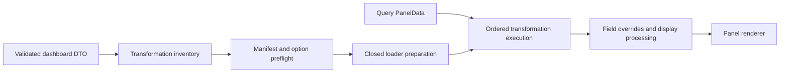

# Dashboard Transformation Compatibility Strategy

## 1. Document metadata

| Field | Value |
| --- | --- |
| Owner | Dashboard Render SDK G maintainers |
| Phase | Phase 1 — Production Architecture and Distribution Strategy |
| Workstream | Define dashboard transformation compatibility strategy |
| Status | Architecture research and design |
| Created | 2026-10-12 |
| Last Updated | 2026-10-12 |
| Evidence baseline | Grafana OSS 13.2.3 at `6193dc03311b631b9727b560d24369e683dc396e`; `@grafana/data@13.2.3`; `@grafana/scenes@8.13.5`; React/ReactDOM 19.2.8 |

This document follows the canonical phase semantics in the
[project roadmap](../../project/roadmap.md). It defines how a concrete renderer
provider declares, validates, loads, and executes dashboard transformations. It
does not implement the production provider, change the Phase 0 POC, authorize
distribution of Grafana-derived code, or claim general transformation parity.

Evidence labels are:

- **VERIFIED FACT** — directly observed in the pinned upstream source or the
  completed Phase 0 POC;
- **INFERENCE** — supported by evidence but not yet proved in a
  production-shaped provider;
- **PHASE 1 DECISION** — the production architecture selected here;
- **EXPERIMENT REQUIRED** — a claim that needs focused implementation evidence;
  and
- **DELEGATED DECISION** — intentionally assigned to another workstream.

## 2. Executive summary

Phase 0 proved one real transformation path: the schema-42 fixture's Time
series panel used the published Grafana `renameByRegex` implementation to turn
`Phase 0 Pulse Raw` into `Phase 0 Pulse Signal` after a real TestData query.
The POC validated the exact option shape, admitted no other transformation,
passed a custom operator into `SceneDataTransformer`, and failed closed on an
unknown ID. It did not prove Grafana's complete standard registry.

**VERIFIED FACT.** Importing `@grafana/data@13.2.3` supplies
`transformDataFrame`, transformation contracts, package-backed operators, and
an empty mutable `standardTransformersRegistry`. Grafana application startup
populates that registry from unpublished
`public/app/features/transformers/standardTransformers.tsx`. The application
initializer combines package-backed and application-owned implementations with
React editors, translations, images, feature toggles, and lazy imports. An
unknown transformation ID is silently passed through by the published
executor.

**PHASE 1 DECISION.** Select **Model B — a closed, provider-owned allowlist of
exact supported transformations** as the compatibility model. Use **Model C —
lazy per-transformation provider loaders** inside that closed model as the
delivery strategy. The combination is called the **closed lazy catalogue** in
this document:

- inert manifest descriptors declare support before Grafana code loads;
- dashboard preflight validates every ordered transformation and option form;
- only provider-mapped logical loaders may resolve executable operators;
- required operators load after preflight and before scene activation;
- the provider's immutable catalogue, not Grafana's mutable registry, is the
  source of compatibility truth;
- any Grafana registry mirror is installed once inside the provider-owned
  physical package cohort and must exactly match the catalogue digest; and
- unknown, mismatched, or silently skipped transformations are errors.

The initial Phase 2 transformation set is deliberately one item:
`renameByRegex` from the exact Grafana 13.2.3 Data implementation, with the
exact series-topic option profile proved in Phase 0. Empty pipelines are also
valid. Filters, annotation topics, disabled entries, option interpolation,
chains longer than one, application-owned transformations, custom host
operators, and every other transformation ID are initially unsupported.

The production provider should preserve the POC's proven explicit-operator
execution path until a production-shaped experiment proves declarative lookup
through one physical Grafana cohort. This is not a custom reimplementation:
the provider invokes the exact Grafana operator and leaves DataFrames inside
the provider boundary.

**Final status: READY WITH EXPERIMENTS.** The capability, ownership, failure,
manifest, loading, and initial product policies are defined. Production-shaped
registry/cohort, operator-entry, cancellation, chain, performance, and bundle
experiments remain required before the initial provider can publish its
transformation conformance claim.

## 3. Phase 0 evidence

Primary evidence comes from the [Phase 0 POC results](../research/poc-results.md),
the [Data investigation](../research/grafana-data-investigation.md), the
[Scenes investigation](../research/grafana-scenes-investigation.md), and the
[panel dependency analysis](../research/panel-rendering-dependencies.md).

### 3.1 Exact successful configuration

The controlled Time series panel contained exactly:

```json
{
  "id": "renameByRegex",
  "options": {
    "regex": "/Raw/",
    "renamePattern": "Signal"
  }
}
```

The configuration is tracked in
[`grsdk-phase0-poc.json`](../../../dev/grafana/provisioning/dashboards/grsdk-phase0-poc.json).
The preflight validator required one transformation on panel 3, rejected
unknown keys, required both string options, and rejected transformations on the
other fixture panels.

### 3.2 Exact successful execution path

```text
V1/schema-42 dashboard DTO
  -> fixture preflight and exact transformation validation
  -> provider runtime installs a one-entry registry mirror
  -> real TestData predictable_pulse query
  -> SceneQueryRunner Loading -> Done
  -> normalized PanelData / DataFrame[]
  -> provider resolves exact renameByRegex DataTransformerInfo
  -> provider closes validated options into CustomTransformOperator
  -> SceneDataTransformer executes the operator on the series topic
  -> transformed PanelData
  -> field overrides/display processing
  -> real Time series renderer and visible "Phase 0 Pulse Signal" legend
```

The implementation evidence is:

- [`installTransformers.ts`](../../../packages/poc-compat/src/registries/installTransformers.ts)
  initializes only `renameByRegex`;
- [`preflightFixture.ts`](../../../packages/poc-compat/src/dashboard/preflightFixture.ts)
  validates the exact saved shape;
- [`acquirePocRuntime.ts`](../../../packages/poc-compat/src/runtime/acquirePocRuntime.ts)
  resolves the exact Grafana operator and records executions; and
- [`convertFixtureV1.ts`](../../../packages/poc-compat/src/scenes/convertFixtureV1.ts)
  passes the custom operator to `SceneDataTransformer`.

**VERIFIED FACT.** Scenes 8.13.5 did not execute the declarative registry lookup
across the POC's standalone cohort boundary. The POC therefore passed the same
published Grafana operator explicitly; it did not fabricate or rewrite frames.
This result proves explicit operator execution, not the reason the declarative
path failed.

### 3.3 Proven behavior and limits

| Evidence | Result | Production implication |
| --- | --- | --- |
| Real query input | TestData response reached `SceneQueryRunner` and `PanelData` | Transformation conformance must include the real query lifecycle |
| Exact operator | Published `renameByRegexTransformer` from Data 13.2.3 | Preserve exact implementation/provenance per provider cell |
| Result | Legend became `Phase 0 Pulse Signal` | Assert semantic output, not merely pipeline completion |
| Order | One transform | General chain behavior remains unproved |
| Topic | Default series topic | Annotation transformations remain unsupported initially |
| Options | Required `regex` and `renamePattern`; no variables/filter/disabled flag | Initial schema profile must stay equally narrow |
| Registry | One-entry, one-shot initialization | Registry identity belongs to the provider runtime |
| Unknown ID | Rejected before execution | Never inherit upstream silent pass-through |
| Operator throw | Became a controlled transformation error; sibling host/paths survived | Runtime execution failures can be panel-local |
| Time-range/refresh | Each real response was transformed | Reprocessing must follow the query generation |
| UID change/unmount | Stale results did not publish; resources returned to baseline | Subscription and generation guards are required |
| Multiple dashboards | Two compatible instances ran independently under one runtime | Loaders/registry may be shared; pipelines remain instance-owned |

Phase 0 did not prove multiple transform chains, frame filters, annotations,
variables in options, streaming data, asynchronous transformations, complete
registry parity, app-owned operators, transformation editors, or upgrades.

## 4. Transformation pipeline model

The production pipeline has four separate stages:



| Stage | Owner | Output |
| --- | --- | --- |
| Inventory | Dashboard capability inside renderer provider | Ordered project-owned descriptors containing IDs, topics, option-profile fingerprints, and panel ownership |
| Preflight | `TransformationProvider` against immutable compatibility manifest | Complete success report or typed unsupported/invalid failures before scene activation |
| Prepare | Provider loader catalogue | Digest-checked prepared pipeline containing opaque exact operators |
| Execute | Provider-private Scenes/Data adapter | Transformed provider-private frames and sanitized execution result |
| Display processing | Provider's Grafana Data/panel path | Field overrides, display processors, units, mappings, thresholds, and links applied after transforms |

**PHASE 1 DECISION.** The dashboard converter may preserve raw configuration
only after transformation preflight succeeds. It never asks Grafana's global
registry whether an ID happens to be present and then infers product support.

The provider treats transformation order as dashboard meaning. It does not
sort, deduplicate, fuse, remove, or substitute entries. The pipeline identity
includes the ordered transformation descriptors and option-profile versions.
Raw dashboard option values are not placed in a public manifest or telemetry.

## 5. Upstream API inventory

### 5.1 Published contracts and executors

| API | Pinned source/export | Observed behavior | Stability treatment |
| --- | --- | --- | --- |
| `DataTransformerConfig` | `@grafana/schema@13.2.3`; Data re-export is deprecated | Saved ID, options, optional matcher filter/topic/disabled fields | Use Schema only inside provider; never expose publicly |
| `DataTransformerInfo` | `@grafana/data` root; [`types/transformations.ts`](https://github.com/grafana/grafana/blob/v13.2.3/packages/grafana-data/src/types/transformations.ts) | Exact operator plus metadata/default options | Public type at exact cell; provider-internal |
| `CustomTransformOperator` | `@grafana/data` root | Context-to-RxJS operator factory | Public and used by the proven path; provider-internal |
| `SynchronousDataTransformerInfo` | `@grafana/data` root | Optional synchronous equivalent | Public, but not required by Phase 0 |
| `transformDataFrame` | `@grafana/data` root; [`transformDataFrame.ts`](https://github.com/grafana/grafana/blob/v13.2.3/packages/grafana-data/src/transformations/transformDataFrame.ts) | Applies an ordered RxJS operator chain | Root-exported but unresolved stability; exact provider adapter only |
| `standardTransformersRegistry` | `@grafana/data` root; [`standardTransformersRegistry.ts`](https://github.com/grafana/grafana/blob/v13.2.3/packages/grafana-data/src/transformations/standardTransformersRegistry.ts) | Starts empty; mutable one-shot lazy registry | Public/unstable global; never core-facing |
| `standardTransformers` | `@grafana/data` root at 13.2.3; [`transformers.ts`](https://github.com/grafana/grafana/blob/v13.2.3/packages/grafana-data/src/transformations/transformers.ts) | Map of package-backed implementations | Explicitly deprecated; acceptable only behind an exact provider cell while replacement entry is proved |
| `DataTransformerID` | `@grafana/data` root; [`ids.ts`](https://github.com/grafana/grafana/blob/v13.2.3/packages/grafana-data/src/transformations/transformers/ids.ts) | Stable-looking persisted string IDs | ID alone is not a compatibility version |
| `Registry` | `@grafana/data` root | Lazy init; duplicate rejection; no public reset/unregister | Public/unstable infrastructure; provider-runtime lifetime |
| `SceneDataTransformer` | `@grafana/scenes@8.13.5` root | Subscribes to source data and transforms series/annotations | Published Scenes primitive; exact provider-internal |
| `CustomTransformerDefinition` | `@grafana/scenes@8.13.5` root type | Custom operator with optional data topic | Published type; proven series operator path |

`@grafana/data` as a package is documented as beta. Root export status does not
establish cross-version stability.

### 5.2 Standard Grafana application catalogue

Grafana initializes the registry through
[`getStandardTransformers`](https://github.com/grafana/grafana/blob/v13.2.3/public/app/features/transformers/standardTransformers.tsx).
At the pinned source it contains 34 named primary entries when the conditional
Smoothing feature is enabled, eight hidden compatibility entries, and one
alias. With Smoothing disabled, one primary entry is absent.

| Implementation category | IDs at the pinned baseline | Source location |
| --- | --- | --- |
| Package-backed named entries | `reduce`, `filterFieldsByName`, `renameByRegex`, `filterByRefId`, `filterByValue`, `organize`, `joinByField`, `seriesToRows`, `concatenate`, `calculateField`, `labelsToFields`, `groupBy`, `sortBy`, `merge`, `histogram`, `convertFieldType`, `groupingToMatrix`, `limit`, `formatString`, `groupToNestedTable`, `formatTime`, `transpose` | `packages/grafana-data/src/transformations/transformers/**` |
| Package-backed hidden entries | `ensureColumns`, `noop`, `order`, `rename`, `filterFields`, `filterFrames`, `convertFrameType`; `append` maps to `noop` | Same package tree, assembled by the app initializer |
| Package-backed alias | `seriesToColumns` aliases `joinByField` | Application registry metadata plus package operator |
| Application-owned lazy entries | `rowsToFields`, `configFromData`, `prepareTimeSeries`, `spatial`, `fieldLookup`, `extractFields`, `heatmap`, `joinByLabels`, `regression`, `partitionByValues`, `timeSeriesTable`; conditional `smoothing` | `public/app/features/transformers/<feature>/**` |

**VERIFIED FACT.** The 774-line application initializer statically imports 68
light/dark SVG images and declares 46 dynamic imports across editors and
operators. It also reads Runtime feature toggles, translations, applicability
helpers, and plugin states. Importing it for view-only execution would pull an
application/editor/asset boundary that is materially broader than the required
operator set.

### 5.3 Executor semantics

The pinned `transformDataFrame`:

- preserves declared array order;
- skips `disabled` configurations;
- resolves declarative IDs through `standardTransformersRegistry`;
- silently returns the source stream unchanged when an ID is absent;
- applies optional frame matchers and restores filtered-out frames in their
  original order;
- merges transformer default options with saved options;
- interpolates string options unless `window.__grafanaSceneContext` is set;
- accepts explicit custom operators without registry lookup; and
- caches resolved transformation promises by ID for the process lifetime,
  evicting a failed promise for a future retry.

Scenes performs its own option interpolation before execution, separates series
and annotation topics, unsubscribes the previous transformation stream on a new
source result, and converts execution exceptions into error `PanelData`.

## 6. Registry ownership

The production provider has two related but distinct registries:

1. the **provider capability catalogue**, an immutable project-owned manifest
   and loader map; and
2. the optional **Grafana registry mirror** inside the provider's one physical
   `@grafana/data` cohort.

The capability catalogue is authoritative. The Grafana mirror is only an
execution compatibility mechanism.

**PHASE 1 DECISION.** The renderer provider owns registry initialization. Core,
host code, dashboard JSON, panel modules, and individual dashboard instances do
not register transformations.

Registry rules are:

- the catalogue and optional mirror are finalized before the first lookup;
- the ordered catalogue digest, execution mode, and package-cohort identity are
  part of `RuntimeIdentity`;
- compatible dashboards share the same catalogue and implementation cache;
- `setInit` is called at most once for the physical registry;
- the provider never calls a test reset or pretends the registry can be
  uninstalled;
- a preinitialized or conflicting registry is rejected unless exact identity
  can be proved;
- alias IDs are explicit manifest entries, not discovered implicitly;
- application editor metadata and images are not required by a view-only
  execution mirror; and
- registry presence never widens the manifest capability set.

The initial provider mirrors only `renameByRegex` for coherence and executes it
through the proven explicit custom-operator path. A later declarative mode must
pass the cohort experiment in Section 36 before replacing that path.

## 7. Stable/internal boundaries

| Boundary | Classification | Production policy |
| --- | --- | --- |
| Schema `DataTransformerConfig` | Published schema contract | Provider-private persisted input; project-owned validator wraps it |
| `DataTransformerInfo`, `CustomTransformOperator` | Published Data contracts | Adopt behind provider; exact-version tests required |
| `SceneDataTransformer` | Published Scenes contract | Adopt behind provider; never expose Scenes types through core |
| `transformDataFrame` | Published root function, unresolved stability | Use only inside exact provider cell |
| `standardTransformersRegistry` | Published mutable singleton, public/unstable | Adapt behind runtime coordinator; no host access |
| `standardTransformers` | Deprecated root map | Temporary exact-cell seam only; removal is an expected upgrade event |
| Package transformer implementation files | In named Apache package directory; not separate published subpaths | Source-build or root-export decision belongs to provider build/provenance review |
| `public/app/features/transformers/standardTransformers.tsx` | Unpublished application code | Do not import in initial view-only provider |
| Application lazy operators/editors/images | Unpublished application code/assets | Unsupported initially; each future transform needs separate closure and review |
| Transformation promise-cache reset | Test-only, not root-exported | Never use in production |
| Raw `DataFrame`, RxJS operators, registry items | Grafana/provider internals | Remain opaque to core and public SDK |

The provider contract remains project-owned and license-neutral. It describes
capabilities and opaque execution outcomes without copying Grafana's public or
internal type system into the SDK API.

## 8. Transformation capability model

The following shapes are conceptual contract vocabulary, not TypeScript files
or a frozen public API:

```ts
interface TransformationCapability {
  readonly id: string;
  readonly capabilityVersion: string;
  readonly state: 'supported' | 'conditional' | 'unsupported';
  readonly implementationIdentity: string;
  readonly optionsProfile: string;
  readonly inputProfiles: readonly string[];
  readonly outputProfile: string;
  readonly topics: readonly ('series' | 'annotations')[];
  readonly loaderId: string;
  readonly executionMode: 'explicit-operator' | 'grafana-registry';
  readonly conformanceEvidence: readonly string[];
}

interface TransformationDescriptor {
  readonly id: string;
  readonly capabilityVersion: string;
  readonly normalizedOptionsFingerprint: string;
  readonly topic: 'series' | 'annotations';
  readonly panelKey: string;
  readonly position: number;
}

interface TransformationProvider {
  describe(): readonly TransformationCapability[];
  validatePipeline(input: unknown): TransformationPreflightResult;
  preparePipeline(
    descriptors: readonly TransformationDescriptor[],
    signal: AbortSignal
  ): Promise<OpaquePreparedTransformationPipeline>;
  execute(
    pipeline: OpaquePreparedTransformationPipeline,
    input: OpaqueFrameSet,
    context: OpaqueTransformationContext
  ): TransformationExecution;
}

interface TransformationPipelineResult {
  readonly outcome: 'done' | 'error' | 'cancelled';
  readonly output?: OpaqueFrameSet;
  readonly failure?: TransformationFailure;
  readonly evidence: SanitizedTransformationEvidence;
}
```

Contract rules:

- `TransformationCapability` is inert manifest data and safe to inspect before
  Grafana module initialization;
- `TransformationDescriptor` is produced only after saved JSON validation;
- the prepared pipeline is bound to one provider/runtime/catalogue digest;
- `OpaqueFrameSet` never crosses from provider to core or host;
- preparation is abortable even when a synchronous operator invocation is not;
- execution evidence contains IDs, timings, frame/field counts, and outcome,
  never frame values or raw options; and
- capability state `conditional` names every constraint rather than relying on
  prose elsewhere.

## 9. Compatibility manifest impact

### 9.1 Provider compatibility manifest

The immutable provider manifest adds:

- transformation catalogue schema version and ordered catalogue digest;
- registry mode and expected physical Data/Scenes cohort;
- one `TransformationCapability` per accepted ID or alias;
- exact implementation origin, package/source version, source path, and content
  digest;
- accepted dashboard API/schema and transformation option-profile identity;
- topic support, filter support, disabled-entry policy, interpolation policy,
  and feature-toggle requirements;
- input/output DataFrame profile IDs;
- synchronous/asynchronous classification and cancellation semantics;
- loader ID and eager/lazy policy;
- required matcher/reducer/field-registry dependencies;
- chain constraints, including maximum length and allowed compositions;
- expected output-expansion/performance class;
- provenance/SBOM reference and conformance evidence IDs;
- known limitations and explicit incompatibilities; and
- product support tier distinct from upstream API stability.

The manifest does not include dashboard option values, transformed data,
deployment URLs, hashed chunk names, or credentials.

### 9.2 Deployment manifest

The deployment manifest maps each logical transformation loader ID to
content-hashed local chunks, dependent shared chunks/assets, integrity data,
MIME type, compressed/raw size, cache hints, and build/provenance identity. It
does not redefine capability support.

The compatibility and deployment manifests share a provider build ID. A loader
whose deployment record or digest does not match the selected capability fails
before scene activation.

### 9.3 Runtime identity

The runtime compatibility fingerprint includes:

- provider/build and exact Grafana compatibility cell;
- transformation catalogue digest;
- registry/execution mode;
- package and Scenes module identities;
- feature-toggle profile affecting catalogue membership; and
- transformation loader/provenance policy.

Two dashboards may share a runtime only when these fields match. Different
dashboard pipelines do not create different runtime identities when both are
subsets of the same catalogue.

## 10. Initialization model

Initialization is explicit and ordered:

1. Core validates the inert provider and manifest schema without importing
   Grafana packages.
2. Provider selection fixes the exact Grafana/package/Scenes/React cell.
3. Runtime acquisition fixes the transformation catalogue digest and execution
   mode before any mutable registry lookup.
4. The provider installs or verifies the closed Grafana registry mirror when
   that adapter is declared.
5. Dashboard loading inventories every ordered transformation without
   executing it.
6. `TransformationProvider.validatePipeline` validates IDs, aliases, topics,
   config shape, option profile, chain constraints, and DataFrame expectations.
7. The provider resolves all logical loaders required by the dashboard and
   validates implementation identities before scene activation.
8. The converter attaches prepared explicit operators or validated declarative
   configs to provider-private `SceneDataTransformer` objects.
9. Query activation may begin only after the complete dashboard preflight and
   preparation succeeds.

The provider records sanitized lifecycle evidence for catalogue admission,
registry installation, loader cache hit/miss, pipeline preparation, execution,
cancellation, and failure.

An initialization failure rolls back project-owned loader/session state. It
cannot reset an already initialized Grafana registry or ESM module cache, so a
registry integrity failure poisons that provider realm and requires a reload.

## 11. Loading strategy

**PHASE 1 DECISION.** Use closed logical lazy loaders from Model C underneath
the Model B allowlist.

- Manifest descriptors are eager and contain no operator/editor code.
- The provider maps each admitted ID to a build-owned logical loader.
- Dashboard content can select an admitted ID but never a URL, import
  specifier, package, or arbitrary operator.
- Preflight calculates the minimal unique loader closure for all panels.
- Implementations load concurrently where independent and are deduplicated by
  provider runtime plus implementation identity.
- Required loaders finish before scene activation; first data delivery never
  discovers a missing module unexpectedly.
- A failed provider loader is removed from the provider's pending cache and may
  be retried only through an explicit new preparation attempt.
- Upstream `transformDataFrame` promise caching is treated as an implementation
  detail, not the integrity or retry policy.
- No SystemJS or network-registry fallback exists.

`renameByRegex` is small and already belongs to the shared Data cohort, so its
initial loader may resolve from the provider's exact Data entry rather than
create a separate network chunk. It still has a logical loader ID and bundle
evidence.

Editors, picker metadata, preview images, and authoring applicability UI do not
enter the view-only loader. A future authoring provider is a separate profile.

## 12. Version coupling

A transformation ID is a persisted name, not a version. Compatibility depends
on all of:

- Grafana server/source cell;
- `@grafana/data`, Schema, Runtime, UI, and Scenes cohort;
- operator source or artifact digest;
- accepted options-schema profile;
- DataFrame and field matcher behavior;
- topic/interpolation/filter semantics;
- application feature toggles when relevant;
- surrounding pipeline and field-processing order; and
- conformance fixtures.

Each capability therefore has a project-owned immutable
`capabilityVersion`, such as a provider-specific revision tied to the exact
implementation digest. It is not presented as an upstream transform semver.

Every Grafana patch starts unsupported. A provider built for 13.2.3 does not
accept a nearby patch because `renameByRegex` still appears in the dashboard.
The version policy in
[`grafana-version-compatibility-policy.md`](grafana-version-compatibility-policy.md)
applies without exception.

Alias behavior is versioned too. For example, the application registry maps
`seriesToColumns` to `joinByField`; a future provider must declare and test that
alias explicitly rather than inherit it from whatever registry happens to be
loaded.

## 13. Pipeline ordering/chaining

Transformations execute in saved dashboard order. For a pipeline
`[T1, T2, T3]`, each operator receives the preceding operator's output. The
provider must not reorder for apparent performance or merge operators based
only on IDs.

Preflight validates:

- ordered position and duplicate occurrences;
- input profile required by the first transform;
- output-to-input compatibility between adjacent transforms;
- allowed series/annotation topic transitions;
- matcher/filter behavior;
- option and interpolation profiles;
- maximum chain length and output-expansion limits; and
- dependencies on variables, field registries, or feature toggles.

Each occurrence has its own descriptor and options fingerprint even when IDs
repeat. Loader implementations may be shared; configuration and execution state
may not.

Disabled transformations are not silently removed during initial Phase 2
preflight. They are outside the one proven option profile and are rejected. A
future capability may declare exact upstream skip semantics while retaining the
entry in diagnostics and pipeline identity.

The initial Phase 2 maximum chain length is one. Expansion requires at least
one conformance fixture for each admitted ordered composition, not merely
isolated transform tests.

## 14. DataFrame/input assumptions

Grafana transformations operate on provider-private arrays of `DataFrame`
objects. Correctness depends on frame shape, field types, names, labels,
metadata, lengths, nullability, and mutable field state.

The provider describes inputs through named profiles rather than exposing
Grafana types publicly. A profile records:

- frame count bounds and topic;
- time-series/table/wide/long shape;
- required field types and equal-length assumptions;
- label/refId/meta requirements;
- nullable values and numeric/string/time expectations;
- streaming versus finite behavior; and
- normalization step and Data package version.

The initial `renameByRegex` profile is the normalized finite series output
proved by the TestData `predictable_pulse` fixture: a time field plus a numeric
value field whose display name contains `Raw`. The exact Grafana operator
preserves values, frame order, lengths, types, ref IDs, and metadata while
returning copied matching frames/fields with updated display names.

An empty frame set and a nonmatching name should remain unchanged according to
the upstream implementation, but those cases need production conformance before
the initial manifest claims them beyond internal behavior. Streaming and
annotation frames are unsupported initially.

The provider may enforce safety/resource limits before and after execution. It
must not serialize full frames into errors, logs, manifests, or host telemetry.

## 15. Field matcher/override interaction

The observed order is:

```text
query normalization
  -> ordered transformations
  -> transformed PanelData
  -> VizPanel field configuration / applyFieldOverrides
  -> display processors
  -> panel renderer
```

Consequences:

- a transformation can create, remove, reorder, rename, or reconfigure fields
  before override matchers run;
- field-name overrides can match transformed names rather than source names;
- `renameByRegex` updates both `field.config.displayName` and
  `field.state.displayName` for matched fields;
- display processors, thresholds, mappings, units, links, reducers, legend,
  and axes observe transformed output; and
- a plausible rendered panel can still be wrong if either transformation or
  field registry support is missing.

The transformation provider owns transform-level frame filters. The field
configuration provider owns post-transform field matchers/overrides. They share
the exact Data cohort and a declared ordering contract but do not share mutable
registries opportunistically.

Initial Phase 2 does not admit `DataTransformerConfig.filter` or variables in
transformation options. Expansion requires cross-tests with frame matchers,
field-name overrides, display-name sources, variable changes, and panel
reducers.

## 16. Query lifecycle

For each panel-local pipeline:

1. `SceneQueryRunner` publishes query state and normalized source frames.
2. `SceneDataTransformer` subscribes to the source data provider.
3. A `Loading` or metadata-only update is propagated according to Scenes
   behavior without treating old transformed output as a new success.
4. Each new usable `Done` result executes the prepared ordered pipeline.
5. Successful transformed frames replace the prior transformed series for that
   query generation.
6. Field configuration and panel rendering consume the transformed result.
7. Refresh, time-range, variable, or datasource changes start a new source
   generation and re-execute the pipeline.
8. UID change or session release invalidates all previous generation results.

Transformations do not own query transport, authentication, datasource
selection, or refresh scheduling. A view-only transform also must not make
undeclared network requests. A future network/resource-dependent transform
would require a separate capability and security profile.

Series and annotation pipelines are distinct in Scenes. A provider never
applies a series-only operator to annotations as a fallback.

## 17. Cancellation

There are two cancellation boundaries:

### Preparation cancellation

Module/chunk resolution and pipeline preparation accept the dashboard/session
`AbortSignal`. A cancelled preparation must not activate a scene or publish a
late prepared pipeline. A shared module import may finish and remain cached for
another compatible consumer, but the cancelled dashboard owns no result.

### Execution cancellation

Scenes unsubscribes the prior transformation subscription on a newer source
result and on deactivation. Provider generation checks prevent a late result
from publishing to a changed UID or released panel.

The published operator API has no `AbortSignal`. Synchronous CPU work such as
`renameByRegex` cannot be preempted after it begins; cancellation suppresses
publication and releases subscriptions at the next boundary. An asynchronous
operator is unsupported until its descriptor declares cooperative
unsubscription behavior and conformance proves it.

Cancellation is an expected `TransformationPipelineResult` outcome, not a
panel error. It must not create error chrome, retry automatically, or retain
input/output frames after the owning generation releases them.

## 18. Unsupported behavior

The provider performs transformation preflight before scene activation and
rejects:

- unknown or undeclared IDs and aliases;
- known IDs outside the selected provider cell;
- mismatched implementation or option-profile versions;
- unsupported option keys, values, topics, filters, interpolation, disabled
  flags, or feature-toggle conditions;
- unsupported input/output profiles or chain combinations;
- application-owned transforms absent from the provider artifact;
- host-supplied operators or dashboard-supplied module locations; and
- loader/registry identities that do not match the manifest.

The initial product rejects the whole dashboard session when a material saved
transformation is unsupported. It does not show untransformed data, omit the
entry, substitute a lookalike, or create a partially compatible dashboard.
Displaying raw data after a missing transform can materially misrepresent the
dashboard.

A future partial-dashboard mode requires a separate product decision, manifest
capability, explicit panel placeholder, and user-visible compatibility report.
It is not implied by panel-local runtime failure isolation.

## 19. Error model

Errors are project-owned and sanitize options, frames, and source details.

| Error class | Code | Trigger | Normal detection point |
| --- | --- | --- | --- |
| `UnsupportedTransformation` | `transformation.unsupported` | ID/alias or declared config feature is outside the manifest | Dashboard preflight |
| `TransformationVersionMismatch` | `transformation.version-mismatch` | Capability/options/implementation digest differs from selected cell | Provider admission or preparation |
| `TransformationRegistryUnavailable` | `transformation.registry-unavailable` | Registry is missing, already initialized incompatibly, or cannot prove the catalogue | Runtime initialization |
| `TransformationExecutionFailure` | `transformation.execution-failed` | Exact operator throws or errors its stream | Panel pipeline execution |
| `TransformationInputUnsupported` | `transformation.input-unsupported` | Runtime frame shape violates declared input profile | Before/operator execution |
| `TransformationPipelineInvalid` | `transformation.pipeline-invalid` | Order, topic, chain length, or adjacent profiles are invalid | Dashboard preflight |
| `TransformationOptionsInvalid` | `transformation.options-invalid` | Saved options do not match the exact schema profile | Dashboard preflight |
| `TransformationLoaderFailure` | `transformation.loader-failed` | Closed logical loader fails or returns wrong identity | Preparation |
| `TransformationOutputInvalid` | `transformation.output-invalid` | Result violates output profile/invariants | After execution |
| `TransformationResourceLimit` | `transformation.resource-limit` | Declared frame/field/row/time expansion limit is exceeded | Preflight or execution |

Cancellation is represented as `outcome: cancelled`, not an exception class.

Safe diagnostics may include provider/build ID, dashboard UID, panel ID,
transformation ID, descriptor version, ordered position, topic, input/output
counts, duration, cache result, and failure category. They never include raw
options, regex replacement data from untrusted dashboards, frame values,
credentials, query payloads, cookies, or source bodies.

## 20. Failure isolation

| Failure | Scope | Required behavior |
| --- | --- | --- |
| Manifest/catalogue/registry integrity failure | Provider realm fatal | Do not commit or continue the runtime; fresh realm/provider required |
| Loader digest/module mismatch | Provider build fatal for selected cell | Stop activation; no alternate arbitrary loader |
| Unsupported transform/options/chain found in preflight | Dashboard-session fatal initially | Return complete compatibility report; construct no partial scene |
| Input profile mismatch after a valid query | Panel pipeline local | Publish typed panel processing error; sibling panels and host survive |
| Operator execution/output failure | Panel pipeline local | Scenes error `PanelData` plus project-owned failure; no raw-data fallback |
| One panel preparation cancelled | Dashboard generation local | Publish nothing stale; shared compatible cache may survive |
| One dashboard unmounts | Dashboard instance local | Unsubscribe its pipelines; keep shared catalogue/loaders for other instances |
| Repeated systemic execution failure | Provider health diagnostic | Keep immediate failures panel-local, mark provider cell unhealthy for support evidence; do not mutate catalogue |

The initial all-or-nothing preflight is stricter than runtime isolation because
the provider can know unsupported saved semantics before rendering. Once an
admitted graph is active, an unexpected operator/data failure is isolated at
the smallest panel pipeline that owns it.

## 21. Performance/memory

Transformation cost is data-dependent. Operators may clone frames/fields,
materialize joins/groups, multiply output frames, sort rows, or retain state.
Scenes additionally keeps current transformed `PanelData`, a replayed result,
and a previous-source reference for duplicate-work detection.

The provider must record, per pipeline occurrence:

- input/output frame, field, and row counts;
- wall/CPU duration where measurable;
- loader/cache state;
- synchronous/asynchronous classification;
- output-expansion ratio;
- cancellation and stale-result outcome; and
- retained provider/session resources after release.

Policy:

- catalogue and resolved implementation promises are provider-runtime lifetime;
- options, operator instances, input/output frames, subscriptions, and metrics
  are dashboard/panel-generation lifetime;
- one dashboard may not remove shared implementation state used by another;
- no unbounded cache is keyed by dashboard UID or raw options;
- each capability declares an expansion/performance class and any hard safety
  limits;
- chain limits are enforced before execution; and
- workers or background threads are unsupported unless explicitly declared.

The initial one-step `renameByRegex` path is synchronous and linear in the
number of fields/frames. Exact budgets remain experiment-derived rather than
invented here. The initial provider conformance run must establish baselines
for small, representative, and safety-limit inputs.

## 22. Bundle impact

This strategy refines the
[bundle/dependency strategy](bundle-dependency-strategy.md):

- provider bootstrap contains inert transformation descriptors and catalogue
  digest only;
- a small transformation-runtime adapter belongs to the shared provider cohort;
- operators are closed logical loaders and load only for dashboards that need
  them;
- package/Data/RxJS/Scenes dependencies are shared, never copied per operator;
- editor components, transformation picker UI, preview SVGs, and application
  feature pages are excluded from the view-only profile;
- transformation chunks carry exact source and license provenance; and
- CI reports initial/lazy bytes and unexpected source/asset edges per capability.

Importing Grafana's application initializer is rejected for the initial
profile. At the pinned baseline it brings 68 image imports and 46 dynamic
imports, including editor closures, to describe a catalogue whose vast
majority is unsupported.

The initial `renameByRegex` implementation already belongs to the provider's
Data cohort. Its incremental code and loader metadata must still be measured;
the strategy does not assume tree shaking proves isolation. Model C becomes
more valuable as the catalogue expands, especially for application-owned
operators with large dependencies.

Transformation support must not reintroduce Monaco, Codicon, query editors, or
authoring UI into the view-only provider.

## 23. Provenance/licensing

Every transformation capability records:

- upstream repository, tag, commit, and exact source path;
- package name/version/integrity or application-source identity;
- source and emitted content digests;
- loader/chunk and transitive source inventory;
- adaptations, aliases, and generated entrypoints;
- license/notice evidence identity; and
- conformance evidence.

**VERIFIED FACT.** The `renameByRegex` implementation is in
`packages/grafana-data`, whose published 13.2.3 package declares Apache-2.0 and
whose directory is named by Grafana's Apache exception evidence. The complete
application registry and its application-owned operators/editors/images are in
`public/app`, outside that named package exception and subject to the upstream
repository-default evidence documented by the
[licensing/distribution strategy](licensing-distribution-strategy.md).

This is a source classification, not legal advice or distribution approval.
Any source-built, adapted, server-hosted, or distributed operator follows the
existing legal/provenance gates. A separate lazy chunk is not assumed to be a
license firewall.

Initial technical preference for the package-backed exact operator reduces the
application-source closure but does not change the project's unresolved package
and bridge publication decisions.

## 24. Server-hosted implications

A server-hosted provider could theoretically map the same logical
transformation loader IDs to exact assets served by the target Grafana server.
The pinned source does not establish a stable standalone transformation-module
endpoint or a discoverable transformation capability manifest.

A qualifying experiment must prove:

- server semantic/build and provider catalogue identity;
- discoverable ID-to-module mapping, content hashes, and option-profile versions;
- browser module format and public-path behavior;
- exact external binding to the already selected Data/Scenes/React cohort;
- no second registry, Runtime, React, or RxJS identity;
- CORS, CSP, credentials, integrity, caching, and offline failure behavior;
- execution without `GrafanaApp.init`, route tree, shell, or editor registry;
- source/provenance and legal/deployment authority; and
- identical conformance output to the local provider for the same capability.

Dashboard JSON never supplies the server module URL. The installed provider and
host deployment policy select it after compatibility admission.

**Conclusion: EXPERIMENT REQUIRED.** Server-hosted transformation loading is
not part of the initial Phase 2 path and does not broaden supported IDs.

## 25. Offline support

The initial provider must operate with locally deployed transformation
descriptors, loaders, code, and provenance. Runtime transformation execution
must not require npm, GitHub, a public CDN, a transformation registry service,
or Grafana application static assets.

The host may still contact its Grafana server for dashboard and datasource
APIs. That network path is separate from operator distribution.

An air-gapped deployment selects an installed inert provider manifest, verifies
local content hashes, and resolves logical loaders from the local deployment
manifest. Missing operator assets fail before scene activation with
`TransformationLoaderFailure`; raw query data is not shown as fallback.

## 26. Conformance testing

Every admitted transformation capability needs:

1. manifest/descriptor schema and digest tests;
2. exact source/package/loader identity and physical-cohort tests;
3. positive and negative option-schema fixtures;
4. real dashboard DTO preflight and ordered inventory tests;
5. exact normalized input/output golden structural assertions;
6. empty, nonmatching, null, multi-frame, and boundary inputs that the manifest
   claims;
7. real query-to-transform-to-panel browser evidence;
8. field matcher, override, unit, threshold, reducer, legend, and tooltip
   interaction tests where output names/shapes matter;
9. chain-order and adjacent-profile tests for every admitted composition;
10. refresh, time-range, variable behavior where declared, and repeated source
    emissions;
11. query cancellation, preparation cancellation, UID change, unmount,
    remount, and stale-generation tests;
12. two compatible dashboards sharing loaders but not pipeline state;
13. controlled loader, input, operator, output, and registry failures;
14. frame/value non-disclosure and evidence sanitation checks;
15. performance, expansion, memory, and retained-resource budgets;
16. view-only bundle/source/asset/editor exclusion and provenance checks;
17. offline/local deployment tests; and
18. full Text/Stat/Time series regression for the exact provider cell.

For `renameByRegex`, conformance additionally covers slash-delimited versus
anchored non-delimited regex semantics, replacement capture groups, matched and
unmatched field display names, values unchanged, and the Phase 0
`Phase 0 Pulse Signal` sentinel.

No transformation support claim is created by a unit test alone. Each public
cell requires a real provider/browser/dashboard path and the conformance
evidence IDs referenced by its manifest.

## 27. Upgrade workflow

For every Grafana/provider candidate:

1. pin source tag/commit, package artifacts/integrities, Schema, Scenes, React,
   and candidate provider build;
2. diff `DataTransformerID`, Schema transformation config, public exports,
   `transformDataFrame`, registry semantics, and promise caching;
3. diff package-backed operator sources and transitive dependencies;
4. diff the application registry, aliases, hidden entries, feature toggles,
   application-owned operators, editors, images, and license/provenance;
5. diff Scenes `SceneDataTransformer` topic, interpolation, subscription,
   failure, and lifecycle behavior;
6. rebuild immutable capability and deployment manifests with new digests;
7. rerun isolated capability and ordered-chain conformance;
8. rerun field-processing and full panel/browser regression;
9. rerun bundle/editor/provenance/security/offline gates; and
10. publish a new provider cell only after review.

An unchanged transformation ID does not waive any step. A new default option,
matcher behavior, alias, feature-toggle condition, input assumption, or output
shape is a compatibility change.

Existing provider manifests are immutable. They are deprecated or superseded,
never widened in place.

## 28. Initial Phase 2 transformation set

The first experimental provider admits:

| Capability | Initial policy |
| --- | --- |
| Empty pipeline | Supported; query output proceeds to field processing unchanged |
| ID | Exactly `renameByRegex` |
| Grafana cell | Exact OSS/Data 13.2.3 provider cell only |
| Implementation | Exact Grafana `renameByRegexTransformer`; no reimplementation |
| Capability version | Immutable provider revision tied to source/artifact digest |
| Topic | Default series only |
| Options | Exactly `regex: string` and `renamePattern: string`; both required |
| Phase 0 value profile | `/Raw/` and `Signal` fixture is mandatory conformance evidence |
| Input | Normalized finite TestData-style time-series profile proved by Gate C |
| Chain | At most one transformation occurrence |
| Execution | Prepared explicit `CustomTransformOperator` in `SceneDataTransformer` |
| Registry | One-entry closed mirror owned by provider runtime; not used to infer support |
| Loading | Closed logical loader, prepared before activation; locally deployable |
| Filtering | Unsupported |
| Annotations | Unsupported |
| Disabled configs | Unsupported |
| Variable interpolation | Unsupported |
| Streaming/asynchronous operator | Unsupported |
| Host/custom transforms | Unsupported |
| Other Grafana IDs/aliases | Unsupported and rejected during dashboard preflight |

This is an experimental compatibility cell, not general support for all inputs
accepted internally by the upstream operator. Broader input fixtures and
option semantics can be added only through immutable capability revisions.

## 29. Decision matrix

Scores are 1 (worst) to 5 (best). For “version coupling,” a higher score means
the coupling is more explicit and containable, not that it disappears. The
weighted total is `sum(score × weight) / 100`.

| Criterion | Weight | A: complete Grafana registry | B: closed provider allowlist | C: lazy per-transform loaders | D: custom SDK layer |
| --- | ---: | ---: | ---: | ---: | ---: |
| Fidelity | 20 | 5 | 5 | 5 | 2 |
| Grafana compatibility | 15 | 5 | 5 | 4 | 2 |
| Version-coupling containment | 10 | 1 | 3 | 3 | 4 |
| Bundle cost | 15 | 1 | 4 | 5 | 4 |
| Source/licensing containment | 10 | 1 | 4 | 4 | 5 |
| Maintainability | 10 | 2 | 4 | 3 | 1 |
| Testability | 10 | 2 | 5 | 4 | 3 |
| Performance | 5 | 3 | 4 | 4 | 3 |
| Extensibility | 5 | 5 | 3 | 5 | 4 |
| **Weighted total / 5** | **100** | **2.90** | **4.30** | **4.20** | **2.95** |

Arithmetic:

- A: `(100+75+10+15+10+20+20+15+25) / 100 = 2.90`;
- B: `(100+75+30+60+40+40+50+20+15) / 100 = 4.30`;
- C: `(100+60+30+75+40+30+40+20+25) / 100 = 4.20`; and
- D: `(40+30+40+60+50+10+30+15+20) / 100 = 2.95`.

| Model | Classification | Decision |
| --- | --- | --- |
| A — complete built-in registry | **TECHNICALLY VIABLE WITH SIGNIFICANT TRADE-OFFS** | Reject initially: excessive application/editor/asset closure, hidden globals, and unsupported parity claim |
| B — closed provider-owned allowlist | **TECHNICALLY PREFERRED** | Selected capability, validation, ownership, and support model |
| C — lazy per-transform loaders | **TECHNICALLY PREFERRED AS B'S DELIVERY MECHANISM** | Selected inside B; not an independent permission to load undeclared transforms |
| D — custom/reimplemented SDK layer | **REJECTED FOR INITIAL FIDELITY** | May host project-owned transforms in a future separate provider, but cannot substitute for claimed Grafana behavior |

Model B and Model C are complementary. Model B answers “what is supported and
who owns it”; Model C answers “when and how admitted implementation code
loads.”

## 30. Technical recommendation

Adopt the closed lazy catalogue:

1. provider manifest declares exact transformation capabilities and option
   profiles;
2. dashboard preflight inventories and validates every ordered entry;
3. provider-owned logical loaders resolve exact implementation identities;
4. all required implementations prepare before scene activation;
5. the initial path compiles the exact `renameByRegex` implementation into a
   custom operator for Scenes;
6. a closed Grafana registry mirror exists only for provider compatibility and
   never defines support;
7. unknown or mismatched transformations fail before rendering;
8. execution/input failures remain panel-local after successful preflight;
9. capability and deployment manifests retain exact provenance and bundle
   evidence; and
10. expansion proceeds one immutable transformation capability and conformance
    profile at a time.

| Recommendation | Confidence | Basis |
| --- | --- | --- |
| Closed allowlist as compatibility truth | **HIGH** | Phase 0 fail-closed path and upstream silent skip make it necessary |
| Provider-owned registry/runtime lifetime | **HIGH** | Registry is empty, mutable, one-shot, and non-resettable |
| Explicit operator for initial `renameByRegex` | **HIGH** | It is the exact path that passed Gate C |
| Lazy loaders inside the closed catalogue | **HIGH** | Aligns with bundle strategy and upstream lazy resolvers without widening support |
| Initial one-transform profile | **HIGH** | Only transformation behavior proved end to end |
| Declarative registry execution in a production cohort | **MEDIUM** | Upstream supports it, but the standalone POC boundary did not |
| Future application-owned transforms | **LOW** until individual experiments | Source, option, dependency, bundle, and legal closures differ per transform |

This recommendation is technical. It does not authorize a provider artifact or
make a licensing conclusion.

## 31. Provider-contract impact

The conceptual `TransformationProvider` in
[`bridge-provider-architecture.md`](bridge-provider-architecture.md) should be
refined to include:

- inert `describe()` capability data;
- complete ordered-pipeline preflight rather than one config at a time;
- options/input/output profile versions;
- abortable `preparePipeline()` with closed logical loaders;
- opaque execution handles and project-owned result/failure vocabulary;
- registry/catalogue identity and safe status inspection;
- lifecycle ownership and shared-versus-instance cache policy;
- sanitized execution evidence; and
- exact conformance/provenance references.

The core may inventory project-owned descriptors and present compatibility
errors, but it does not inspect `DataFrame`, `DataTransformerInfo`, RxJS,
Scenes, or Grafana registry objects.

Provider session flow becomes:

```text
provider manifest
  -> runtime/catalogue acquisition
  -> dashboard transformation inventory
  -> pipeline preflight report
  -> operator preparation
  -> opaque scene/pipeline construction
  -> execution status/evidence
  -> session cancellation/release
```

## 32. Other Phase 1 impacts

| Workstream | Impact | State |
| --- | --- | --- |
| Bridge/provider architecture | Gains detailed transformation capability, preflight, preparation, result, and lifecycle semantics | **UNBLOCKED for contract refinement** |
| Runtime isolation | Runtime fingerprint adds catalogue digest, registry mode, feature toggles, and transform implementation cohort | **REQUIRES CONSISTENT FINGERPRINT UPDATE** |
| Grafana version compatibility | Every exact cell records transform implementation/options/input/chain evidence; unchanged IDs do not imply compatibility | **ALIGNED** |
| React/Scenes compatibility | Initial custom operator and `SceneDataTransformer` remain in the exact tested Scenes cell | **ALIGNED; declarative cohort experiment required** |
| Bundle dependency strategy | Adds descriptor-only bootstrap, shared transform runtime, closed lazy loaders, and editor/image exclusion | **ALIGNED; gains transform-specific evidence** |
| Styling containment | Transformed names/shapes feed legends, axes, tables, and display processing; no transform owns CSS | **ALIGNED; semantic visual assertions required** |
| Licensing/distribution | Every operator/initializer/editor/image has per-chunk source and license provenance | **LEGAL/DISTRIBUTION REVIEW STILL REQUIRED** |
| Server-hosted modules | Must expose transform manifest, hash, module/external identity, and identical conformance | **EXPERIMENT REQUIRED** |
| Public SDK API | Exposes project-owned capability/error/status concepts only; no Grafana transformation or frame types | **UNBLOCKED for design** |
| Final Phase 1 approval | Gains the last named compatibility policy but still depends on recorded legal and implementation experiments | **NOT YET PRODUCTION APPROVAL** |

The recommended next canonical workstream is **Phase 1 production-architecture
approval synthesis and gate review**. That work should reconcile every existing
Phase 1 document and distinguish decisions complete on paper from experiments
and legal approvals still blocking Phase 2.

## 33. POC migration

| POC element | Production treatment | Reason |
| --- | --- | --- |
| `PocTransformerRegistry` | **DISCARD TYPE / KEEP RESPONSIBILITY** | Replace with provider-owned catalogue and exact Grafana registry adapter |
| `installGateCTransformers` | **REWRITE** | Preserve one-entry fail-closed semantics; add manifest/digest/loader/lifecycle ownership |
| `requireGateCTransformer` | **REWRITE** as capability preflight | Validate full descriptor/options/topic/input/chain profile, not only ID |
| `resolveGateCTransformation` | **KEEP CONCEPT / REWRITE** | Continue exact operator compilation behind opaque provider contract |
| Deprecated `standardTransformers` access | **CONTAIN / EXPERIMENT** | Exact 13.2.3 seam only; prove renderer-only source entry or documented replacement for future cells |
| Fixture-only transformation validator | **DISCARD AS GENERAL VALIDATOR** | Keep fixture as conformance input; production validator is generated/owned per capability profile |
| Direct Scenes/Data types in compat package | **KEEP PROVIDER-INTERNAL ONLY** | No Grafana types cross core/public boundary |
| Execution counter | **REWRITE** as sanitized provider evidence | Add duration/count/outcome without frame values/options |
| Global registry initialization during POC runtime | **KEEP CONCEPT / HARDEN** | One provider cohort, catalogue digest, conflict detection, permanent lifetime |
| Gate C browser sentinel | **KEEP / EXPAND** | Becomes mandatory real-path transformation conformance fixture |

No POC file is promoted unchanged.

## 34. Decisions made

1. Transformation support is provider-specific, explicit, and manifest-driven.
2. Model B is the compatibility/governance model.
3. Model C is the closed lazy loading mechanism within Model B.
4. Grafana's complete application registry is not initialized by the initial
   view-only provider.
5. The provider capability catalogue, not `standardTransformersRegistry`, is
   the source of support truth.
6. Any Grafana registry mirror is provider-owned, one-shot, exact, and part of
   runtime identity.
7. Unknown transformations never inherit upstream silent pass-through.
8. Saved pipeline order is immutable meaning and is never optimized away.
9. Every capability versions implementation, options, input/output, topic,
   chain, and conformance—not only its ID.
10. Operators prepare after preflight and before scene activation.
11. DataFrames and Grafana transformation types remain provider-private.
12. Initial Phase 2 admits only an empty pipeline or one exact series
    `renameByRegex` configuration.
13. Initial execution uses the exact proven custom-operator path.
14. Unsupported material transformations reject the dashboard before rendering.
15. Unexpected runtime execution/input failures are isolated to their panel
    pipeline after valid preflight.
16. Cancellation prevents stale publication but does not claim preemption of
    synchronous CPU work.
17. View-only transformation loaders exclude editors, preview images, and
    authoring UI.
18. Every Grafana release/capability expansion requires a new immutable
    provider cell and conformance evidence.

## 35. Delegated/open decisions

- Exact generated manifest schema syntax and package names: Phase 2 contract
  implementation after final Phase 1 approval.
- Whether the first provider uses the deprecated root export or a source-built
  package transformer entry: experiment and distribution/provenance review.
- Whether one physical production cohort makes declarative registry execution
  reliable enough to replace explicit operators: focused cohort experiment.
- Numeric CPU, memory, frame/field/row, expansion, and chain budgets:
  performance experiment using production-shaped builds.
- Additional package-backed transformation priority: product requirements and
  one-capability-at-a-time evidence after initial release.
- Application-owned transformation distribution and obligations:
  licensing/distribution workstream and qualified legal review.
- Server-hosted operator discovery/loading: dedicated server-hosted experiment.
- Streaming, asynchronous, worker-backed, resource/network-dependent, and
  annotation transformations: future capability workstreams.
- Partial-dashboard behavior for unsupported transforms: future product/UX
  decision; initial policy is all-or-nothing preflight.
- Authoring/editor/picker capability: separate future provider profile.
- V2 transformation schema/adapters: future dashboard-schema work; initial V1
  schema 42 only.
- Custom host/user transformations: future extension model; not a Phase 2
  initial capability.

## 36. Required experiments

Before the initial provider claims transformation conformance:

1. **Physical-cohort registry experiment** — build the production-shaped
   provider with one Data/Scenes cohort; prove one-entry initialization,
   declarative lookup behavior, conflict detection, and page-lifetime semantics.
2. **Exact operator-entry experiment** — compare pinned deprecated root access
   with a renderer-only/source-built package entry; verify identical output,
   provenance, bundle size, and no editor/application closure.
3. **Explicit-versus-declarative parity** — run the same fixture through both
   modes in isolated realms and compare structural output, interpolation,
   defaults, failure, and lifecycle behavior. Keep explicit mode unless parity
   passes.
4. **Pipeline-order experiment** — use controlled repeated/second-transform
   diagnostics to prove order, adjacent profiles, failure position, and no
   optimization. This does not add the second transform to support.
5. **Cancellation and stale-generation experiment** — cancel preparation,
   refresh during execution, change UID, unmount, and run two dashboards; prove
   no stale publication or retained frame/subscription state.
6. **Input/performance experiment** — establish initial frame/field/row/time and
   memory baselines, safety limits, empty/nonmatching cases, and bounded cache
   behavior.
7. **Bundle/provenance experiment** — prove descriptor-only bootstrap, exact
   operator closure, no transformation editors/images/Monaco/Codicon, and
   manifest-to-chunk agreement.
8. **Field/display interaction experiment** — verify rename output against
   field-name overrides, units, thresholds, legend, tooltip, axes, refresh, and
   time-range updates.
9. **Failure-isolation experiment** — exercise loader, registry, invalid regex,
   unsupported input, operator throw, and output invariant failures with the
   specified provider/dashboard/panel scopes.
10. **Server-hosted diagnostic** — only if that delivery workstream proceeds;
    test discovery, integrity, CORS/CSP, external cohort binding, and offline
    failure without changing initial support.

Experiments 1–9 are required before Phase 2 publishes the initial
transformation capability. Experiment 10 is optional for the locally deployed
provider and cannot delay it unless server-hosted delivery becomes a release
requirement.

## 37. Final status

**READY WITH EXPERIMENTS**

The production compatibility strategy is defined: a provider-owned closed
allowlist supplies exact capabilities, and closed lazy loaders prepare only the
operators required by an admitted dashboard. The initial product set is the
empty pipeline plus the exact Phase 0 `renameByRegex` profile. Unsupported
semantics fail before rendering; runtime data/operator failures remain
panel-local; no raw-data fallback or complete-registry parity is claimed.

The experiments in Section 36 must convert the exact POC evidence into a
production-shaped provider claim. Distribution of any resulting provider
remains subject to the existing licensing, provenance, and final Phase 1
approval gates.
